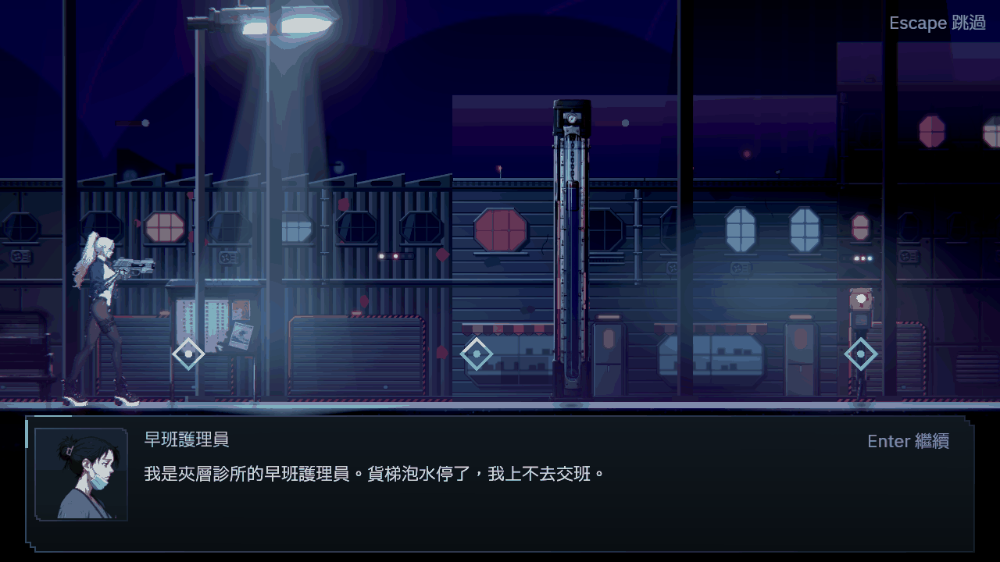
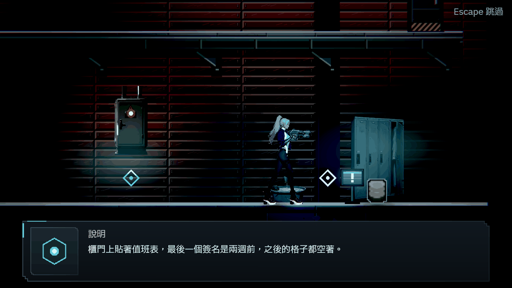
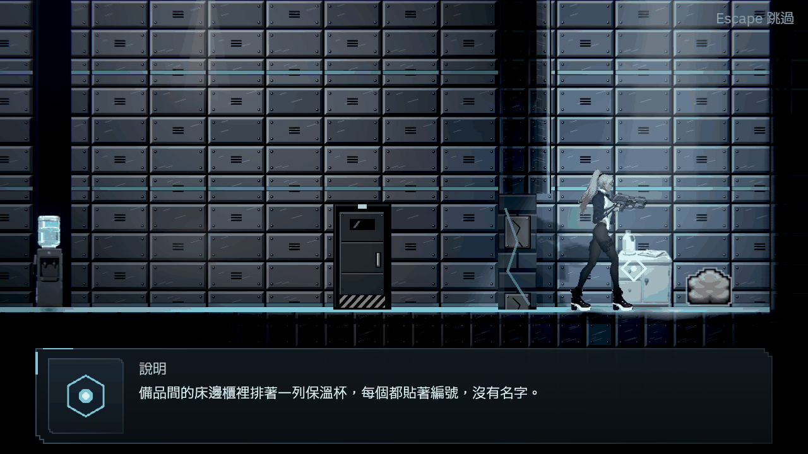
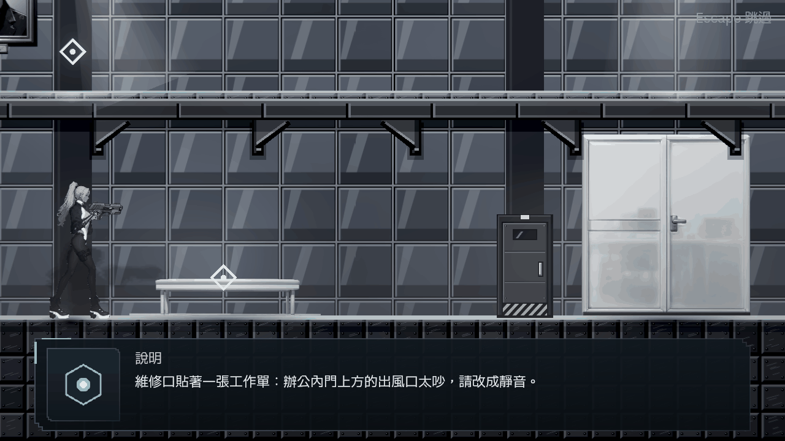

# [ST-61] 讓第三章廣場、泵室與秘密空間有前因

> 狀態：完成

## 內文

### 需求
第三章前半段在廣場貨梯與泵室排水、叫車廂，玩家在做解謎，卻不知道為什麼貨梯泡在水裡、誰在等它。地圖線在夾層診所後面做了備品間、在天穹辦公接待廊天花板下做了空調維修廊，裡面只有信用點。補上看得到前因的人與紙：廣場有等著交班的人、公告欄寫為什麼停運，泵室有沒人簽的值班表；兩處秘密空間放只有找到的人才看得到、和那一區的人事有關的紙條。排完水、貨梯通電、月報對出來之後，內容會跟著變。

### 來源
2026-11-28 盤點（ST-55，`design/22-living-scenes/STORY_COVERAGE.md` §2 第三章）；主 session 轉來地圖線的秘密空間位置（NE-419）。

### 驗收條件
- [x] 廣場貨梯有一位等著上夾層的人可以說話，說得出為什麼上不去；貨梯通電後說的話不同
- [x] 廣場公告欄與泵室的值班櫃可以讀，交代集水槽為什麼淹水、泵為什麼沒人轉；排水或通電後內容會變
- [x] 夾層診所的備品間與辦公接待廊的空調維修廊各有一件可以讀的東西，短、具體、和那一區的人事有關，不擋主線
- [x] 新台詞是完整句子，中日英三語齊全；正式文字檢查 0 錯誤、0 警告
- [x] 新內容不寫主線旗標、不給物品；故事、連續性與章節檢查全過
- [x] 實機截圖確認站位與文字不互相遮住

### 測試流程
1. 第三章從廣場貨梯開始，和等貨梯的人說話、讀公告欄，到泵室讀值班櫃
2. 排水、叫車廂後回來再看一次
3. 打破診所的裂縫牆、爬上辦公接待廊的維修廊，讀裡面的東西
4. 執行受影響的測試、文字檢查與連續性報告

---

# 跟其他票的關係

- Blocks：無
- Blocked by：無
- Related：ST-21、ST-55、NE-419

---

# Commit-1

## 內文

第三章前半段在廣場貨梯與泵室排水、叫車廂，玩家在解謎，卻不知道貨梯為什麼泡在水裡、誰在等它；地圖線新做的兩處秘密空間裡只有信用點。
現在廣場長椅旁站著夾層診所的早班護理員：「貨梯泡水停了，我上不去交班。」她也說明外梯的鎖扣連著貨梯，水不退就不會開，和外梯的說明一致。廣場公告欄寫著集水槽夜間漲水、貨梯安全聯鎖啟動，下面釘著一張手寫的紙：「泵室改成手動以後，誰有空誰去轉一下排水輪。」泵室的值班櫃上，值班表最後一個簽名是兩週前，旁邊的通知說泵室改由巡檢器巡視，值班人員調往廣場站。玩家因此知道為什麼要自己去轉排水輪。排完水、貨梯通電之後，護理員改說「芷姐一個人顧了整晚」，公告下面多一行「不知道是誰轉的輪子」，值班表最後一格多了今天的日期、沒有簽名。
兩處秘密空間：
- 夾層診所裂縫牆後的備品間，舊備品櫃裡排著一列只貼編號、沒有名字的保溫杯，櫃門內側的紙寫「R17 那幾格，家屬還沒來領，先不要丟」，對上本章查的月報十七那一批。月報對出來之後，紙條下面多一行「這幾格再留一個月」。
- 天穹辦公接待廊的空調維修廊，維修口的工作單要求把辦公內門上方的出風口改成靜音，下面有人用鉛筆補了一句「改好以後太安靜了，門縫裡的話聽得一清二楚」，呼應凜在等候臺聽見老 K 與葉談話的那一幕。
兩處都用可以讀的物件，不用收藏文件：備品櫃的紙條在月報對出來後會多一行，收藏品撿了就不會變；工作單是貼在牆上的東西。新內容不寫旗標、不給物品，也不擋主線。同一張票把我在 ST-58 拉長的守門機戰鬥喊話改回原本的「他會重複，先看蓄力。」，戰鬥喊話要在十個字以內。
第三章的地圖由產生器輸出（地圖線在 NE-419 讓它可以重現），這次的站位都加在產生器裡。重跑時另外三個區域（玻璃邊緣、夾層通道、樣品房）也被改動了，那是這次無關的漂移，沒有提交；四個有改的區域逐一核對過，舊的資源、欄位與地圖字元都沒有少。

### 測試結果

| 項目 | 結果 |
|---|---|
| 正式文字檢查（StoryLint） | 11,203 條來源，0 錯誤、0 警告 |
| 連續性報告 | 錯誤 0 |
| 受影響的 Godot 測試（依新的固定清單挑 13 組：文字、故事內容、第三章故事、過場、人物三組、氣泡、節奏、區域、任務地圖、連續性、世界提示） | 9,188 項，0 新失敗 |
| 故事與關卡產生器的 Python 測試 | 全過（`test_stage_weather` 只在本機因為下一張票的第一章草稿而不符，草稿不在這次提交裡） |
| 缺譯 | 0 |

### 截圖

