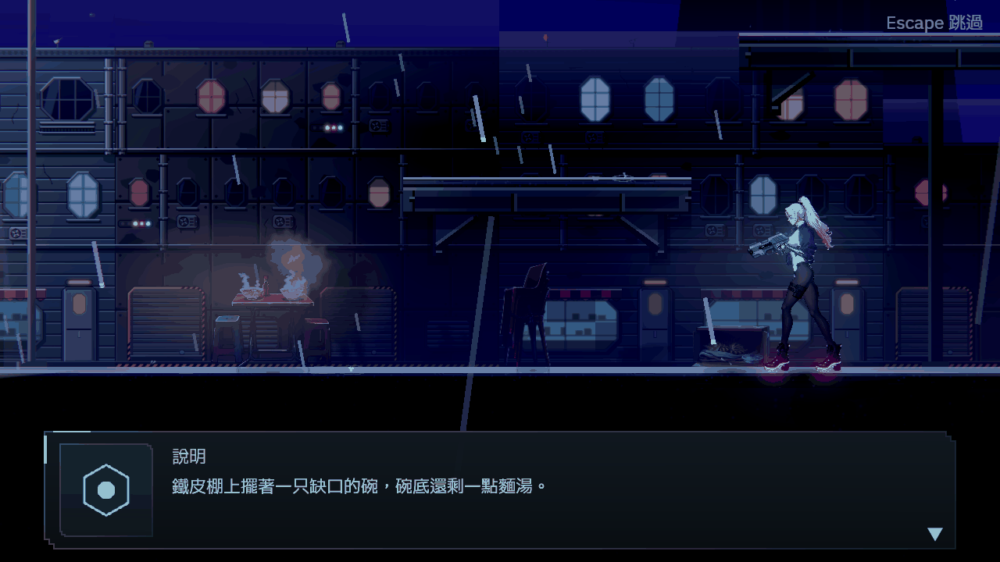

# [ST-62] 在第一章麵攤的鐵皮棚放野貓的碗

> 狀態：完成

## 內文

### 需求
地圖線在第一章宵夜麵攤出口頂上的鐵皮棚做了一個要爬上去才到得了的角落（「野貓角落」），裡面只有信用點。放一件可以讀的東西，讓爬上去的人看到這個麵攤平常的一面：短、具體、和那一區的人有關，不擋主線、不改收藏數。

### 來源
2026-11-28，主 session 轉來地圖線新做的角落位置（第 37～44 欄、第 13 列，盡頭第 43 欄）；第一章的收藏文件數仍寫死在測試裡，所以用可以讀的物件，不用收藏文件。

### 驗收條件
- [x] 鐵皮棚上有一件可以讀的東西，內容短、具體、和麵攤有關
- [x] 不給物品、不寫旗標、不改第一章的收藏數；從地面看不到提示，爬上去才看得到
- [x] 中日英三語齊全；正式文字檢查 0 錯誤、0 警告；受影響的測試全部通過
- [x] 實機截圖確認站位與文字不互相遮住

### 測試流程
1. 第一章天亮後到宵夜麵攤，從凳子堆旁的矮雨棚爬上出口頂上的鐵皮棚
2. 讀棚上的東西
3. 執行受影響的測試與文字檢查

---

# 跟其他票的關係

- Blocks：無
- Blocked by：無
- Related：ST-55、ST-59

---

# Commit-1

## 內文

第一章宵夜麵攤出口頂上的鐵皮棚，是地圖線新做、要從凳子堆旁的矮雨棚爬上去才到得了的角落，原本只有一包信用點。
現在棚上（第 41 欄）擺著一只缺口的碗：「鐵皮棚上擺著一只缺口的碗，碗底還剩一點麵湯。」旁邊的鐵皮用粉筆寫著：「灰貓天亮會來一次，別趕牠，湯裡不要放蔥。」爬上去的人會看到麵攤收攤後的另一面。這是可以讀的物件，不是收藏文件，第一章的收藏數維持五份；不給物品、不寫旗標。中日英三語齊全。

### 測試結果

| 項目 | 結果 |
|---|---|
| 正式文字檢查（StoryLint） | 0 錯誤、0 警告 |
| 受影響的 Godot 測試（依固定清單：文字、故事內容、第一章地圖、過場、人物三組、氣泡、節奏、任務地圖、連續性、世界提示、收藏） | 11,412 項，0 新失敗 |
| 故事與關卡產生器的 Python 測試 | 全過 |

### 截圖

碗本身沒有圖，棚上看得到的是互動點；棚下地面原本就有一個野貓紙箱窩，上下對得起來。截圖工具的麵攤取樣點多加一個「站在鐵皮棚上」的位置，之後補拍可以直接用。
