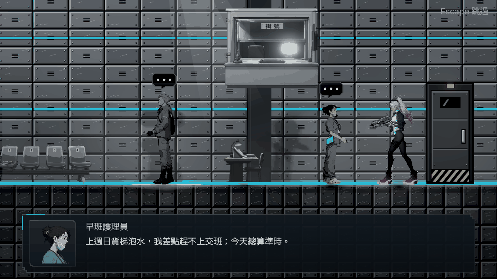
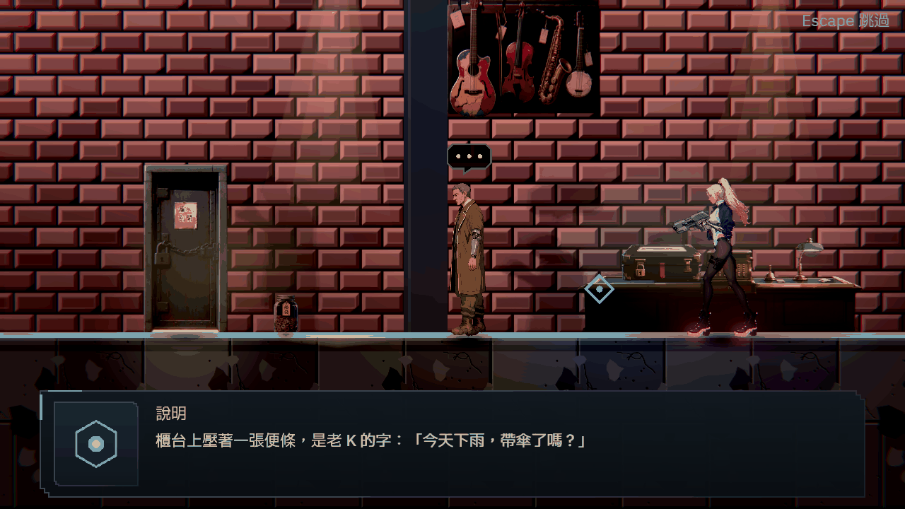
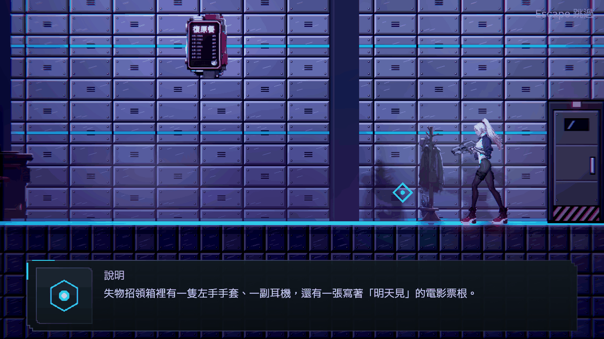

# [ST-63] 讓第四章對話區之間有東西可看可讀

> 狀態：完成

## 內文

### 需求
第四章開頭從當舖、病房外櫃檯、安養病房到復原館，是連續四區平地對話；地圖線不會硬加動線，要靠故事內容讓它們不單調：對話之間有可以看、可以讀、可以選擇要不要理的東西。地圖線在病房的備品頂架與廠房屋頂的冷卻機維修平台做了兩處要爬上去才到得了的空間，裡面只有信用點，放進收藏文件。同時核對第四章回放引用的櫃子與門的位置，補進 `STORY_CONSTRAINTS.md`。

### 來源
2026-11-28，主 session 轉來地圖線的需求（NE-423 改完第四章動線、兩處秘密空間的位置）；`STORY_CONSTRAINTS.md` 標「待定」的第四章回放座標。

### 驗收條件
- [x] 當舖、病房外櫃檯、復原館各有一件不擋主線、可以不理的東西可以看或讀，內容和那一區的人有關，不改劇情
- [x] 病房外櫃檯有一位可以說話的人，簽訪客簿之前與之後說的話不同
- [x] 病房備品頂架與廠房屋頂維修平台各有一份收藏文件，算進第四章的收集進度
- [x] 第四章回放引用的櫃子、門與門栓位置已核對，寫進 `STORY_CONSTRAINTS.md`
- [x] 台詞沒有暗示接線廊的上層比較安全
- [x] 中日英三語齊全；正式文字檢查 0 錯誤、0 警告；受影響的測試全部通過
- [x] 實機截圖確認站位與文字不互相遮住

### 測試流程
1. 第四章從當舖出門，依序經過病房外櫃檯、病房、復原館，讀或略過新加的東西
2. 爬上病房備品頂架與廠房屋頂的維修平台，撿起文件，確認背包的收集進度
3. 執行受影響的測試、文字檢查與連續性報告

---

# 跟其他票的關係

- Blocks：無
- Blocked by：無
- Related：ST-23、ST-55、NE-423、NE-451

---

# Commit-1

## 內文

第四章開頭從當舖、病房外櫃檯、安養病房到復原館，連續四區都是平地上的對話，區域之間沒有可以自己看或讀的東西；地圖線新做的病房備品頂架與廠房屋頂維修平台裡只有信用點。
現在：
- 當舖櫃台的收銀機上壓著一張便條，是老 K 的字：「今天下雨，帶傘了嗎？」同一張紙下面又寫了一次同樣的話，字比較歪。只寫凜看得到的東西，不交代原因。
- 病房外櫃檯站著第三章那位早班護理員。簽訪客簿之前，她說上週日貨梯泡水差點趕不上交班，提醒床頭燈是暖色的床位才能探訪。凜問床上的人不想見人怎麼辦，她答「那就在門邊等，床上的人會讓你知道能不能靠近」，呼應棠由自己決定讓不讓人靠近。簽完簿子之後，她只說一句「床上的人沒回答，就再等一下」。
- 復原館衣帽架旁的失物招領箱裡有一隻左手手套、一副耳機、一張寫著「明天見」的電影票根，側面貼著「復原完的人常常忘了自己帶了什麼來，請慢慢找」。
- 兩份收藏文件，算進第四章的收集進度：
  - 病房備品頂架盡頭（第 52 欄）的「病房的交班便條」：護理員寫給下一班，週日那位訪客來時先別叫棠的名字；訪客在床邊的桌上敲幾下，棠跟著哼就讓她們多坐一會兒，棠把手收進被子裡就請訪客在門邊等。
  - 廠房屋頂維修平台（第 44 欄）的「冷氣主機的保養卡」：最後一次保養是工廠停工的前一天，背面寫著「下班後在這裡看得到港區的燈，數到第三盞就是我家」。
新內容不寫旗標；除了兩份收藏文件不給物品，也不擋主線。第四章的台詞裡沒有暗示接線廊上層比較安全的句子（NE-451 的新配置）。
核對第四章回放引用的位置：鷺的現地回放在執行時用名字找床頭櫃、內廊門與門栓，格位可以移，物件要留在病房的可走地面；當舖的返店演出用的是過場舞台，不讀關卡地圖。結果寫進 `STORY_CONSTRAINTS.md`，「待定」的第四章那一列已補上。
第四章的地圖由產生器輸出，這次只改到五個區域（當舖、病房外櫃檯、安養病房、復原館、廠房屋頂），逐一核對過舊的資源、欄位與地圖字元都沒有少。便條與失物箱一開始放的位置對不到實物（便條在地下室門邊、失物箱在空牆前），看截圖後移到櫃台收銀機上與衣帽架旁。
測試抓到四件事並修正：收藏文件的名字原本用「冷卻機」，但「冷卻」是遊戲的操作用語，改成「冷氣主機」；兩份文件補上日文與英文；交班便條的譯文太長、放不進背包的閱讀框，三語一起收短，中文一句超過四十字的也拆開；收藏測試原本把「有收藏的章節數」與「全部收藏總數」寫死成三章、17 份，改成跟著資料算，之後章節新增收藏文件不必再改測試。

### 測試結果

| 項目 | 結果 |
|---|---|
| 正式文字檢查（StoryLint） | 0 錯誤、0 警告 |
| 連續性報告 | 錯誤 0 |
| 受影響的 Godot 測試（固定清單 14 組：文字、故事內容、第四章故事、過場、人物三組、氣泡、節奏、收藏、區域、任務地圖、連續性、世界提示） | 14 組 9,608 項抓到 4 項（上述四件事），修正後重跑收藏、文字檢查、故事內容 3 組 2,013 項 0 新失敗 |
| 故事與關卡產生器的 Python 測試 | 全過 |
| 缺譯 | 0 |

### 截圖

