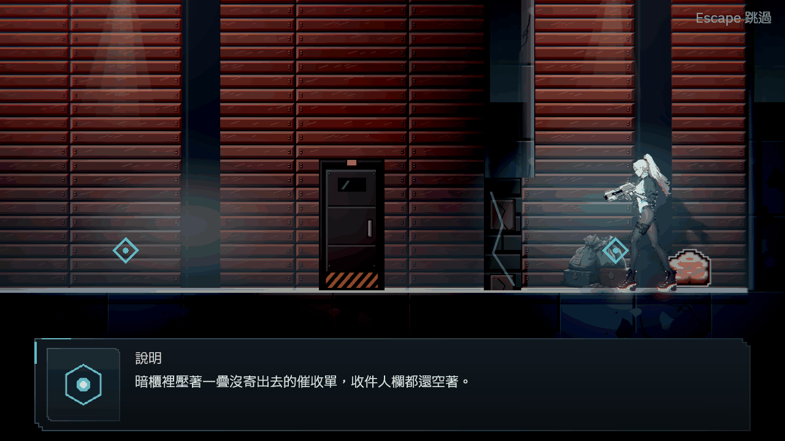
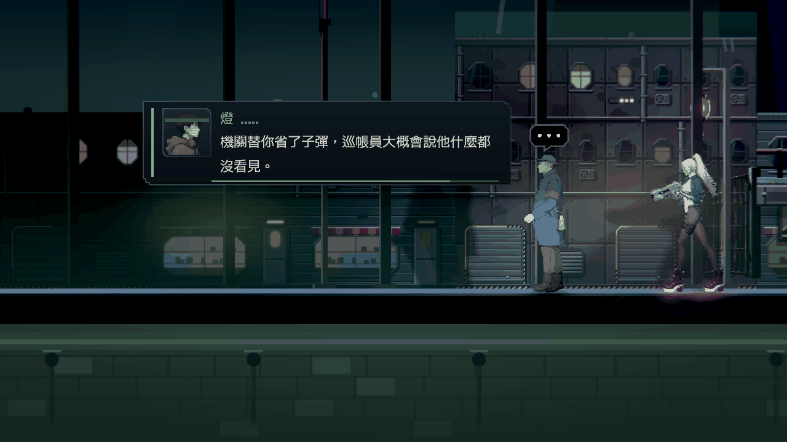
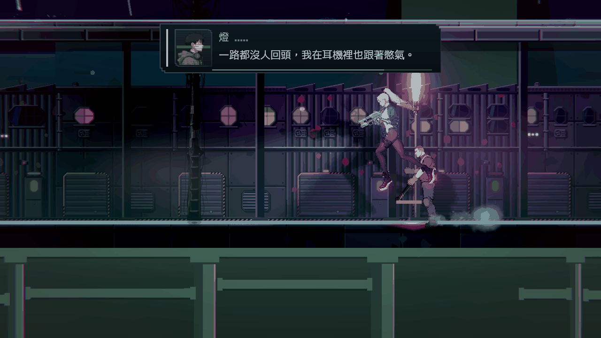

# [ST-64] 讓挑戰完成時有人說一句，並放進北棟暗櫃的紙

> 狀態：完成

## 內文

### 需求
區域裡的可選小挑戰（用環境機關擊倒、不被發現通過、限時抵達）完成時只有一行系統提示和信用點，世界裡沒有人注意到玩家做了什麼。完成時加一句世界裡的反應，讀挑戰自己已經記住的完成狀態，不新增旗標系統、不擋路。地圖線在第二章北棟二樓前室的裂縫牆後做了一個暗櫃，裡面只有錢袋和信用點，放一件可以讀的東西；劇本沒有寫這個暗櫃是誰的，內容不指向任何人物。

### 來源
2026-11-28，`design/22-living-scenes/BACKLOG.md` 故事表第 3 項（場景人物對玩家做過的事有反應）；主 session 轉來地圖線的暗櫃位置（第 57～62 欄）。

### 驗收條件
- [x] 第二章市集入口的環境擊倒、第二章裝卸間的不被發現通過、第四章接線廊的限時抵達，完成時各有一句不鎖操作的反應
- [x] 反應讀挑戰自己的完成狀態，不新增旗標；寫錯場景時資料檢查會報錯
- [x] 北棟前室的暗櫃有一件可以讀的東西，不指向特定人物，不給物品、不寫旗標
- [x] 中日英三語齊全；正式文字檢查 0 錯誤、0 警告；受影響的測試全部通過
- [x] 實機截圖確認文字不溢出、不被遮住

### 測試流程
1. 在三個挑戰區各完成一次挑戰，看到一句反應
2. 打破北棟前室的裂縫牆，讀暗櫃裡的紙
3. 執行受影響的測試與文字檢查

---

# 跟其他票的關係

- Blocks：無
- Blocked by：無
- Related：NE-410、NE-411、NE-418、ST-55

---

# Commit-1

## 內文

區域裡的可選小挑戰完成時只有一行系統提示和信用點，世界裡沒有人注意到玩家做了什麼；地圖線在第二章北棟二樓前室裂縫牆後做的暗櫃，裡面只有錢袋和信用點。
現在三個挑戰完成時，燈在通訊裡說一句（不鎖操作）：
- 第二章市集入口，用環境機關擊倒三名敵人：「機關替你省了子彈，巡帳員大概會說他什麼都沒看見。」
- 第二章裝卸間，不被發現通過：「一路都沒人回頭，我在耳機裡也跟著憋氣。」
- 第四章接線廊，限時抵達：「比清掃線快了幾秒。下次別再拿自己去賭時間。」
反應寫在挑戰自己的資料裡（完成時播哪一句），讀的是挑戰本來就記在存檔的完成狀態，沒有新增旗標；寫錯場景 id 時資料檢查會報錯。市集入口那句原本想讓巡帳員冒氣泡，但他是可以對話的人物，截圖裡氣泡變成被截斷的一條，而且挑戰完成時他不一定在畫面內，所以改由燈在通訊裡說。
北棟前室的暗櫃（第 59 欄）：「暗櫃裡壓著一疊沒寄出去的催收單，收件人欄都還空著。」「最上面那張用鉛筆寫著：這批先不要寄，等雨季過了再說。」劇本沒有寫這個暗櫃是誰的，內容不指向阿勇、小薇或任何人；可以讀的物件，不給物品、不寫旗標，第二章收藏數不變。
同一次也依主 session 的決定更新 `SCRIPT_CH02.md` 的敵人編制：第二章收帳人從兩種身份變三種（押運手、票據投手、聯絡員），聯絡員負責回報與叫人、自己不出手；「最大 3 普通敵人」不變。只改編制那一行，不動對白與劇情。

### 測試結果

| 項目 | 結果 |
|---|---|
| 正式文字檢查（StoryLint） | 0 錯誤、0 警告 |
| 連續性報告 | 錯誤 0 |
| 受影響的 Godot 測試（改到挑戰的程式，選擇器的 23 組加上故事線清單，共 30 組） | 19,403 項，0 新失敗 |
| 新回歸檢查 | 三個正式挑戰都指向存在的反應場景；寫錯場景 id 會被回報 |
| 故事與關卡產生器的 Python 測試 | 全過 |

### 截圖

