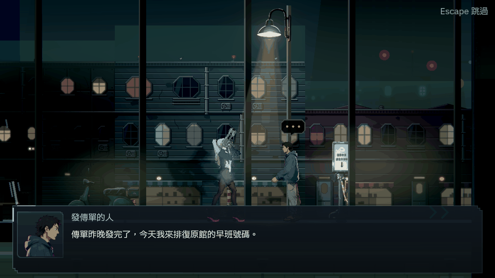
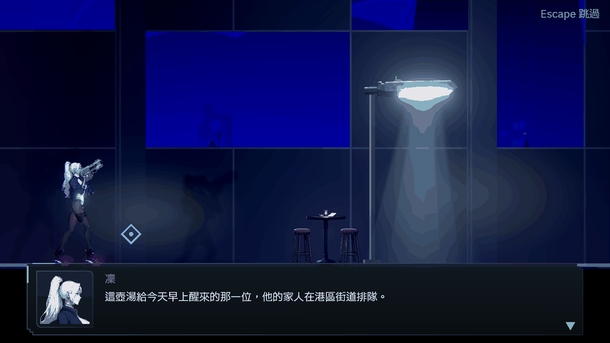
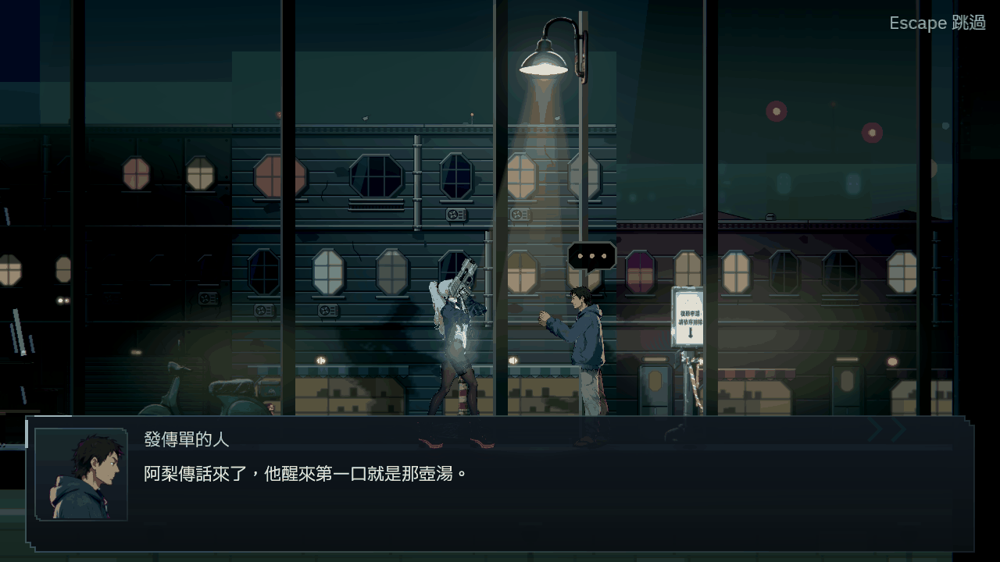
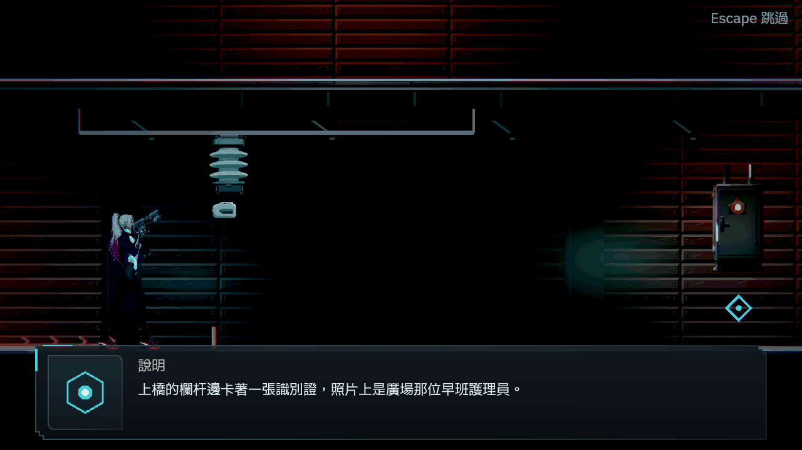
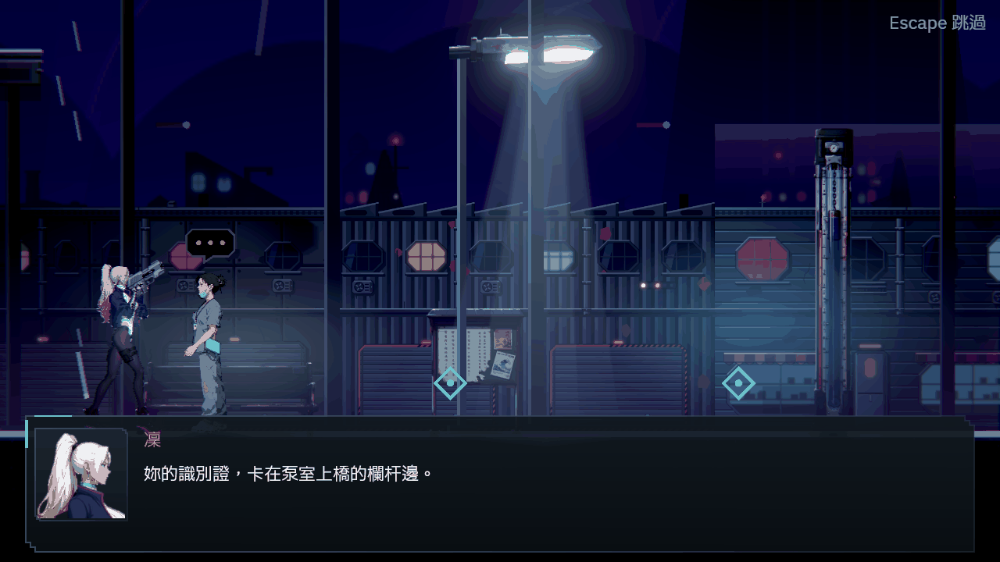

# [ST-65] 讓街坊與護理員託凜兩件小事

> 狀態：完成

## 內文

### 需求
城市裡的人只在劇情需要時開口，沒有人有自己的小事要凜幫忙。加兩件不擋主線的小委託，委託人是已經存在的場景人物，每件用一種不是開槍的玩法，完成後那個人說的話會變；進任務目錄、標成可選，放著不做也不會讓任何東西卡住；獎勵用信用點。同時處理第一章第一座電話亭的錄音：亭子改由自己演出登記之後，錄音和亭子的字重複了。

### 來源
2026-11-28，`design/22-living-scenes/BACKLOG.md` 故事表第 3 項（支線小事）；主 session 對小委託的五點要求與電話亭錄音的小修（NE-494 之後）。

### 驗收條件
- [x] 第二章：港區街道排隊的人託凜把熱湯送到復原館外的寄放架，回來告訴他（送東西）
- [x] 第三章：廣場等貨梯的護理員掉了識別證，到泵室上橋找回來還她（找東西）
- [x] 兩件都進任務目錄、標成可選，有地圖位置；放著不做、章節結束都不會卡住
- [x] 完成後委託人說的話不同；獎勵各四十信用點，不打亂商店進度
- [x] 第一章第一座電話亭的錄音只留亭子沒有顯示的資訊；第一次死亡後醒來的那座亭子說的話是完整句子
- [x] 中日英三語齊全；正式文字檢查 0 錯誤、0 警告；任務稽核與受影響的測試全部通過
- [x] 實機截圖確認文字不溢出

### 測試流程
1. 第二章早上和港區街道排隊的人說話，接下熱湯；到復原館外放進寄放架；回去找他
2. 第三章和廣場的護理員說話；到泵室上橋撿起識別證；回廣場還她
3. 打開任務目錄，確認兩件可選委託的步驟與地圖位置
4. 執行任務稽核、受影響的測試與文字檢查

---

# 跟其他票的關係

- Blocks：無
- Blocked by：無
- Related：ST-59、ST-60、ST-61、NE-494

---

# Commit-1

## 內文

城市裡的人只在劇情需要時開口，沒有人有自己的小事要凜幫忙；第一章第一座電話亭改由亭子自己演出登記後，錄音又把亭子已經顯示的事說一遍。
現在有兩件不擋主線的小委託。第二章早上，港區街道排隊的發傳單的人說傳單昨晚發完了，今天來排復原館的早班號碼，託凜把一壺熱湯送到復原館外的寄放架，給今天早上醒來的那一位；凜放好之後回去找他，他說阿梨傳話來了，醒來第一口就是那壺湯，給四十信用點。第三章廣場等貨梯的早班護理員多說一句：識別證大概掉在泵室的上橋，沒有它進不了護理內門；問過之後，泵室上橋的欄杆邊才會出現那張識別證，撿起來回廣場還她，同樣四十信用點。兩件都進任務目錄、標成可選、有地圖位置；只在接下委託後才公開，放著不做或章節結束都不影響主線；完成後兩人換成不同的話與反應。第二章的「排隊的人」原本只有一般回訪，現在第一次見面就是委託本身，稽核遞交之後仍維持原本那句。
電話亭錄音只留亭子沒有顯示的一句（「歡迎使用天穹備份服務。」），仍維持凍結寫入旗標的規則；第一次死亡後醒來的那座亭子說的話改成完整句子（「這座電話亭已經登記，之後死了會在這裡醒來。」），中日英三語跟著亭子的其他文字放在同一處，測試與演出稽核改讀同一份。
截圖工具的氣泡情境多了 `--flags=`，可以先寫入故事旗標再播有條件的回訪。推送前接上 main 新加的「地圖產生器重跑不得有差異」檢查：寄放架寫回第二章地圖產生器，第二、三章重跑都和資料一致；接上後重跑故事、任務、人物、區域、死亡流程等 11 組 4,583 項，0 新失敗。

### 測試結果

| 項目 | 結果 |
|---|---|
| 正式文字檢查（StoryLint） | 11,372 條來源，0 錯誤、0 警告 |
| 連續性報告 | 錯誤 0、警告 0 |
| 任務稽核（第二章、第三章） | 問題 0；第二章 11 項、第三章 10 項任務，入口各為本章當舖 |
| 受影響的 Godot 測試（20 組） | 13,928 項：抓到 1 項地圖氣泡排版檢查，用同一順序重跑該程序的 6 組 1,814 項 0 失敗（與本票改動無關、跟執行順序有關） |
| 故事產生器與契約的 Python 測試 | 新的三筆結果補進第二章完成規則與契約數量後全過 |
| 缺譯 | 0 |

### 截圖

