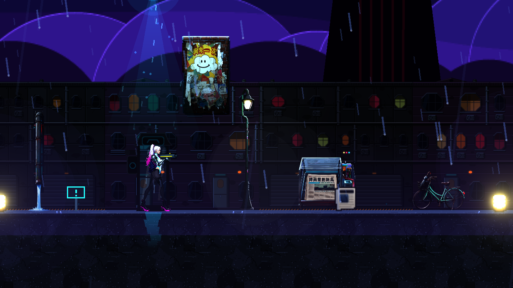
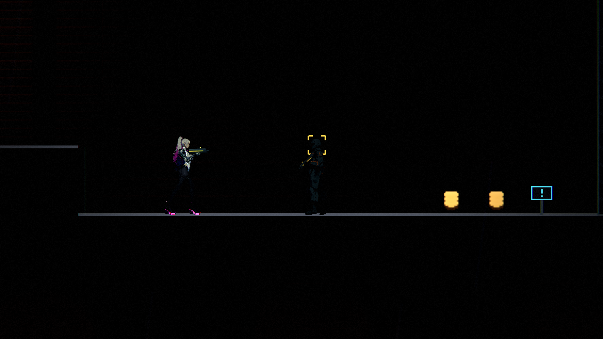
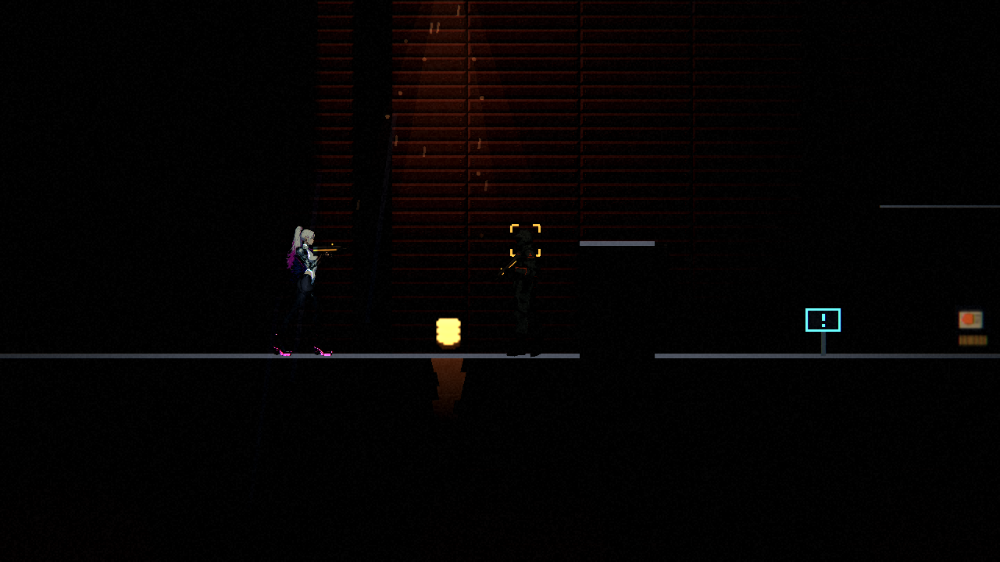
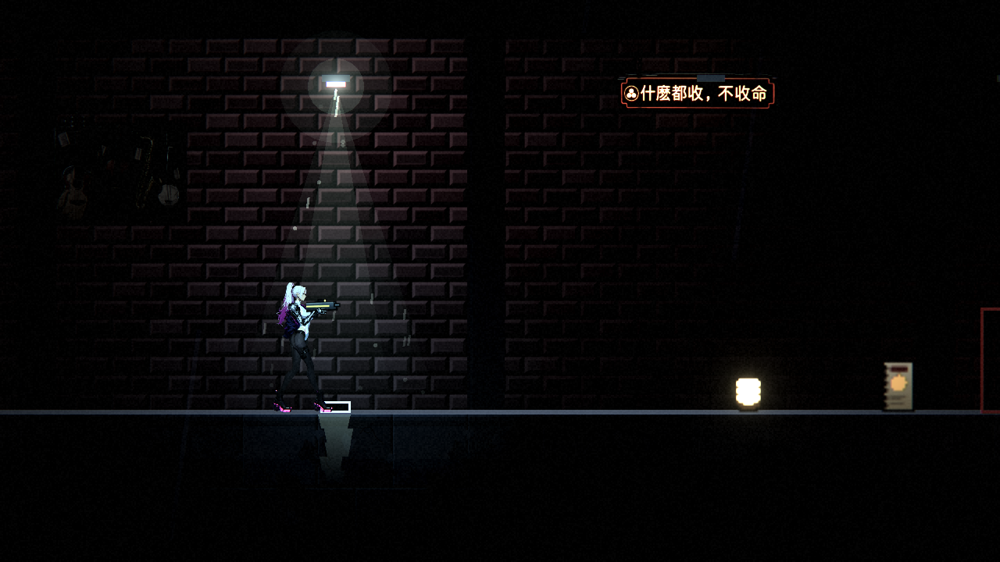

# [ST-6] 建立第一章「傘」的地圖資料

> 狀態：審查中

## 內文

### 需求
依 ST-4 的設計建立第一章的所有區域：當舖、屋頂、港區街道、電話亭巷、碼頭倉庫、復原館、宵夜麵攤、天亮的當舖，每個區域有地圖、地形材質、環境主題與場景專屬物件、光影、音樂與環境音、提示牌、出入口；新遊戲從這一章開始。

### 來源
2026-10-05，使用者要求把第一章的遊戲做出來。設計見 `design/13-story-v2/CH01_LEVEL.md`。

### 驗收條件
- [x] 8 個區域的地圖符合設計的尺寸與版面，可解析、無警告
- [x] 每個區域的主路徑可通行：跳躍高度與坑寬在玩家能力內，起點、出入口、電話亭站得穩
- [x] 區域之間的連接與玩家走的順序與設計一致
- [x] 每個區域使用對應場景的專屬物件與適合的地形材質；暗場可讀
- [x] 光影、音樂與環境音依區域切換；沒有對應曲目時有合理的退回
- [x] 提示牌與教學順序符合設計
- [x] 新遊戲從第一章的當舖開始；舊關卡不受影響
- [x] 每個區域的檢查（可通行、可讀、出入口對應）有測試

### 測試流程
1. 逐區載入，確認地圖與物件
2. 依主線順序走完全程
3. 執行可通行與暗場可讀性檢查
4. 執行完整測試套件

---

# 跟其他票的關係

- Blocks：ST-9
- Blocked by：ST-5
- Related：ST-7、ST-8、BG-11

---

# Commit-1

## 內文

用 `tools/level/build_ch1.py` 產生第一章的八個區域：當舖 112×24、屋頂 72×24、港區街道 208×24、電話亭巷 56×24、碼頭倉庫 244×24、復原館 56×24、宵夜麵攤 48×24、天亮的當舖（與當舖同一張地圖）。每個區域有自己的環境主題（地形材質、立面、室內牆面、背景、天空）、該場景的專屬物件、光影區段、提示牌與出入口；音樂依區域指定（`music.json` 的 levels）。新遊戲從當舖開始（`Main.FIRST_LEVEL`）。產生器在輸出前檢查：站立與淨空、出入口與道具腳下有地面、起點到每個道具與出入口的可達性（走、跳 5 格、橫 7 格、落下；閘門視為打開、水坑視為漲滿）。

與設計的差別（已寫進 CH01_LEVEL.md §3.1、§12）：當舖改成「後空地→店面→廚房」由左到右，讓劇情觸發點能依序觸發；倉庫地面抬高到第 17 列，水坑才挖得出 6 格深；街道尾段多一台無人機，讓閘門廳的新敵人只剩打手。

測試：`Chapter1MapSuite`（618 項）：八區解析、道具與出入口對得上、從當舖走得到每一區、敵人名單與分佈與間隔、道具只有該放的、劇情接點與旗標、依序走過每個出入口、世界在區域間保留、天亮的當舖結束本章。完整測試套件除了 main 上就有的 3 項失敗外全數通過。

沒有 GPU，無法截圖：暗場可讀與畫面請在有顯示的環境確認（所以票維持進行中）。

---

# Commit-2

## 內文

沿用目前八區場景；倉庫拆分後共九個關卡資料。逐區核對專屬物件、材質與地形，加入十四個可重現的暗場取樣點。安全區只檢查玩家與地面，戰鬥區另檢查該區確實存在的清掃兵。

市集原本的玩家對比為 0.56，未達既有 0.60 門檻。將一盞既有燈具移到電線桿頂部附近，相同設定重測提升至 0.72；碼頭入口也仍通過。沒有更改對比門檻、敵人、美術、音樂或遭遇設定。整合新的背景匯入尺寸後，重建仍會保留原始背景寬度；隔離重建與正式輸出完全一致。

### 測試結果

| 項目 | 結果 |
|---|---|
| 受影響測試（明確基準 293fcebb，涵蓋全部）／票要求的完整回歸 | 78 組，50,397 項，0 新失敗、0 已知失敗，293 秒 |
| 整合遠端 NE-95 後的相關回歸 | 8 組，28,011 項，0 新失敗、0 已知失敗，53 秒 |
| 九個關卡、十四個暗場點 | 14 點站立有效且通過；玩家 ≥0.60、地面 ≥1.00、敵人 ≥0.45 |
| 產生器隔離重建 | 0 新增／變更輸出，保留 ST-15 與 BG-17 成果 |
| 舊第一章屋頂探針 | 玩家 0.73、地面 6.40、敵人 0.91，腳下高度各自核對後通過 |
| 無命中關卡／取樣點 | 均回傳預期失敗代碼 1，不把空集合當通過 |

實際畫面使用 Godot 4.7、Forward+、Vulkan llvmpipe 軟體渲染，亮度 0.5、光影 high、邏輯 640×360／PNG 1280×720。九區先量測，修正只影響街道，街道兩點以相同條件重拍並保留修前報告。取樣場景停用遭遇觸發及文字提示，確認腳底沒有被戰鬥推移；正式遊戲行為不變。此處驗證是靜態渲染與自動檢查，沒有宣稱整章人工實玩、GPU 效能或試聽。

詳見 [逐區物件與量測表](../../design/13-story-v2/CH01_ENVIRONMENT_AUDIT.md)、[原始報告](images/ST-6-readability/readability-report.json)及 [完整回歸摘要](attachments/ST-6-full-tests.txt)。

### 截圖

