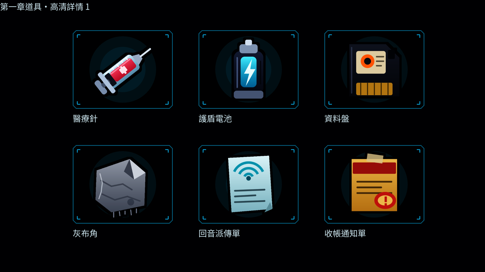
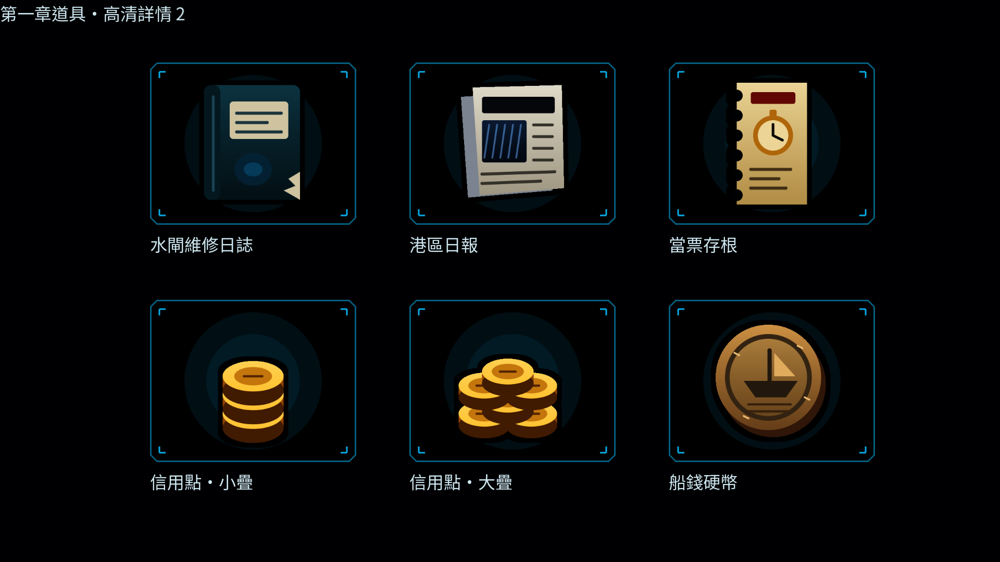
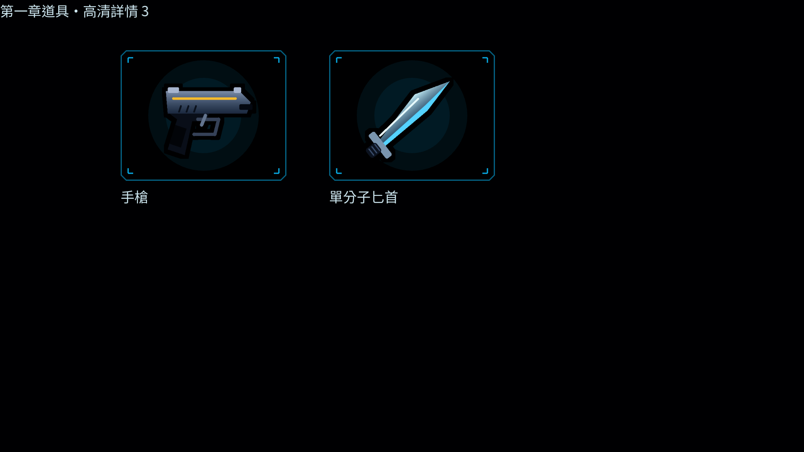
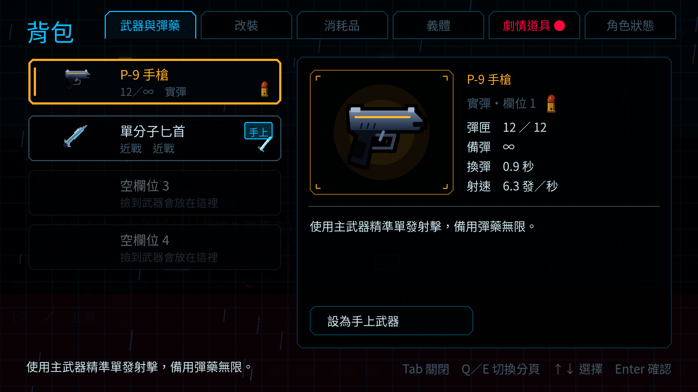
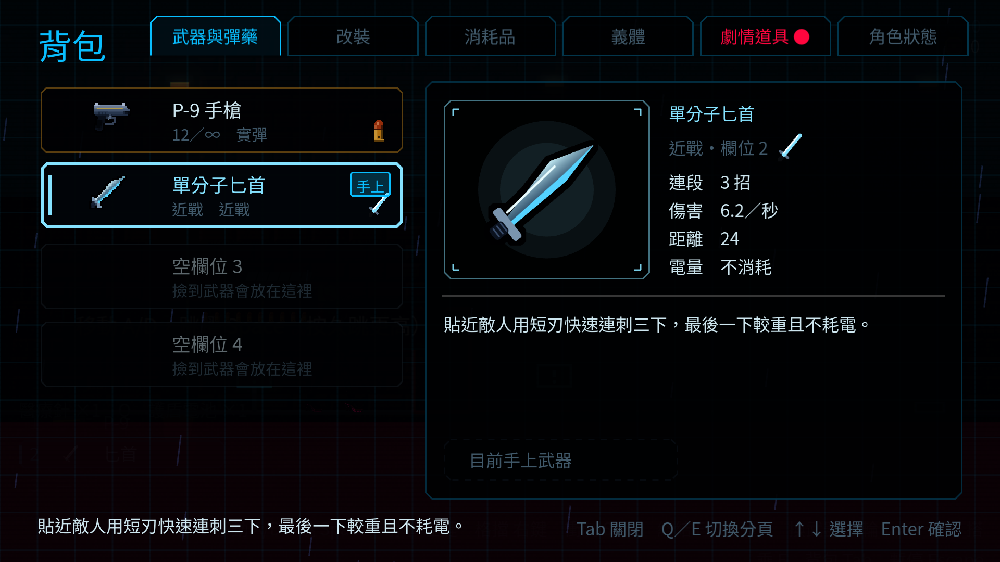
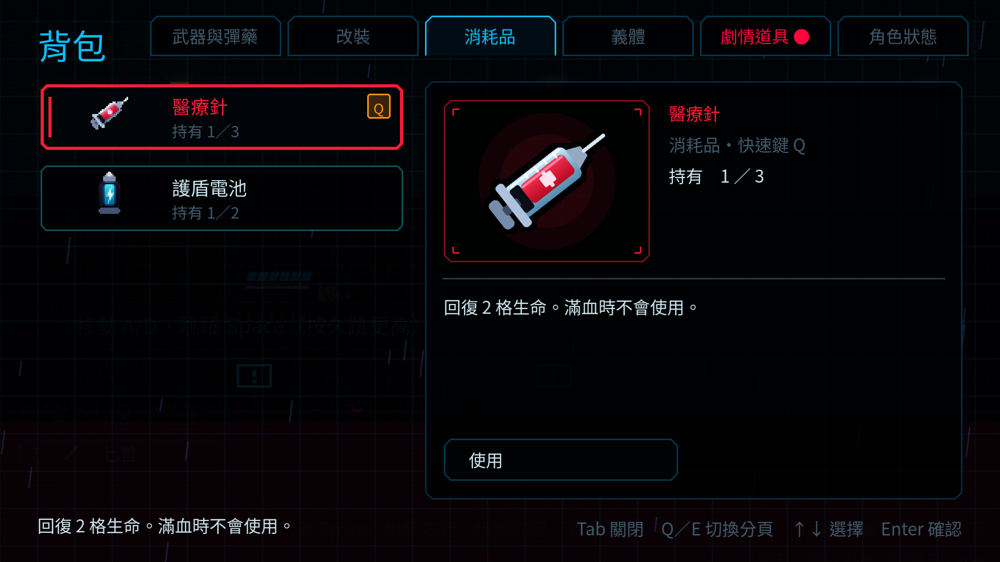
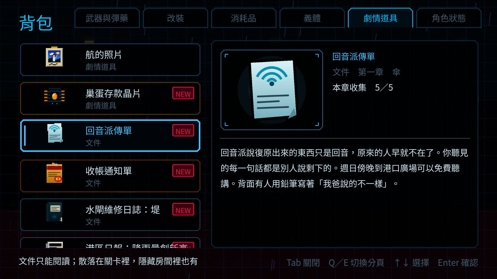
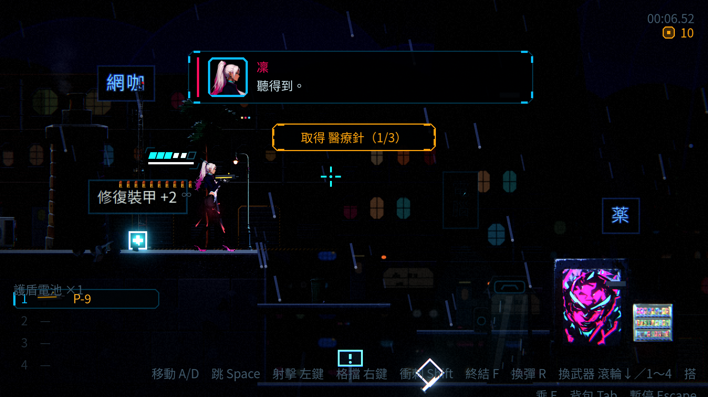

# [ST-8] 加入第一章的道具與水坑機關並重畫圖示

> 狀態：審查中

## 內文

### 需求
第一章只放該放的道具：醫療針、護盾電池、信用點、單分子匕首、新故事的短文件、資料盤與灰布角。水位謎需要新的機關：水坑會因開關漲水，坑底的踏板踩下去會漲滿讓玩家溺斃，閘門與水位在死後保留。現有的道具圖示太簡陋（背包圖示 32×32 偏小、場景裡的拾取物只是幾個像素的小方塊、文件全都長一樣），要依專案畫風重新繪製。

### 來源
2026-10-05，使用者要求道具只放該放的，並重畫圖示。設計見 `design/13-story-v2/CH01_LEVEL.md` 第 5、7 節。

### 驗收條件
- [x] 第一章用到的每個道具有資料；新故事的短文件（每種各自的內容）與關鍵道具（資料盤、灰布角）可以取得並出現在背包
- [x] 水坑與踏板機關：開關改變水位、踏板踩下去漲水溺斃、死後水位與閘門保持，從電話亭回來後房間已經漲滿
- [x] 背包圖示重畫（解析度提高、細節與配色更豐富、風格統一），包含信用點、醫療針、護盾電池、各種文件、資料盤、灰布角、船錢硬幣、單分子匕首、手槍
- [x] 場景裡的拾取物換成各自的圖（帶發光與漂浮），不再是程式畫的小方塊
- [x] 圖示由可重複執行的腳本產生；介面在新尺寸下沒有破版
- [x] 既有道具的行為與測試不變

### 測試流程
1. 逐一拾取第一章的道具，確認背包卡片與說明
2. 解水位謎，確認機關與狀態保留
3. 檢視所有重畫的圖示與場景拾取物
4. 執行完整測試套件

---

# 跟其他票的關係

- Blocks：無
- Blocked by：ST-5
- Related：ST-6

---

# Commit-1

## 內文

- 道具資料：五種新故事的短文件（回音派傳單、收帳通知單、水閘維修日誌、港區日報、當票存根）與兩個關鍵道具（資料盤、灰布角）；資料盤可以在關卡裡撿起（`CollectiblePickup` 接受取得時機 MANUAL 的關鍵道具）。
- 水坑（`FloodPit`、`MechanismData.Kind.FLOOD_PIT`）：站上坑底的踏板，閘門打開、水在 `rise_time` 秒內漲滿，頭頂被淹過就溺斃（死因 `flood`，有敗北圖鑑）；漲滿後水面浮著貨櫃（單向平台）；水位與閘門存進持久世界，死亡後回來房間已經漲滿。開關與閘門沿用既有機關，第一章的機關資料在 `data/props/ch1_*.tres`。
- 圖示：`tools/art/build_item_icons.py`（8 倍超採樣向量描繪，縮小後邊緣二值化並描邊）重畫醫療針、護盾電池、資料盤、灰布角與五種文件：背包卡片 32×32、詳情面板大圖 96×96（逐項繪製，不是放大）、場景拾取小圖 24×24（另有自發光層，漂浮並發光）；信用點（小疊與大疊）、醫療針、護盾電池、文件與資料盤在場景裡改用小圖，沒有圖的道具退回原本的程式繪製。要換成手繪或 AI 圖，用同名檔案覆蓋即可。
- 測試：`FloodPitSuite`（23 項）。

船錢硬幣、手槍與匕首的背包圖示沿用現有的圖（匕首是近戰武器的剪影，手槍與其他槍共用同一套），沒有重畫；沒有 GPU 無法截圖，圖示在遊戲裡的樣子請在有顯示的環境確認（所以票維持進行中）。

---

# Commit-2

## 內文

詳情圖原本只有 96×96，手槍與單分子匕首也沿用小型外觀或剪影。現在第一章十四張詳情素材直接以 384×384 繪製，保留醫療針、護盾電池、資料盤、灰布角、五種文件的配色，補上信用點大小兩疊、船錢硬幣、手槍及單分子匕首。手槍与匕首已用於背包卡片及詳情；武器与改裝頁都可選用高清詳情，缺高清圖的武器仍有原來的替代圖。

高清圖的顯示長邊固定 96 邏輯像素，切頁、底板、名稱與說明沒有被素材尺寸撐開；首次排版前的空外框也不再造成渲染錯誤。既有 42 張卡片及拾取圖保留原檔，沒有重做水坑、修改機關或更動第一章地圖。船錢硬幣列在素材審查圖；本次沒有新增其故事道具資料或取得配置。

### 測試結果

| 項目 | 結果 |
|---|---|
| 固定基準 58b9ccf4 的受影響測試／本票要求完整套件 | 78 組、50,529 項檢查；新增失敗 0、已知失敗 0，165 秒 |
| 圖示來源與重跑 | 14 張原生 384×384 RGBA；相同來源重畫逐像素一致，42 張既有卡片／拾取圖保留原檔位元組 |
| 高清圖與缺圖退回 | 高清圖顯示 96×96 邏輯尺寸；舊圖整數倍率與最近鄰退回、武器與近戰資料掛載檢查通過 |
| 道具、UI、拾取與水坑回歸 | 完整套件含 UI、消耗品、收集、補給、典當、水坑、區域持久狀態及第一章地圖檢查 |
| 原生截圖 | 1920×1080、Forward+；十四張底板、手槍／匕首、消耗品与五種文件、資料盤／灰布角、拾取及典當畫面 |
| 擷取日誌 | 無腳本／渲染錯誤；退出時 ObjectDB 與空場景 MSAA 警告保留於附件，沒有冒充人工操作驗收 |

[完整測試](images/ST-8-validation/full-tests.txt)、[素材重跑](images/ST-8-validation/asset-reproduction.txt)、[背包擷取](images/ST-8-validation/inventory-capture.txt)。

### 截圖

