# [ST-9] 把第一章劇本接進遊戲

> 狀態：進行中

## 內文

### 需求
把第一章劇本（ST-1）接進新的區域：每個區域的進場過場、場景舞台（用場景立繪）、通訊、可互動物件的短台詞、選項與旗標、死亡畫面序列、章節卡與章末卡。台詞資料要有中日英三欄與雙關標記；缺語言時安全退回。

### 來源
2026-10-05，使用者要求把第一章的遊戲做出來。劇本見 `design/13-story-v2/SCRIPT_CH01.md`，地圖見 `CH01_LEVEL.md`。

2026-10-10需求補充：先完成序章至第三章，逐章劇本審查、正式主支線與演出、累積單檔發行；詳見[整體設計](../../design/20-campaign-experience/DESIGN.md)。

2026-10-10，正常遊玩閉環審查补充；需求與來源見[序章至第一章檢查](../../design/20-campaign-experience/CH01_PLAYABLE_REVIEW.md)。

### 驗收條件
- [x] 序幕到章末的過場、通訊與玩法段台詞都以資料播出，順序與劇本一致
- [x] 過場的舞台使用對應場景的立繪；過場符合現有的長度與連續句數限制
- [x] 過場中的選項（問鷺、追問燈、宵夜的選擇）可用，旗標會保存並影響後續
- [x] 站在可互動物件前按鍵會說出短台詞，已聽過的有記錄
- [x] 死亡畫面依序播出，第一次完整、之後簡化、更後面可略過
- [x] 舊的第一章腳本不再被使用，既有功能與測試不變，完整測試套件全數通過

- [x] 序章到第一章章末、付款／留下吃麵及回家門檻有合理前後因果，正式主支線可完整完成。
- [ ] 新增演出、短反應與必要情境動作依最新劇本審查選擇，不以舊固定過場數量限制內容。

- [x] 電話亭實際錄音完成後可自願追問燈，未聽者不會被當作已聽，無死亡的玩家也能完成這條支線。
- [x] 正式回家路線只播一次第一章完成卡；第一章獨立包清楚顯示進度已保存與包含範圍，繼續不重發已完成結果。
- [ ] 回家、交盤與麵攤的必要道具動作可見且與實際結果一致；入口提示說角色目的，不出現製作指令。

- [ ] 正式故事結果只在真遊戲行為和成功保存後生效；拒絕、取消、死亡與續玩不提前發道具、獎勵或完成旗標。
- [x] 歷史格式相容測試與正式劇本流程分開驗證；保留原斷言，不回填已刪開場、直接授旗標或假造存檔成功來掩蓋正式缺口。

### 測試流程
1. 從新遊戲跑完整個第一章，確認每個事件的過場與台詞
2. 在過場中分別選擇不同選項，確認旗標與後續
3. 連續死亡三次，確認死亡畫面變化
4. 執行受影響範圍測試

---

# 跟其他票的關係

- Blocks：ST-19、NE-233、NE-223
- Blocked by：ST-6
- Related：ST-1、ST-2、ST-3

---

# Commit-1

## 內文

第一章的劇本接進新的區域：當舖進場播序幕與開場，廚房入口觸發晚飯，屋頂觸發鷺的差事，街道進場播出門並用觸發點播燈的通訊與戰鬥提示，倉庫進場與水坑前後、保險箱前各有對話，看門狗倒下時（機關頻道 `watchdog_gate`，`LevelData.channel_scenes`）播出「只有一頭」，第一次死亡後重生播出復原室（`respawn_scenes`），復原館與麵攤進場自動播出，天亮的當舖播出回家後結束本章，章末卡取自新的章節。

**還沒做**：過場中的選項（問鷺、追問燈、宵夜的選擇）、可互動物件的短台詞（標籤、傘桶、茶杯）、死亡畫面的序列、電話亭的第一次錄音場景（目前由電話亭本身的標語取代）、戰鬥中的即時通訊（第一次受傷、完美格擋）；這些屬於 ST-3，所以票維持進行中。

# Commit-2

## 內文

試玩回報三件事，一併處理：

- **進場卡一下**：第一次進區域時要從磁碟讀取並解碼貼圖（量到第一次約 0.5～1.8 秒，之後約 0.3 秒）。新增 `AssetPrefetch`：玩家在區域裡時，背景預載出入口通往的區域與接下來的過場舞台的貼圖，主選單時預載新遊戲的第一個區域；測得倉庫的建立時間約 0.5 秒降到 0.15～0.19 秒。
- **手腕錯位**：手的貼圖是五指朝 +X 畫的（握槍時沿瞄準方向），手臂垂下、沒握武器時卻沒轉，手腕折成直角。空著的手現在順著前臂（人物、NPC、倒下的姿勢都是），沒有武器時雙手自然下垂而不是伸出去握空氣；有測試鎖住（八個人物、站立、走路、蹲下）。敵人的手與前臂接點有 2～6 像素的落差（流氓兵、潛行者、監管者），這次沒動。
- **過場裡的角色沒坐在椅子上、比例怪**：BG-11 立繪裡的家具是真實比例，原本的角色縮放（2 倍）只有立繪裡椅子的一半高。現在每個舞台依畫面量到的桌椅、櫃台、欄杆高度決定角色縮放，坐姿用量到的座面高度與各骨架坐著時的髖高算腳底位置（凜坐左邊的椅子、老 K 從爐子走過來坐右邊；復原室坐在檢查台邊緣；復原館坐高腳椅；麵攤補上麵攤、桌子、燈籠與小板凳），鏡頭也改成對話框不蓋住腳。舞台參數在 `tools/story/build_ch1_story.py` 開頭，重新執行即可重產。

沒有 GPU，沒辦法截圖：用立繪座標格線疊上角色的方框確認過比例與座位，實際畫面請在有顯示的環境確認。

# Commit-3

## 內文

第一章交盤與宵夜收尾原本缺少明確的取物、交付、回執、付款及去留結果；回家門也依賴可選地址。
完整製作稿補齊13段對話與演出、第一晚免收的晚飯、11個主支線任務語義，以及35列退出、死亡、略過、缺錢與回訪邊界。點餐才成立200帳單，招待不發退款，取盤報酬720留到次晨核對；離開與留下都能回家。交接與夜話分段完成後各自保存。
逐場獨立通讀後已放行正式製作，金額、人物知情與下一章銜接有一致前因。

### 測試結果

| 項目 | 結果 |
|---|---|
| 腳本因果與分支通讀 | 通過13段、35列預期矩陣；製作文稿審查 |
| 來源完整性 | 39份來源SHA一致；0筆不符 |
| 文件靜態檢查 | 11個任務語義、18個有地形支撐的候選點；連結缺失0 |
| 受影響遊戲測試 | 純文件更動，無需執行 |
| 實際遊戲與截圖 | 本次未更動遊戲畫面；文稿審查不計實機驗收 |

[完整製作稿](../../design/13-story-v2/CH01_CLOSURE_SCRIPT.md)／[審查紀錄](../../design/13-story-v2/CH01_CLOSURE_REVIEW.json)。

# Commit-4

## 內文

第一章製作稿已整理成可檢查的完整來源，包含81個演出及決策段、16個明確選擇、6個主線與5個支線語義，以及交盤回執、市場摘要、餐酒帳與欠條四份紙物。紙物使用現有文件圖示；市場摘要保留金額與缺少付款附件的證據，並拆成好讀的完整句子。正式發布先檢查所需能力，缺少接點時拒絕輸出，保留目前可玩的故事。

### 測試結果

| 項目 | 結果 |
|---|---|
| 原受影響測試（d68） | 原選取80組、54352項全過，0新／已知失敗，1190秒，自然退出0 |
| 最新main接合（c744） | 六組3438項全過，0新／已知失敗，105秒，自然退出0 |
| 來源獨立複核 | 81段／16選擇／11任務語義；32餐費組合接受6、拒絕26；四紙物一致 |
| 既有內容 | 預設36場與6舞臺生成結果一致，18份目前載入資料內容不變 |
| 原始輸出 | 無SCRIPT ERROR／Parse Error／Compile Error；原負向及引擎診斷完整保留 |
| 截圖 | 不適用；本次交付製作來源與紙物資料，沒有更動正式遊戲畫面 |

[完整來源與原始驗證紀錄](attachments/ST-9-source/manifest.json)／[製作接線清單](../../design/20-campaign-experience/CH1_PRODUCTION_INTEGRATION.md)。

# 2026-10-11 交接紀錄

## 內文

正式 producer 與通訊框架保存在 chapter-one-producers 的 a5f2a1ba9eb64233b56108c3e930c68bffa52158，未合 main。原始 ALL 86,162 checks／126 新失敗／3 SCRIPT／exit1 保留；typed flag 與歷史／正式測試契約遷移候選仍未完成，不能整包視為修復。

使用者要求本 Session 收尾後停止開發。偏好、研究依據、避免重犯事項與精確接手資訊見 [使用者指南](../user_guide.md)及[本次交接](../SESSION_HANDOFF_2026-10-11.md)。此段保存現況，不是新完成紀錄。

# Commit-5

## 內文

第一章收尾的正式劇本（交盤、阿梨、宵夜去留、回家、四張標籤、電話亭錄音、初次建檔的灰布）只寫在作者稿裡，遊戲還在播舊的 36 場；保存分支雖然接上了，卻帶著上百項失敗、沒有合進主線。
這次沒有整包搬保存分支，而是沿用主線現有的劇情系統，只補作者稿需要的能力：段落的前置條件、整段播完才一起生效的結果（旗標、取得、交出原件、正式交易）、現金不足改接選擇、人物與物件依劇情階段挑對的話、選了才接下一段、只在初次建檔當下成立的情境。劇本由作者稿重新轉成 120 個場景與 9 個有真實地點的任務；地圖補上倉庫上層出口到復原館外交接櫃的區域、當舖四件舊物的標籤、電話亭旁的耳機通訊；阿梨說完今晚的話會收店淡出，改在門外麵攤出現。打倒看門狗、打開水閘、解除路障與拿到資料盤這類世界事件，由地圖與物品資料本身寫入旗標。
初次建檔沿用已量測的診間舞台，補回「歡迎回來」與「你的聲音跟電話亭很像」兩句伏筆，建檔後的托盤與灰布選擇留在診間裡；一般死亡有自己的死亡畫面序列；回家只播一次章末卡，結算畫面寫出下一步與「進度已保存，這一版收錄到第一章結束」。選擇畫面加上深色底板，焦點停在哪一項就用一句話說明後果，最後一句關鍵資訊（例如價格）留在選擇提示上。
用真實關卡、真人物互動與真選擇從頭推到章末，兩條宵夜路線（留下吃麵、付清回家）都能完成全部主線任務；戰鬥與機關段以真實事件入口銜接，真人整章通關與冷續玩待本機原生驗收。

### 測試結果

| 項目 | 結果 |
|---|---|
| 受影響範圍（基準 9033d23e，原選擇器選出 69 組） | 78,163 項、0 新失敗、0 已知失敗；無腳本、解析或編譯錯誤 |
| 第一章流程探針（留下吃麵／付清回家） | 兩條路線各自 0 失敗：交盤、回執、摘要、點餐、聊天、去留、回家、章末與全部主線任務完成 |
| 可選支線 | 問鷺週日、四張標籤、未死亡也能問燈錄音、初次建檔收灰布全部可完成 |
| 劇本文字掃描 | 全專案玩家文字 0 錯誤、0 警告 |
| 測試契約更新 | 依新地圖與正式流程更新期望值（多一個交接櫃區、人物入口改為分派、阿梨流程用真選擇與真交易），沒有刪斷言、改選擇器或加已知失敗 |
| 待本機原生驗收 | 真 GPU 畫面、真人整章通關（含戰鬥）、退出後冷續玩；雲端只用軟體 Vulkan 截圖 |

### 截圖

雲端軟體 Vulkan（Forward+）截圖，光影與噪點以本機原生為準。

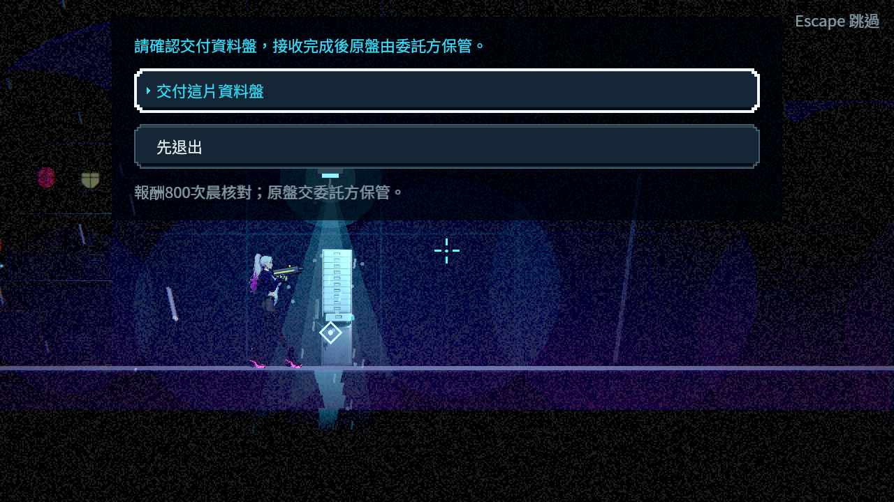
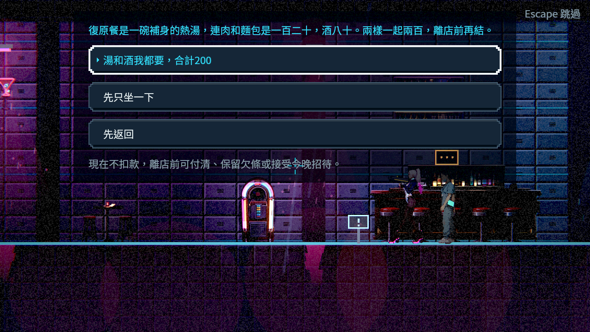
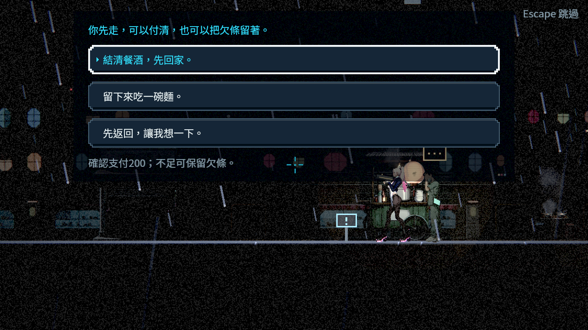
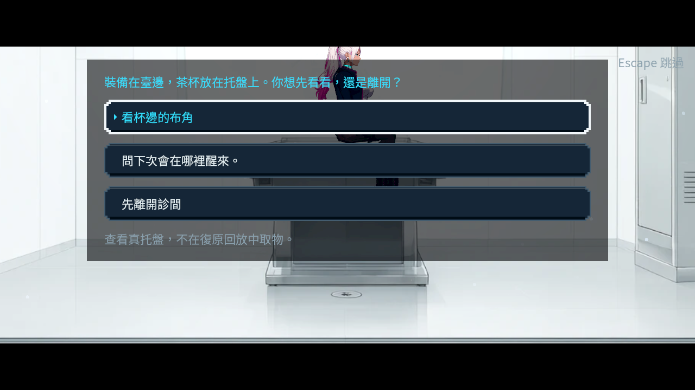
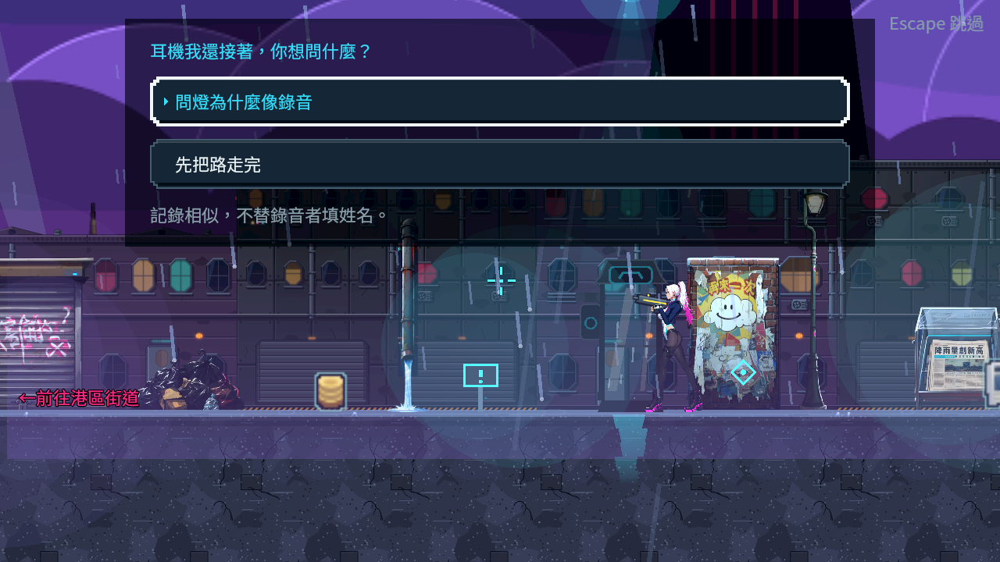
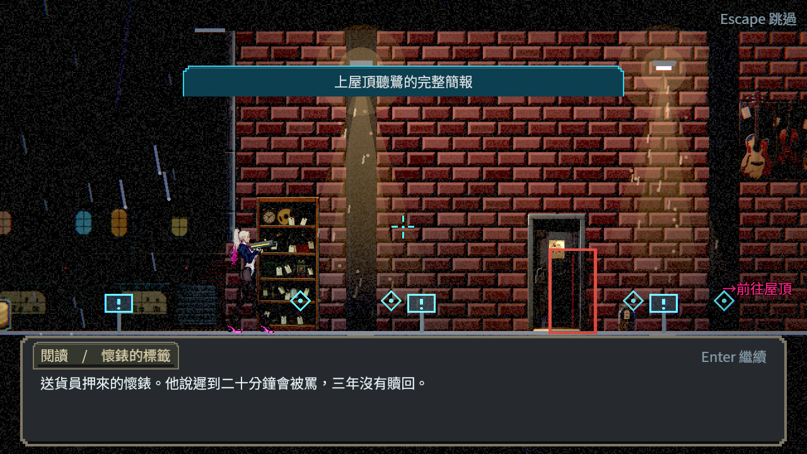
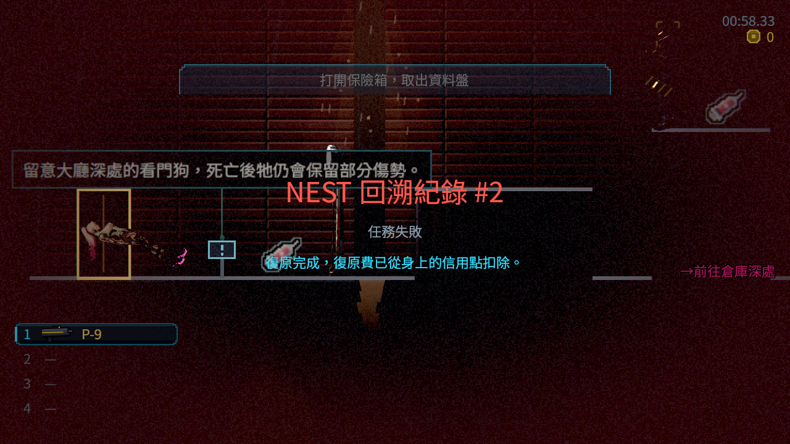
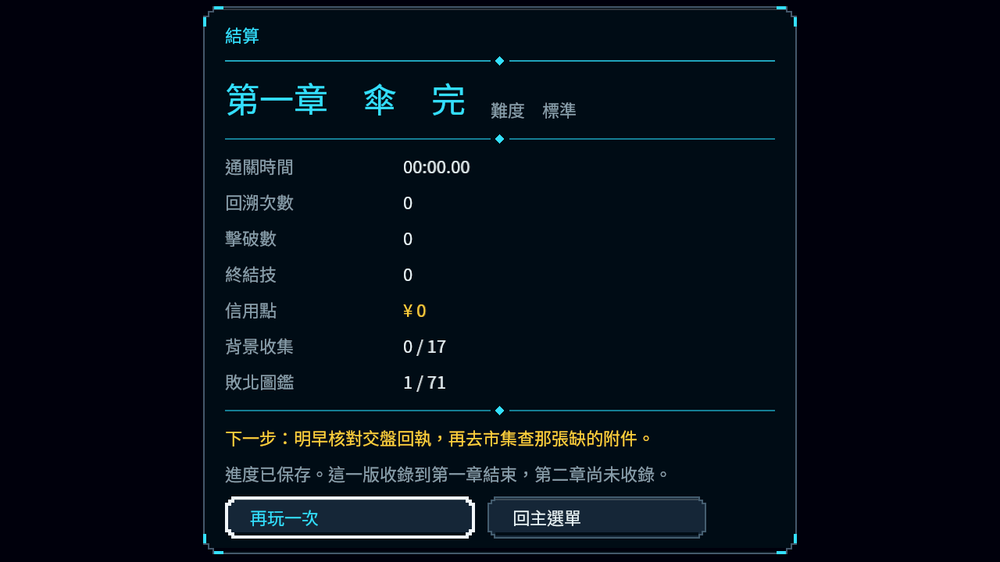

分支：`claude/nest-egg-main-story-flow-ph1dnu`（[分支提交紀錄](https://github.com/deadline314/Nest-Egg/commits/claude/nest-egg-main-story-flow-ph1dnu)）。執行期契約與存檔影響見 [CH1_STORY_RUNTIME.md](../../design/20-campaign-experience/CH1_STORY_RUNTIME.md)。存檔沒有新增欄位，新增的世界旗標列在該文件，NE-230 請跟進；結算畫面與選擇面板的小幅版面調整請 NE-228 知悉；回家過場的鏡頭構圖仍由 ST-10 處理。

# Commit-6

## 內文

劇本裡第一章的三場主要談話——屋頂聽鷺交代差事、復原館認識阿梨、天亮在麵攤決定去留——都寫成在各自場景發生的戲，舞台立繪也早就做好，但遊戲裡只是在地圖上跳出對話框，屋頂、吧台和麵攤的立繪一張都沒用到。
現在走過去和鷺或阿梨說話，畫面會淡入對應的舞台：雨夜的屋頂、霓虹吧台、清晨的麵攤，兩人站在地面上面向對方說完整場；同一場戲的下一段只用很短的淡入，看起來是同一個鏡頭；選擇留下吃麵之後凜會坐上攤前的長凳。聽完之後回頭找人的一兩句回應仍留在地圖上，不打斷操作。發生在序章開場、初次建檔與回家的三段自動過場不變，仍各自在預算秒數內。
用真關卡、真人物互動與真選擇走完兩條宵夜路線，每一場舞台談話的構圖（腳在對話框之上、頭在 21:9 黑邊之下、站著的人不站進長凳）都通過檢查，三語台詞沒有缺譯。

### 測試結果

| 項目 | 結果 |
|---|---|
| 受影響範圍（原選擇器） | Chapter1Map 1,945 項、0 新失敗、0 已知失敗 |
| 劇情相關套件補驗 | StoryContent、StoryLint、Cutscene、ChapterCutscenes、Npc、QuestMap、Continuity、RunSave、DeathFlow、Chapter2Story 共 3,915 項 0 失敗；main 流程 2,256 項 0 失敗 |
| 第一章流程探針 | 留下吃麵、付清回家兩條路線各 63 項 0 失敗（留下吃麵用軟體 Vulkan 截圖） |
| 構圖 | 舞台談話 30 段以上全部通過；自動過場仍為 3 段且在預算內 |
| 待本機原生驗收 | 真 GPU 畫面、真人整章通關與冷續玩；要看的場景：屋頂聽鷺、復原館與阿梨、麵攤去留（兩種選擇） |

### 截圖

雲端軟體 Vulkan（Forward+）截圖，光影以本機原生為準。

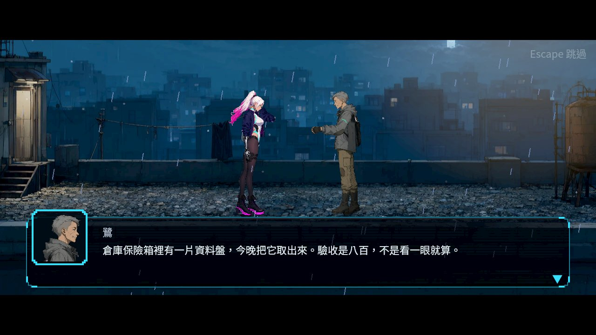
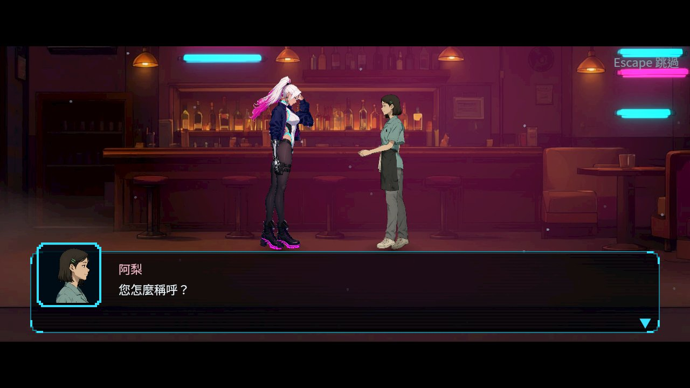
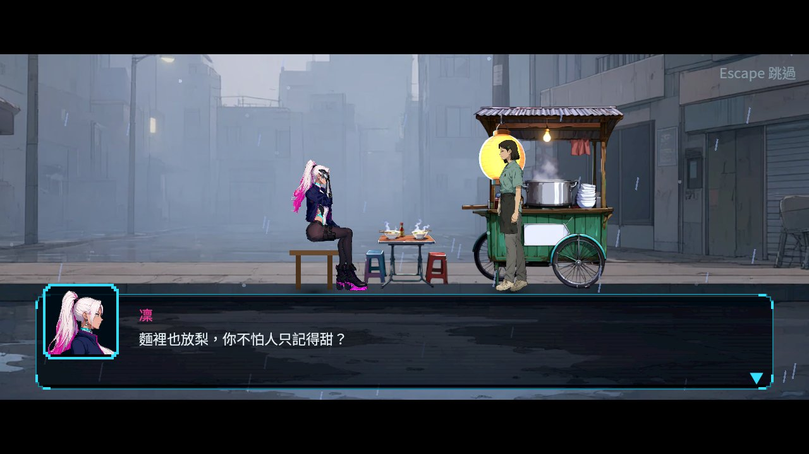

分支：`feature/ecstatic-einstein-gyjqmu`，提交 [a1ce019a](https://github.com/deadline314/Nest-Egg/commit/a1ce019a20c3030ccfa35aa1016abf883a1fb4c4)。晚飯仍是走進真廚房時的地圖對話（序章到第一章的銜接不換舞台）。

# Commit-7

## 內文

「台詞照劇本的順序播出」之前只靠人看，舊的第一、二章劇本也還跟正式劇本一起載入，正式流程和歷史格式測試混在一起驗。
現在第一章流程探針會記下整條路線實際播出的每一個場景，並對照劇本第 2.2 節的主線順序（晚飯 → 屋頂差事 → 電話亭錄音 → 初次建檔 → 交盤 → 認識阿梨 → 麵攤去留 → 回家），任何一段提早或缺席都會失敗；播出紀錄存成清單，可以和劇本逐場對照。舊稿只在開發版給舊示範關卡與歷史測試（ST-2），發行版只讀正式章節，正式流程另外驗。
兩條宵夜路線都依劇本順序播完、只播第一章正式場景（付清回家 44 段、留下吃麵 50 段以上），主線任務全數完成；四條路線的逐狀態主線模擬沒有任何空檔。

### 測試結果

| 項目 | 結果 |
|---|---|
| 第一章流程探針 | 付清回家 0 失敗、留下吃麵 71 項 0 失敗；劇本主線順序 8 個事件依序播出 |
| 主線逐狀態模擬 | prologue／skip／stay／leave 0 空檔，stay、leave 到章末 |
| 完整測試（CI，ST-2 的提交） | [run 281](https://github.com/deadline314/Nest-Egg/actions/runs/38179939678) 通過 |
| 待本機原生驗收 | 真人整章通關（含戰鬥與第一次死亡的實際順序）、退出後冷續玩 |

播出紀錄：[付清回家](attachments/ST-9-scene-order/leave.txt)、[留下吃麵](attachments/ST-9-scene-order/stay.txt)。

分支：`feature/ecstatic-einstein-gyjqmu`，提交 [aab72a24](https://github.com/deadline314/Nest-Egg/commit/aab72a2494fbfbc48ece6c40e348b5d5b03c3725)。還沒完成的三項：交盤與付款的道具動作（另有 NE-278 收起武器）、依使用者審查後的劇本調整演出（ST-1）、結果只在成功保存後生效。

# Commit-8

## 內文

麵攤的去留決定之後，帳只在對話文字裡結清：說「我先結這張」或「欠條先留著」時，畫面上兩個人站著不動，阿梨答應留人請麵時也沒有任何動作。
現在付清時凜說完話走到攤前把錢交給阿梨、留欠條時把紙交過去，阿梨答應留人時把麵端到桌上，都伴隨一聲交付音效，做完回到原位，接著的段落站位一致。交盤與回家的道具動作還沒有（交接櫃是地圖上的互動，另有 NE-278 先處理互動時收起武器），本條維持未勾。

### 測試結果

| 項目 | 結果 |
|---|---|
| 受影響範圍（原選擇器） | Chapter1Map 1,981 項、0 新失敗、0 已知失敗 |
| 第一章流程探針（留下吃麵、付清回家） | 兩條都 0 失敗 |

### 截圖

雲端軟體 Vulkan（Forward+），過場逐段截圖工具拍下付清的那一段：凜在攤前交錢後走回原位。

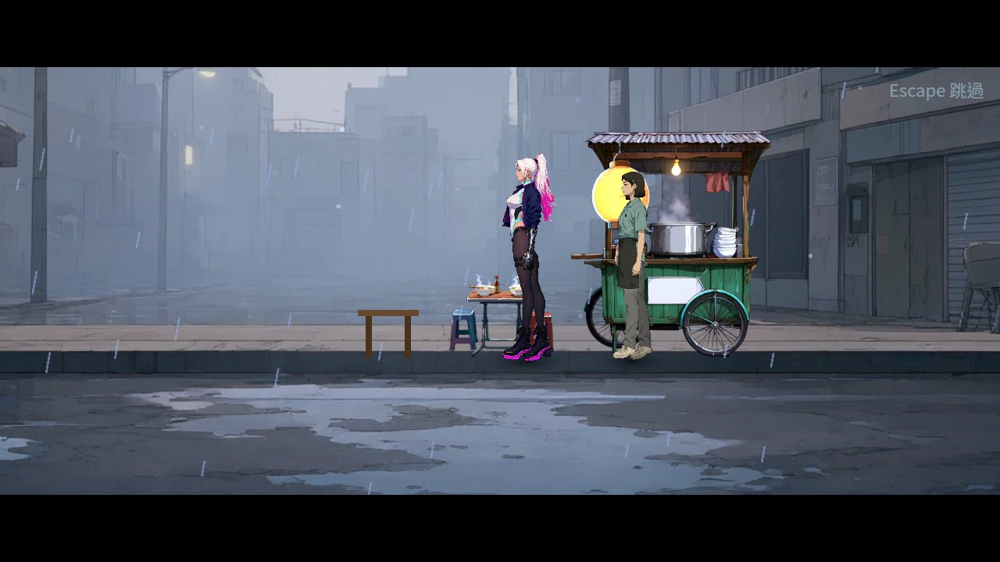

分支：`feature/ecstatic-einstein-gyjqmu`，提交 [6ef88d2b](https://github.com/deadline314/Nest-Egg/commit/6ef88d2b0e015d042295f555da78f548ebc4e3ba)。

---

# Commit-9

## 內文

段尾結果若混入壞資料，原本可能先扣餐費，再略過壞旗標。現在內容檢查與段尾結算先核對整份資料，錯誤會指出場景與位置，拒絕這份結果，保留錢、收據、物品與旗標。

真正餐費交易的15類壞資料負控制有42個預期失敗；修後第一章地圖、連續性與過場三組2414檢查、0新／已知失敗。正常200付款、收據和合法旗標仍成立。這是壞資料防護，沒有將完整保存接線或道具演出當成已完成，原未勾條件保持。

[研究、來源、全部失敗與修後log、精確SHA與重跑方式](attachments/ST-9-result-validation/README.md)。本次沒有改遊戲畫面；原選擇器、filter及known failures不變。

# Commit-10（自動回家完成保存，進行中）

## 內文

回家演出或略過後，兩旗標與完成紀錄原本在保存失敗時仍立刻發布。現在先由共用旗標模組真正保存，再退休原請求及通知等待者；拒絕保留原入口與未完成狀態，明確重試，成功才繼續章末。原通訊入口與工具保持相容。

修前同一535檢查有7預期失敗；最終原66組65262檢查、0新／已知，604秒。真 Main 自動回家、略過、兩次拒絕與按鈕重試、新程序恢復未完成／已完成結果，修後41檢查0失敗，採用五次原生均0 ERROR／SCRIPT ERROR。軟體Forward+、前提由正式結果操作安排，不代稱真人完整通關。

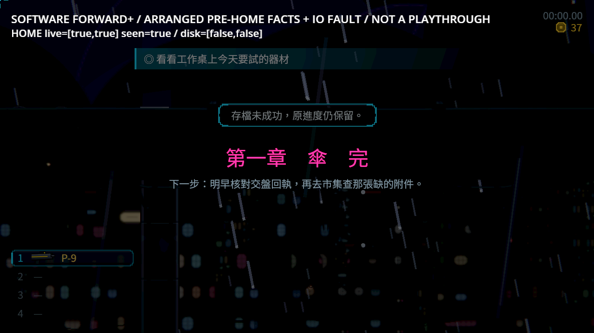
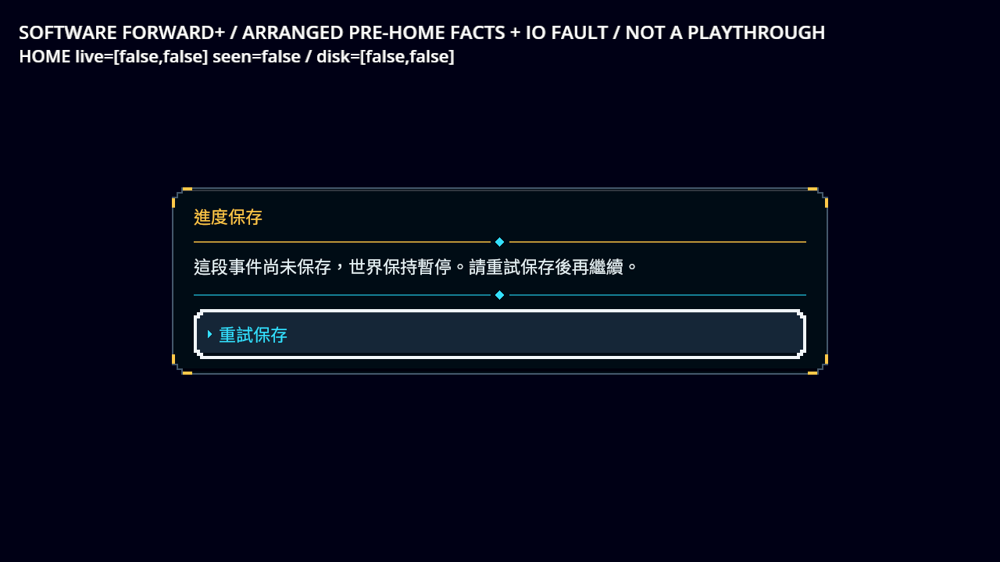

[實際演出、兩個新程序、五款參考圖及全部原始證據](attachments/ST-9-home-completion/README.md)。Main限定的旗標政策只套目前自動回家；通用交易／物品／世界coordinator及交盤、吃麵、關爐裝水的必要道具演出仍續作，三條整票條件保持未勾。

# Commit-11（交接櫃獨立段落保存，進行中）

## 內文

保存失敗時，交盤、取回執與留摘要原本仍發出完成並讓人物互動返回成功。現在三個明確操作與晚飯段先真正保存，成功才同步物品、旗標、錢包／收據與完成紀錄；拒絕保留原件與原請求，明確重試。成功重試會換掉舊失敗訊息。多筆交易也改為整段累計預檢，避免後筆缺錢、重複或互斥時留下前筆。

原生同探針修前11項有3預期失敗，修後11項全過；三操作各兩次拒絕後成功共73項全過，新程序續玩5項全過。通知回呼的普通花費與NEW閱讀保持，四個最終原生log皆0 ERROR／SCRIPT ERROR。受影響原選擇器：checks: 65524, new failures: 0, known failures (tests/known_failures.txt): 0  (wall time 501 s)。原斷言與過濾規則不變。

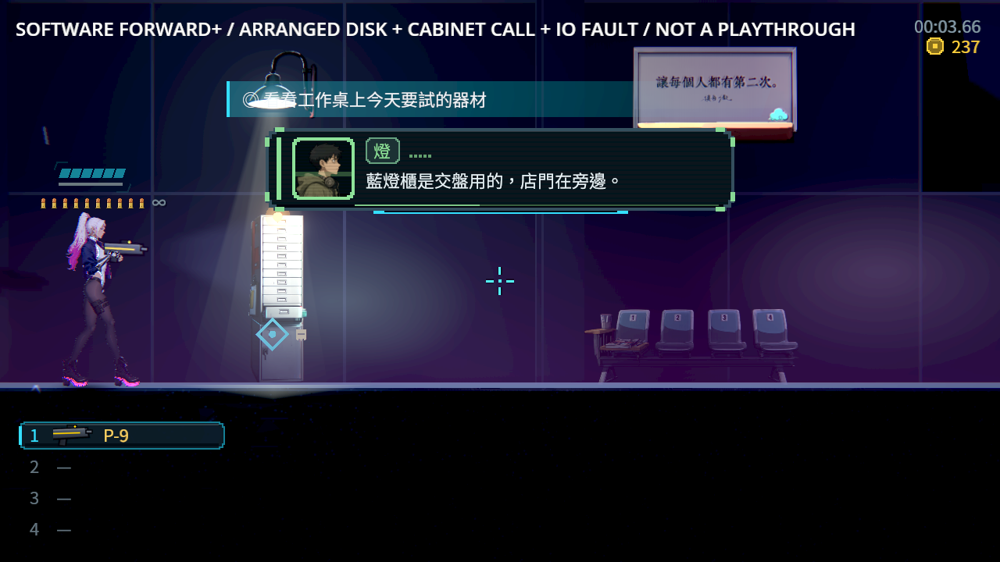

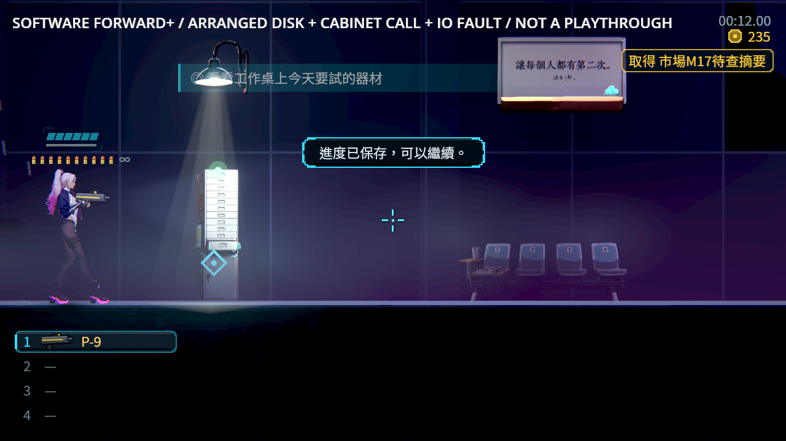

[研究、來源、歷史失敗、真冷續玩與全部原始證據](attachments/ST-9-terminal-results/README.md)。軟體Forward+、安排前提與真櫃互動呼叫，不代稱真人整章／實體手把；全票原三條條件維持未勾。

原備份恢復另驗：修前同提示未更新14項有1預期失敗，修後14項全過；最新main整合後恢復14、普通流程73、新程序5項全過，三輪原生均0 ERROR／SCRIPT ERROR。正式入口恢復的細節與全部早期失敗保存在上述附件，沒有以雲端軟體渲染代稱實體裝置驗收。

合併後第一輪曾有近戰程序原生崩潰，整輪判失敗並保留；上述最終結果為原條件完整重跑，附件含基準對照與全部C++地址，不宣稱已定位該次崩潰。

# Commit-12（世界道具取得先保存，進行中）

## 內文

保險箱取盤原本在存檔拒絕時仍放進背包、完成目標，世界上的盤也消失。現在先一起保存物品、目標與真正世界來源，成功才消耗原盤並通知取得；失敗則保持原件、暫停世界，讓玩家重試或放回。放回後須離開範圍再取，不立即重開提示。

真正寫入拒絕、解除故障後重試、放回再取、通知中的正常金錢／已讀變更，以及另一程序續玩都通過；已提交異動與回滾失敗顯示不同恢復提示。最終原受影響63組65,130項、0新／已知失敗；原生修前14／5、修後七程序156／0，八程序0引擎／腳本ERROR，18張原圖逐張檢視。三語120%、720p與1080p一起核對。

[真來源、前提安排、研究圖與全部歷史失敗及原檔](attachments/ST-9-world-items/README.md)。本次涵蓋正式Main的世界劇情道具邊界，不把NPC贈物、一般補給、全部故事交易或必要道具動畫一併當成完成；整票三條原驗收保持未勾。

| 修前 | 修後 |
|---|---|
| 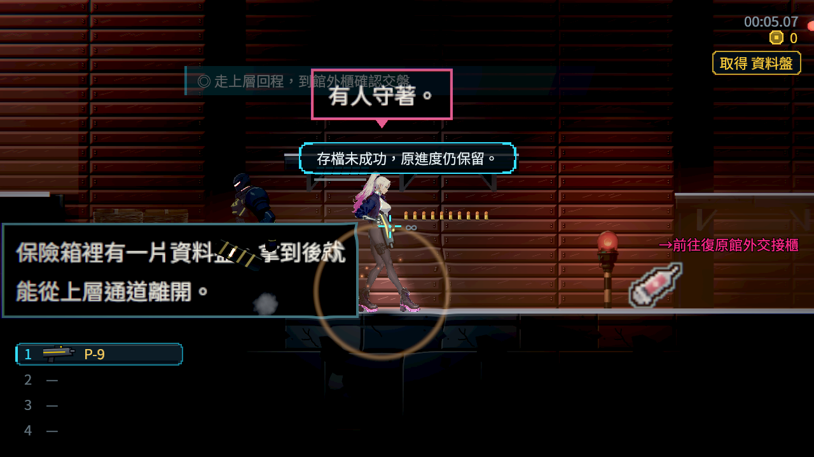 | 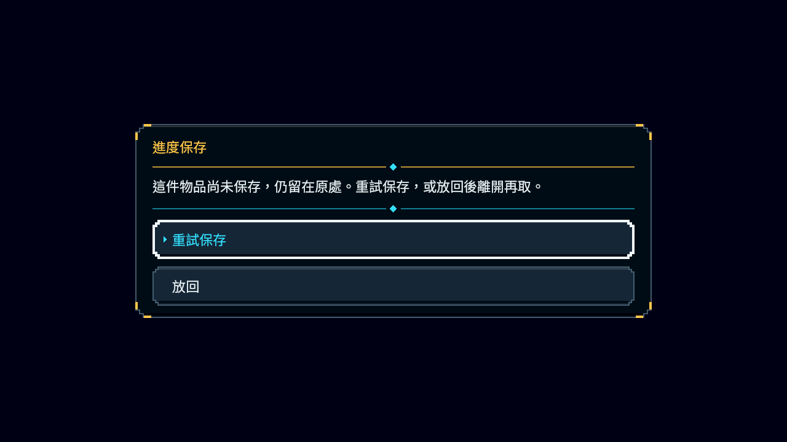 |

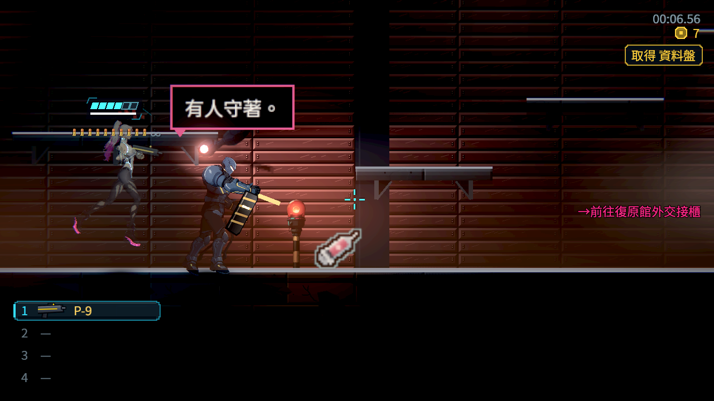
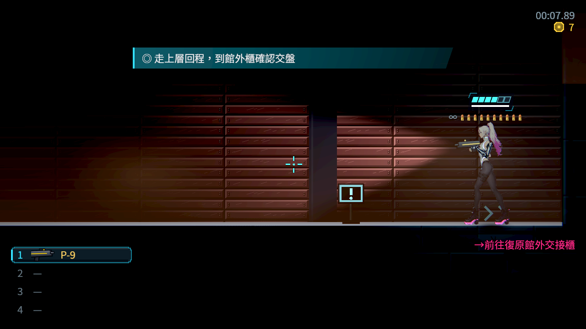
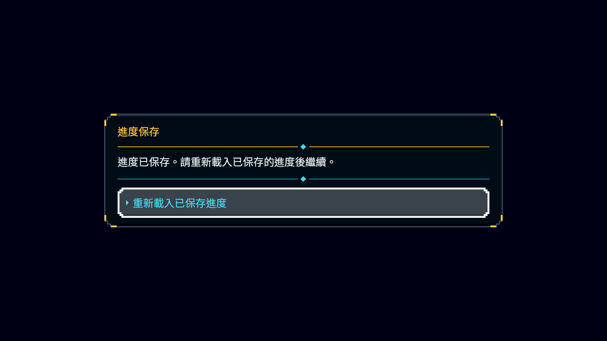
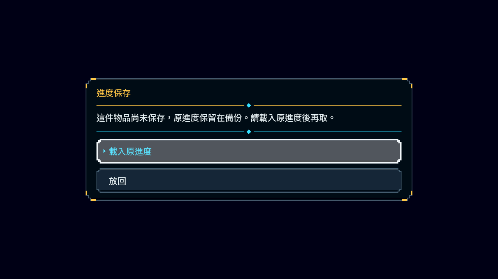
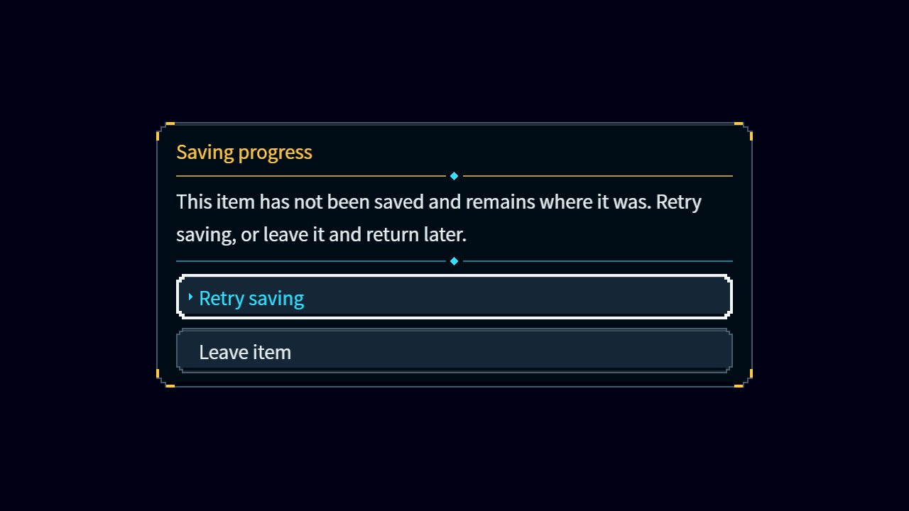
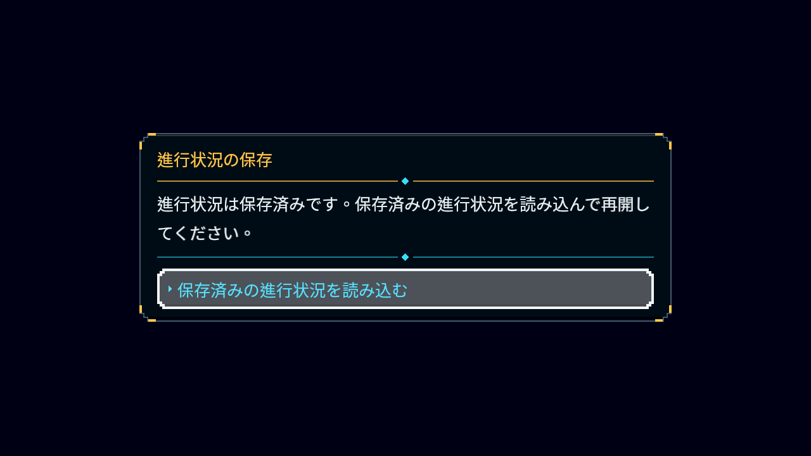
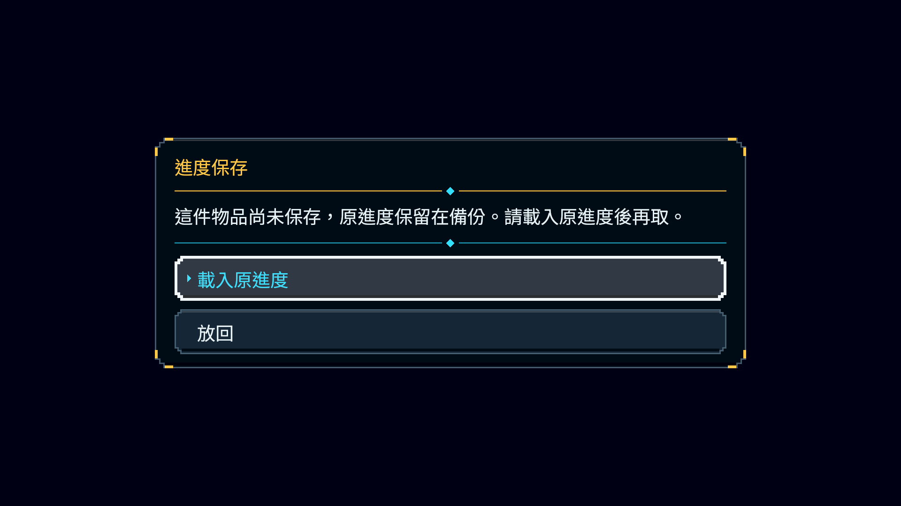

# Commit-13

## 內文

四個當舖標籤與屋頂首次差事簡報，原本可能在保存失敗時仍算讀完。現在真正保存成功後才更新任務、已讀與交談次數；拒絕時保留原狀、維持暫停並提供重試。中途退出再續玩會接回原互動物件；提交後原物件消失則讀回已保存結果，次數仍只算一次。對話中途讀檔時立即定位鏡頭，避免暫停畫面落在地圖外。

先讀User-guide與原保存研究，保留真IO負控制、來源不符的冷續玩失敗及同檔修後對照。[設計與參照](../../design/20-campaign-experience/NPC_TERMINAL_COMPLETION.md)、[全部原檔與原生圖](attachments/ST-9-npc-completion/README.md)。

### 測試結果

| 項目 | 結果 |
|---|---|
| 原正式程式、真IO拒絕 | 14／5失敗；0引擎ERROR、0腳本錯誤 |
| 四個真標籤的原保存回歸 | 政策停用586／8，啟用606／0；原斷言／輸入／等待保持 |
| 同一原檔的中途續玩 | 未接回來源5／1；修後12／0，再驗拒絕／重試 |
| 冷讀暫停時的實際視野 | 同原檔18／1→18／0；最終重跑加入主角位於viewport內的檢查 |
| 最終原受影響範圍、基準a651df03 | checks: 63403, new failures: 0, known failures (tests/known_failures.txt): 0  (wall time 1187 s) |
| 十五個原生程序、最新30圖 | 246／0，0引擎ERROR、0退出洩漏診斷；全部逐張檢視 |

### 本作原生圖

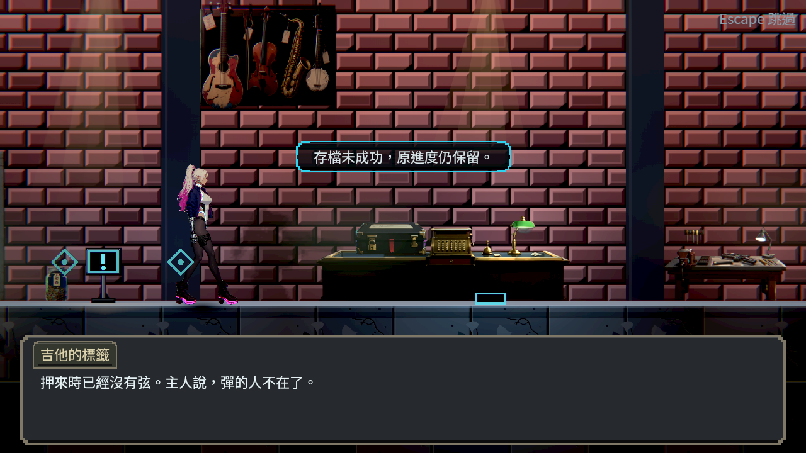
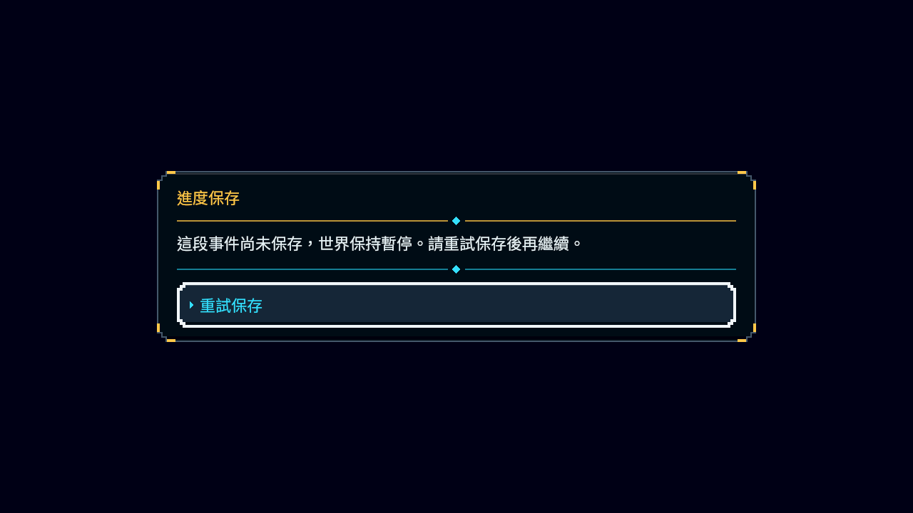
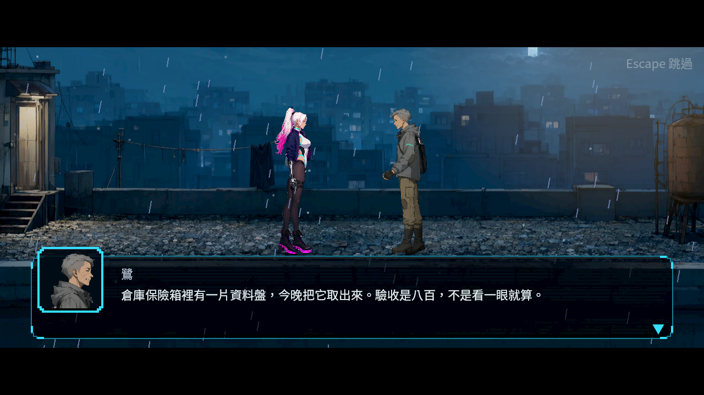
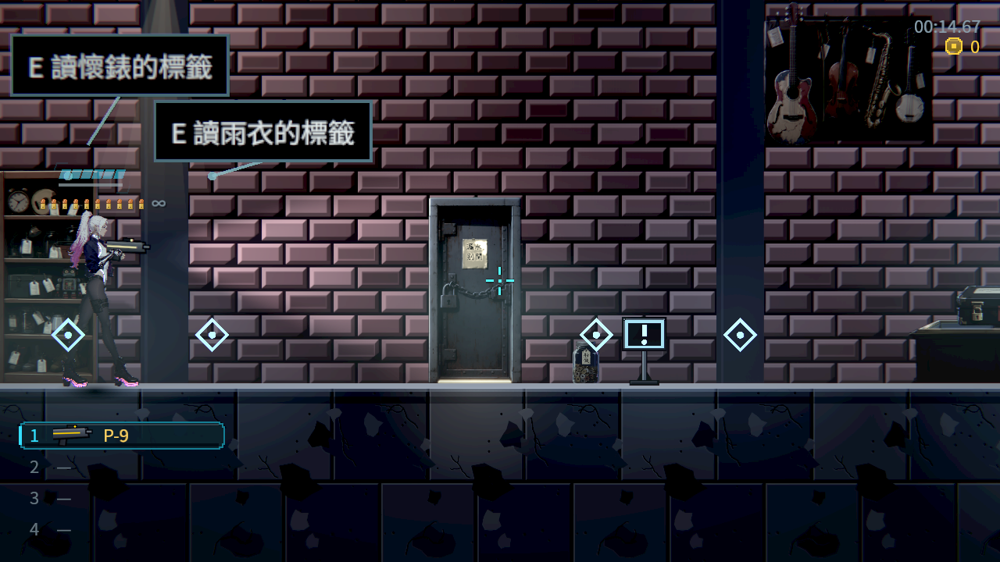
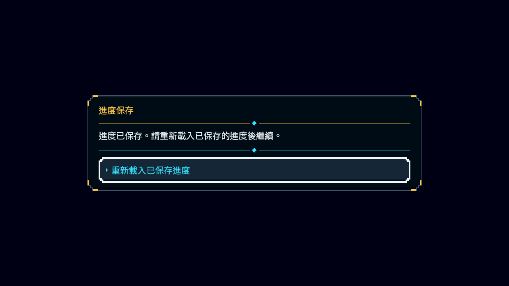

# Commit-14

## 內文

通訊遇到需要修復完整進度的狀態時，原本只提供無法成功的重試。現在可載入原進度再聽，保存前不發布通訊完成、旗標或額外物品，取消及世界暫停保持。

### 測試結果

| 項目 | 結果 |
|---|---|
| 真磁碟修前／修後 | 613／1失敗→613／0 |
| 七組受影響回歸 | checks: 3544, new failures: 0, known failures (tests/known_failures.txt): 0  (wall time 188 s) |
| 正式Main原生恢復 | 15／0；0引擎錯誤與退出洩漏，兩張圖逐張檢視 |

[設計、參照、原檔與驗證界線](attachments/ST-9-radio-repair/README.md)。

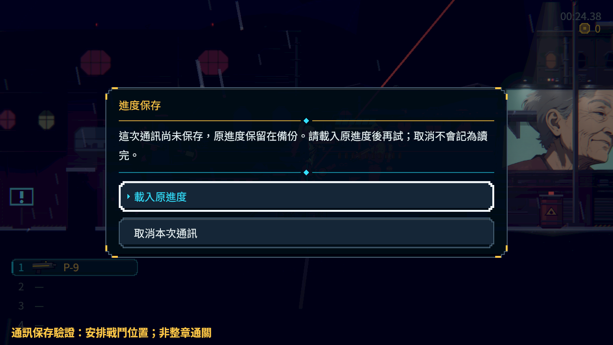

# Commit-15

## 內文

拾取物與沒有交談對象的劇情末段，在需要修復完整進度時，原本仍只提供無法成功的重試。現在可明確載入原進度；拒寫前後不先發物品、獎勵或完成旗標，恢復後保留原進度與未完成來源，解除暫停與舊提示。

### 測試結果

| 項目 | 結果 |
|---|---|
| 真磁碟writer原回歸＋12項 | 625／2失敗→625／0 |
| 七組受影響回歸，最新main合併結果 | 3568項／0新／已知失敗，115秒 |
| 正式Main實際資料盤 | 原生15／3失敗→15／0 |
| 正式Main自然晚飯鏈 | 原生17／3失敗→17／0 |

四輪原生均0引擎錯誤及退出洩漏，八張圖逐張檢視。前置失敗、明示路線安排、非致命下限及舊狀態控制完整保存；不以局部通過代勾通用故事結果條件。[設計、同類作品、完整原檔與驗證界線](attachments/ST-9-repair-owners/README.md)。

### 實際恢復提示

| 實際資料盤 | 正式晚飯末段 |
|---|---|
| 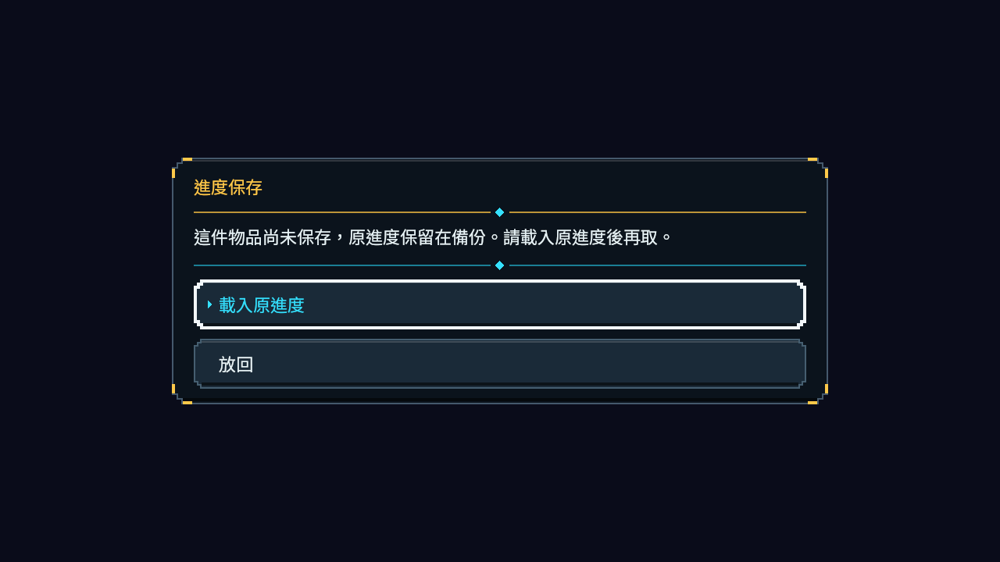 | 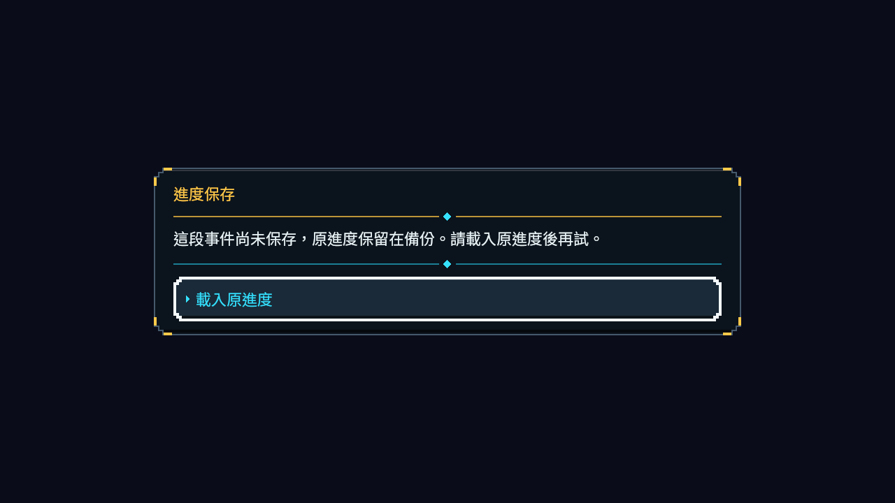 |

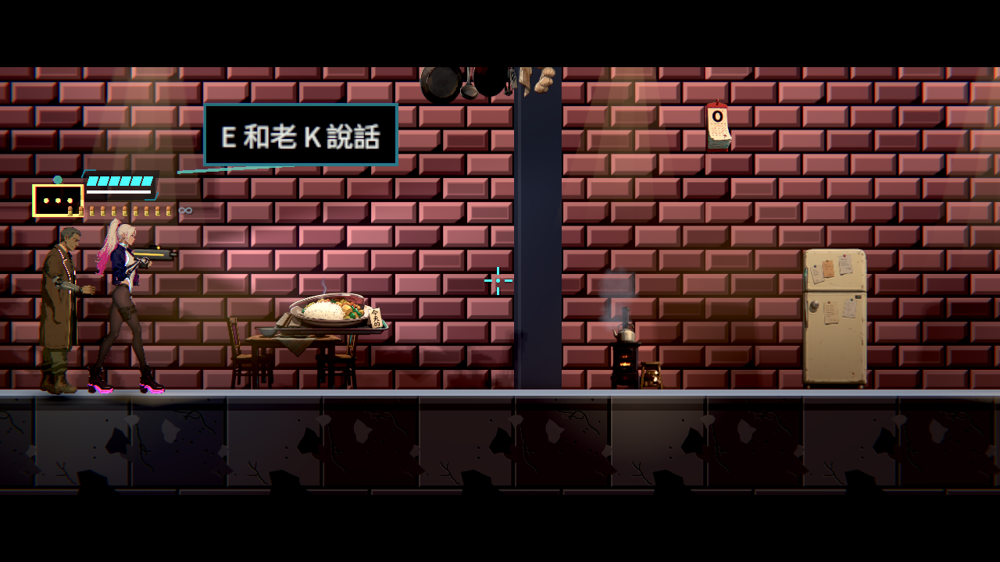
