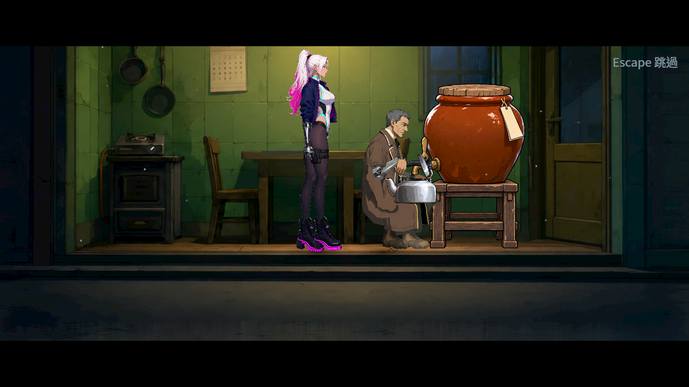
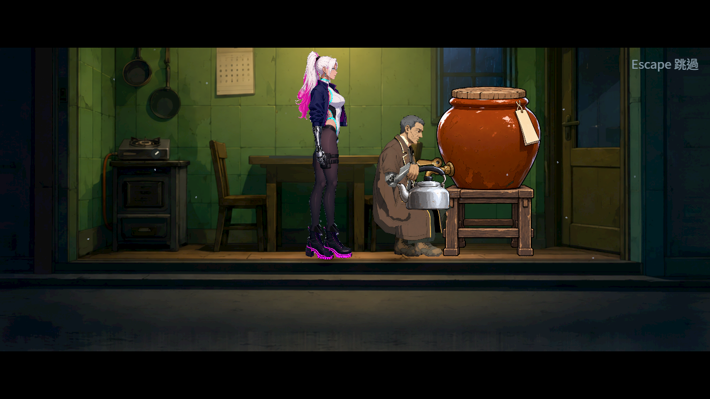
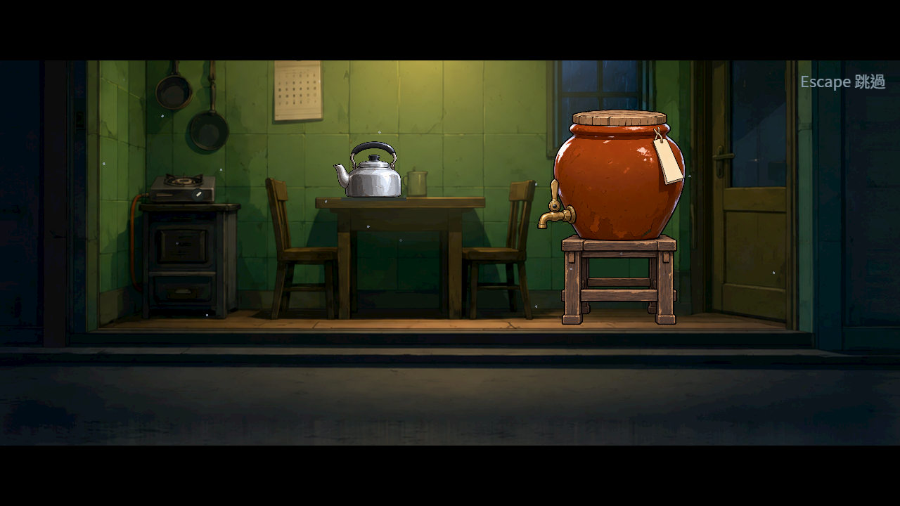

# ST-10：正式返家關爐與裝水

2026-10-26（Asia/Taipei）。凜實際轉爐鈕，老K握同一把壺、開鉸鏈蓋、操作水缸控制桿、裝水、關水關蓋，再把滿壺放到耐熱墊。保留原台詞、任務／物品／經濟結果、三秒遺忘停頓與60秒預算；現行估算44.14秒。吃麵與交盤伸手仍未完成，本母票保持進行中。

## 正式畫面與接觸

真正Main以正式末區自動觸發返家；前置透過既有正式段落結果安排，台詞只在打字完成後由探針推進。Forward+ HDR、Vulkan llvmpipe軟體、Godot4.7.2，原生1280×720 PNG，未縮放或修圖。不是真人整章、實體GPU或手把手感驗收。

以下兩張也來自同一次真正Main，使用正式步序，沒有插入拍攝停頓。逐格觀測保留關火、提壺、搬運、開蓋、入水、水面、關蓋、放下八個階段。

## 驗證與控制

- 真正Main自然播完、裝水中取消及重入：16／0；裝水途中送出Escape跳過：11／0。實際磁碟讀回既有home_done／complete與章節結算，沒有提前發布或殘留操作鎖。
- 真正新程序Main讀已接受的結算，再另建登記的舞台預設：7／0。後段舞台重建用於檢查冷壺預設，**不是完成後可操作的廚房地圖**；滿壺在墊上，爐與水流關、蓋關。三組最終原生合計34／0，均exit0、0引擎ERROR／洩漏。自然流程188個全權重接觸取樣最大0.000126舞台px，握持最大0.0000853px，包含換點途中。
- 早期0.8背景版本的獨立編舞首輪8／1、接觸誤差128.769px，另看見凜擋住裝水；修正站位、起身抬手節奏及過近的放壺站位後8／0，599個接觸取樣最大0.000123px、握持0.0000853px。兩輪原生圖與完整輸出都保留；當時Story JSON未逐輪凍結，**不宣稱擁有可重建的歷史執行來源雜湊**。
- 已將正式編舞加入CutsceneSuite，以真正派發器、人物0→道具10→觀測100的更新順序檢查全權重接觸，包含尚在換點的過程。早期單一負控制只把起身抬手1.2秒改回0.5秒，同一檢查8／1、128.49274px；正式資料8／0。沒有改骨長、判定門檻或選擇器。最後的新幾何／路徑再試同一0.5秒控制為8／0，沒有重現早期失聯，原輸出亦留；不能把0.5秒說成所有站位都會失敗的門檻。正式演出維持1.2秒平順起身。
- 素材管線4項unittest含路徑逸出、normal輸出碰撞、覆寫凍結來源、壞後筆不得部分寫檔、錯誤參數與確定性重建。三份color及normal重建SHA相同，import政策0項額外修改；原始生成圖不變。
- 最終原選擇器76組95,292項、0新／0已知失敗、515秒；檢查數、耗時、來源雜湊見[validation.json](validation.json)及raw內完整八份shard；不以早期單組測試冒稱最終全過。

## 來源、架構與研究

背景重新量測家具，未宣稱生成外區像素不變；甕身／桿與壺身／蓋在各自atlas分區，以來源像素支點組裝，半尺寸匯入仍保留世界尺寸。只握真接觸，不瞬移取物、不鏡像倒壺；弱引用、每舞台最多八件握持、隱藏水流停更新。近手穩定後才開蓋／轉桿，不把此編舞的驗證擴張成任意同步雙手搬動都已驗收。

來源與完整提示詞在[候選歷史](../../../../assets_src/candidates/st10_contacts_1026/README.md)，重建配方`assets_src/pipeline/story_staging_art.json`；共用grade、輪廓normal及import政策，不產假發光。閉壺空／滿外觀相同，滿水狀態由實際入水及開蓋時水面建立。有限指令、接點、鉸鏈、時鐘及重建契約見[設計](../../../../design/20-campaign-experience/KITCHEN_PROP_CONTACTS.md)。

研究沿用已實看的Spiritfarer、Eastward、DAVE THE DIVER、VA-11 Hall-A、The Final Station官方Steam圖片；五個團隊的比例／支撐／分區觀察、來源與15張原圖見[候選研究包](../ST-10-kitchen-candidates/README.md)。只有每作第一張已實看，其餘有明確未看標記；靜態圖不證明逐格提壺動作，也不是玩家偏好調查。

## 保留的失敗

首次prop binding推斷型別造成腳本編譯錯誤，已改明確型別。父子圖集的631／8原是測試使用get_rect整數截斷尺寸，Godot實際繪製浮點region；對照引擎來源後只修量測，631／0。首個assembly探針呼叫錯誤pose方法而退出241，第二個誤等300秒守衛被手動停止；第三版才有有效畫面。第一次CutsceneSuite篩選誤用小寫而跑0項，不算通過。編舞負控制探針首輪漏接runner._frames，重複腳本錯誤的兩份原始log保留為無損gzip，不算產品結果。冷讀首輪7／0但有四個音訊物件／兩資源未釋放，verbose證實是victory_sting，探針依既有退出流程停音訊並等待1.1秒後重跑乾淨。

首輪原選擇器實際89,774項、3項新失敗，另1程序沒有結束：兩項是新餐桌0.53H與整體場景契約，另一項為12次同時爆炸的原6ms預算（+6.82ms）；崩潰發生在Enforcer套件後、HeavyEnemies完成前，C++記錄/root跨執行緒通知與signal11。原始基底與本次版本各重跑相同11組，均5,500／0（291／289秒），沒有再現，**不能宣稱已定位或修好崩潰根因**；OOM紀錄為零。

餐桌實際縮放／對齊修正後，四組重跑的家具與效能項通過，但仍抓到1項換點接觸（69.05234px）。再修爐鈕站位與轉角、提壺向上繞過肩部內圈，完整編舞8／0；數值通過後也改站位避免身體遮住爐鈕，重新走Main。中途Main探針把新爐座x誤抄為104.625而非97.8125，15／2屬探針預期錯誤；改由正式scene初值核對後才有最終16／0。原3張缺漏動作圖也改為逐一觀察所有已完成步驟，八階段皆真實拍到。沒有改比例表、效能門檻、known failures或測試選擇器。

另列兩張本批實看的既有官方參考圖，來源與原始下載紀錄見[餐點素材包](../ST-10-meal-props/README.md)。只借比例、坐姿支撐與角色分區，不當逐格吃麵／提壺證據或玩家喜好民調。

## 重跑與封存

以本次提交為基底；raw.zip的`work/st10-kitchen`解壓到同名暫存路徑。`choreo_check.tscn`走正式資料，`--negative`只作上述0.5秒單因素負控制。`actions.tscn`是獨立拍攝診斷；`main.tscn`使用真正Main，必帶絕對`--slot`及`--out`，`--mode=natural|skip|cold`，cold使用natural實際寫出的同一slot。每次用獨立XDG_DATA_HOME，不碰玩家存檔。原生需Forward+ HDR，音訊Dummy；wrapper的絕對環境路徑須按本機調整。

raw保存本次來源、Git基底文字、未變選擇器／filter、探針、全部初稿／負控制／最終輸出、原生PNG、素材receipt及前票d7c50ec3完整CI的真job（96,974／0、662秒）。manifest逐entry回讀bytes與SHA，候選原始PNG本身已追蹤於repo，按來源manifest核對，不在zip再複製一份。人物接縫、實體裝置與吃麵／交盤的母票條件維持，沒有代勾。

封存：raw.zip共293個entry、24,252,938bytes，SHA256 `645a82ec8d6d0391a5532cfee32ba7994c08c63a092cbdff343f2e3b3b203bbc`；逐entry解壓回讀核對完成。
