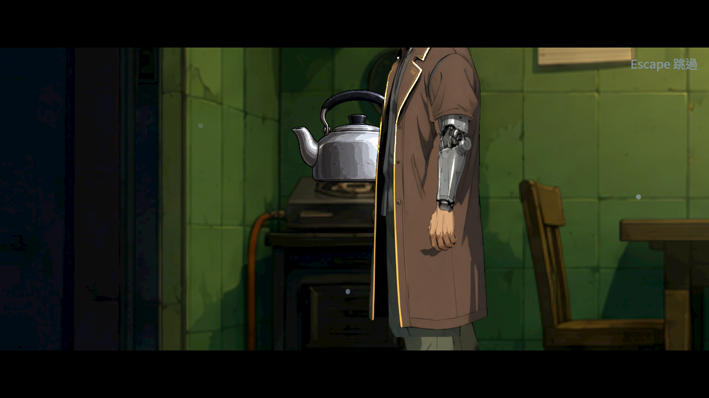

# ST-10：廚房道具拆層候選

2026-10-22（Asia/Taipei）。本批交付可追溯的素材候選與原生比較，沒有採用至正式舞台或勾選整票。原本背景將爐壺畫死，不能直接移壺；新候選把壺拆出並提供可辨控制鈕的瓦斯爐。原舞台、人物、故事與其他Session的素材保持。

## 來源與實看研究

原背景及既有爐壺道具先實看，再以生成工具分別編輯。兩份原始輸出、requested/actual尺寸、來源及輸出SHA、RGBA範圍、完整prompt和未提供的seed/model/job見[候選來源](../../../../assets_src/candidates/st10_contacts_1022/README.md)。不是本機ComfyUI工作，也沒有外區逐像素保留或正式normal/glow驗收。水壺全圖alpha>0的bbox含微弱殘點，不能把它當成壺身底面。

raw.zip的references含15張官方Steam圖及來源JSON，實際看的是每作-1.jpg，共五個不同團隊；未看的10張標viewed=false。Spiritfarer的建築剖面、Eastward的戰鬥層次、DAVE THE DIVER的餐廳座位與檯面、VA-11 Hall-A的調酒區和人物文字分區、The Final Station的樓層支撐各有可借的靜態資訊。它們不證明逐格進食／提壺動作，不是玩家偏好調查，研究圖不當本作驗收圖。

## 原生範圍與失敗

Godot4.7.2、Forward+ HDR、Vulkan llvmpipe軟體、1280×720。真正CutscenePlayer播放正式返家的舞台、鏡頭、兩人倍率與凜走入；停在對話之前，不發正式結果。接著只在此preview的記憶體替換背景並加入獨立壺，正式資料無變動；最後鏡頭推近只查候選擺位，不能算正式構圖通過。圖片以原生HDR→sRGB擷取，未縮放PNG。

- V1：11項、2失敗，exit1、0引擎ERROR。preview誤等步驟5完成，但步驟5正是60秒等待；另外浮點全等及把透明殘點當壺底的檢查有問題，原生圖也看到壺浮起。全部保留，不算產品退化或通過。
- V2：12項、0失敗，exit0、0引擎ERROR。等正式走入步驟4結束；依主要壺身範圍另校候選尺寸與底部。只是preview載入、演員位置、候選輸出與指定座標檢查；仍須實際接觸／遮擋與手部接點驗收，不以這個數字宣稱已不浮空或可正常裝水。
- 原選擇器：本票只改文件與未引用候選，0個受影響遊戲套件，不稱全套遊戲通過。最新正式main a7c4f50a完整CI另為95,959項、0新／已知失敗，raw保存完整job log。

## 畫面

## 重跑

解壓raw.zip的work/st10-contacts到專案同名暫存路徑，候選原始PNG放其candidates子目錄。以原生Godot執行`res://work/st10-contacts/preview.tscn -- --out=<絕對目錄>`，使用獨立XDG_DATA_HOME；原包亦保存本輪wrapper、引擎版本及退出碼。probe不保存遊戲、不套用正式故事結果。

manifest逐entry列bytes與SHA256，所有zip entry回讀核對。此包保存兩版probe、兩輪原生圖／log／exit、原始生成圖、研究圖、來源及CI輸出。原生畫面未替代實體GPU／手把與真人全章遊玩。
