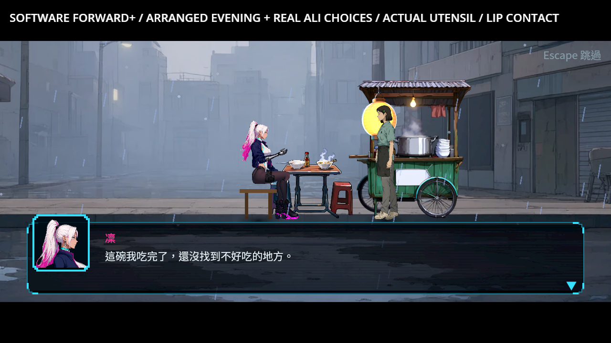
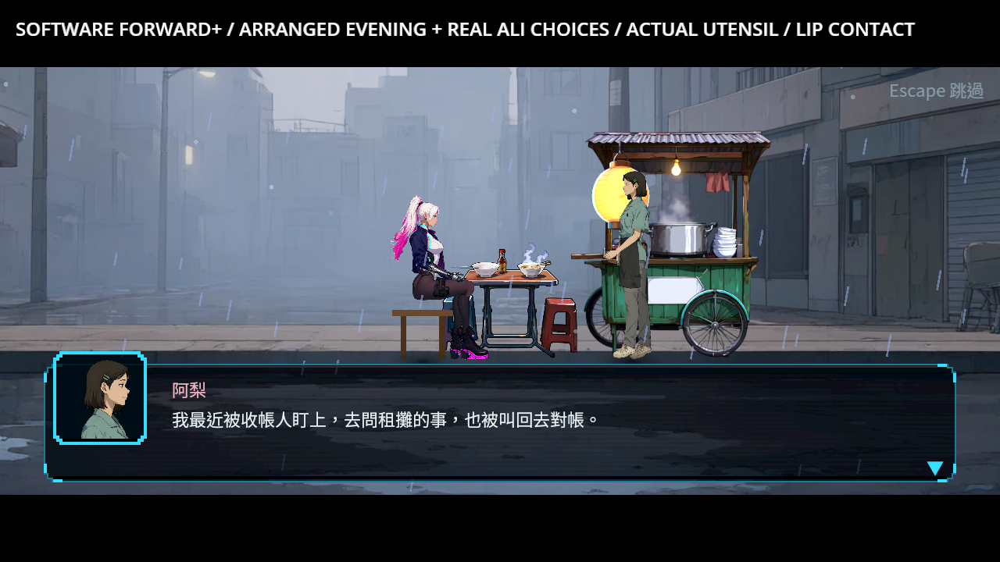
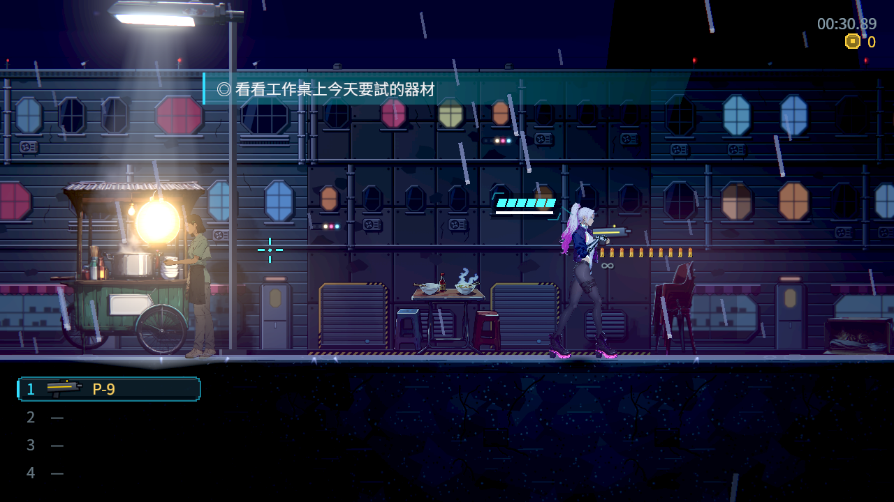
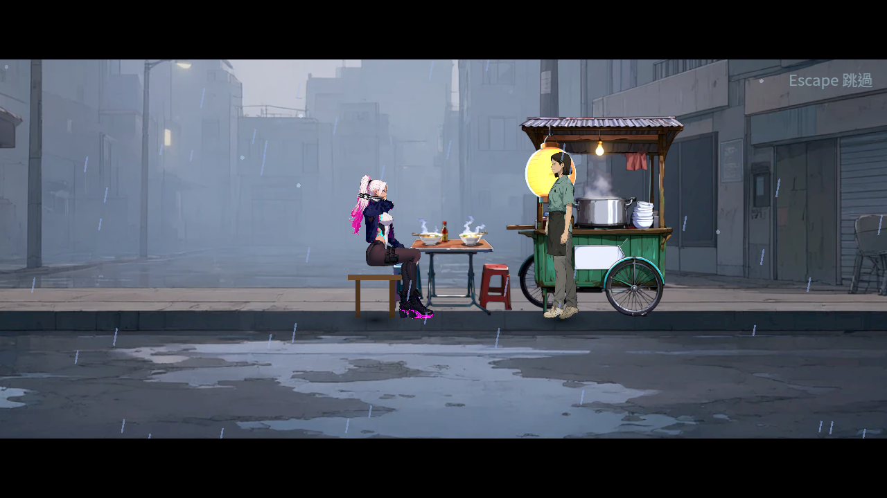
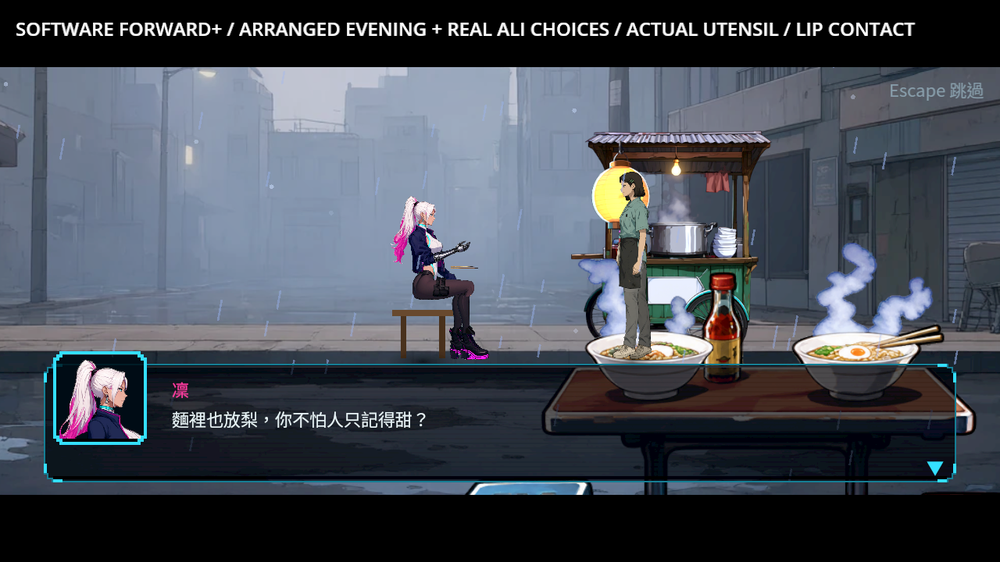
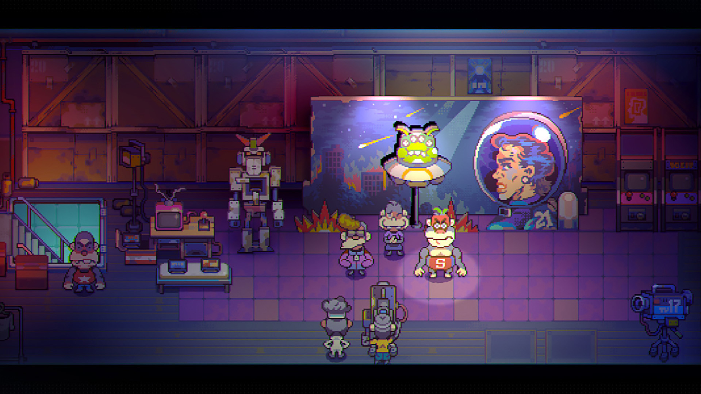

# ST-10：真正持筷進食與餐後地圖

2026-10-26（Asia/Taipei）。凜用既有握持手圖取起同一雙筷子，從左碗取麵、從臉前送入口，實際筷尖碰到呼吸中的嘴唇後食物才消失，再把餐具放回左碗並收手。保留原對話、選擇、原餐後左碗空／右碗有食物與原結果擁有者；短動作是一個吃麵節拍，不宣稱一口吃完一整碗。

地圖也依真正的餐點完成旗標重建餐後狀態。舞台去掉烘入的左筷，因為有同一實體餐具；地圖餐後變體有一雙放回碗邊的筷子。桌碗不自發光，避免舊glow留下固定筷影；攤車與燈籠光仍沿原設定。表面、normal、圖集與前後狀態由同一來源管線製作；舊入口委派同一製作者，舊Qwen表格條目保留為來源歷史。

## 實際原生畫面

本批是Godot4.7.2 ed1daf0bf、Forward+ HDR、Vulkan llvmpipe軟體。安排既有晚間結果，以真Main／真阿梨、明示stay／accept選項走正式段落。拍攝會展開文字，其餘推進等文字完成；動畫沒有插入診斷停頓。跳過呼叫既有Story skip API，不冒稱實體Escape或手把操作。冷地圖先檢查真正遊戲鎖與狀態，再暫停玩家物理、固定鏡頭水平位置拍攝，新增完整餐桌在框內的檢查；不是人類整章通關、自然實體輸入或硬體GPU驗收。

## 驗證

原選擇器80組、97,241項、0新／0已知失敗、507秒。原斷言、filter與known failures未更動。原餐後狀態14項與原廚房機械回歸保留；新檢查包含閉手／旋轉、具名部件、真碗／筷尖、世界／舞台尺寸及餐後地圖。

| 實際Main案例 | checks／failures |
|---|---|
| st10-meal-main-v4 | 22／0 |
| st10-meal-cancel-v3 | 26／0 |
| st10-meal-skip-v3 | 20／0 |
| st10-meal-write-v3 | 19／0 |
| st10-meal-read-v3 | 8／0 |
| st10-meal-world-v6 | 9／0 |

合計104／0，最終六程序0引擎ERROR／退出洩漏。全權重接觸最大0.00004316舞台px、持物0.00007629px、嘴唇0.00007629px；低誤差不代替看圖。原生取樣數與每份完整結果在validation.json。獨立接觸／繼承幫手857／0，實際機械與壞寬度控制12／0。素材工具原4項、匯入政策含新反例共4項通過；真正舊入口重建後14個PNG成品SHA與主製作者相同，304px作者來源座標不再被覆寫，見meal-final-pipeline-proof。

前批返家關爐86845791的真正完整CI為97,687項／0新／0已知失敗、533秒，run40237141943／job121301009049原始job log與receipt一併保留。本批CI另以本批實際提交追蹤，前批結果不當成本批CI。

## 保留的退件與錯誤

第一個水平送入口原型雖筷尖到點，手臂遮臉，退件。最初使用近戰握圖僅作原型量測，正式版使用通用持物握圖，沒有偽造武器／近戰狀態。

第一輪原78組95,617／0、525秒是清理固定筷圖之前的版本，不當最終通過。之後新貼圖從304變1370px，舊匯入工具覆寫source_width卻保留scale，桌子變306.469舞台px，手／餐具彼此的數值仍過；Main-v3圖實看退件。修正工具只補缺少的作者座標，新增舊工具1項預期失敗→修後4／0；正式桌寬68.004px，並額外核對餐具尖端真的在可見碗上。退件來源、log、PNG與新反例一起保留，不把早期數值過關稱作畫面通過。

另有850項／1失敗是測試把同父節點重名當歧義，Godot會自動改名；改成不同父節點的真重名部件後850／0，沒有改產品判定。第一次unittest模組入口相對匯入失敗，換成工具的script入口後4／0，錯誤log保留。world-v3的7項數值通過但照片把桌子裁到右緣，照片不算最終視覺證據；world-v4／v5在引擎取得真正落地前就暫停玩家，照片亦退件；world-v6等實際on_floor並加檢查，再安排拍攝站位與全桌取框，產品來源不變。

## 素材與研究

三份新生成RGBA原件、完整prompt、實際尺寸與SHA皆在assets_src/candidates/st10_meal_1026，原輸出保留。筷子1536×1024，桌面完整／餐後各1369×1149，向右／下補偶數畫布；工具未提供seed／model／job，記null。外區不是逐像素不變：下方桌椅alpha32 IoU0.9816728、右碗／蒸氣0.9869584，仍以原生支撐、尺寸及畫面核對。沒有用繪圖程式手補產品圖。原餐後地圖來源保留一雙休息筷子，右碗食物與蒸氣不移除。

研究沿用已實看的[五款橫向動作作品圖片與來源](../../../Nest-Egg/attachments/NE-278-references/sources.json)，並再次核對Spiritfarer座面／對話留白及Eastward人物層次。官方原圖及URL／SHA在raw.zip的references；靜態圖不當逐格吃麵動作、玩家偏好民調或本作驗收。

## 重跑與界線

最終來源基準及各輪before／after、原選擇器完整八份log、所有退件、原生程序結果、不可變來源、重建receipt在raw.zip；manifest逐entry讀回bytes／SHA。診斷腳本放回work/st10-meal後，用reproduction/native-large.py指定獨立profile／slot跑main.tscn，mode normal/cancel/skip/write/read；write與read共用隔離slot。world_grounded.tscn使用另複本，請依本次replay腳本的slot路徑調整工作目錄，不使用玩家正式存檔。再執行原tools/run_tests_changed.sh，GODOT指定4.7.2；素材入口為story_staging_art.py，舊story_prop_states.py會委派相同製作者。

本批不代勾整票最後綜合條件，不取代其他角色接縫、人工完整章節或實體裝置驗收。ST-10維持進行中。
