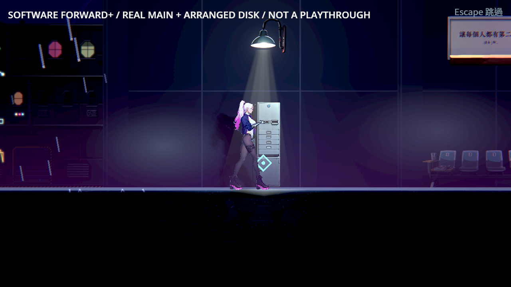
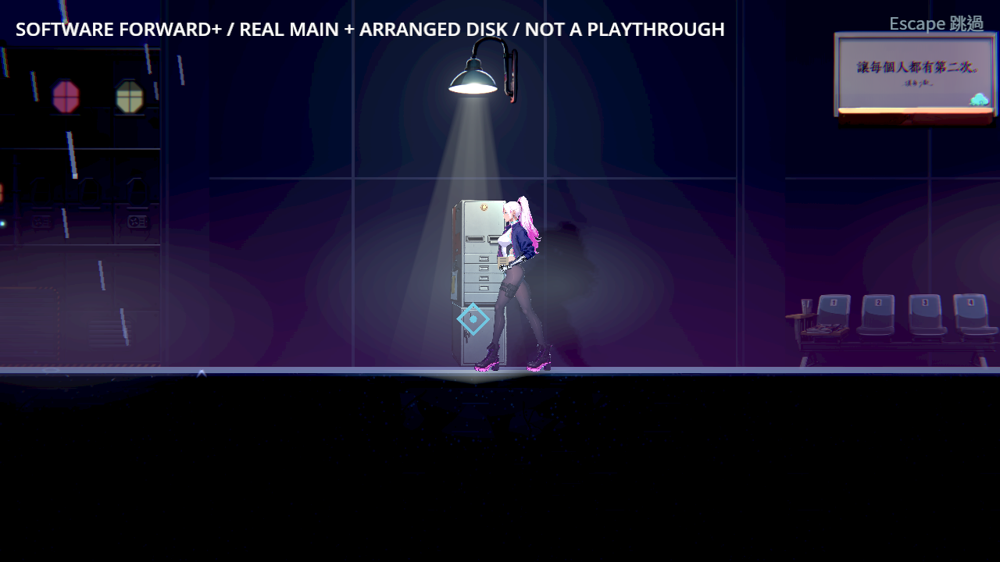
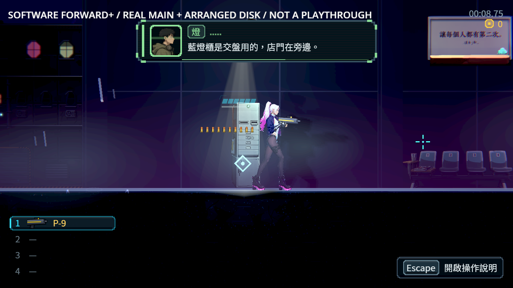
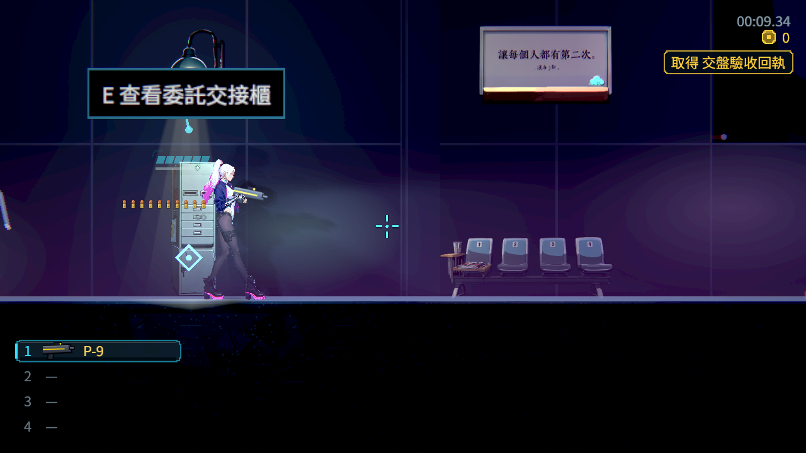
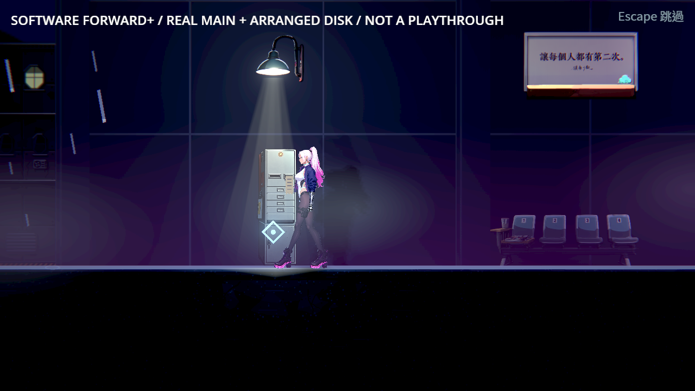
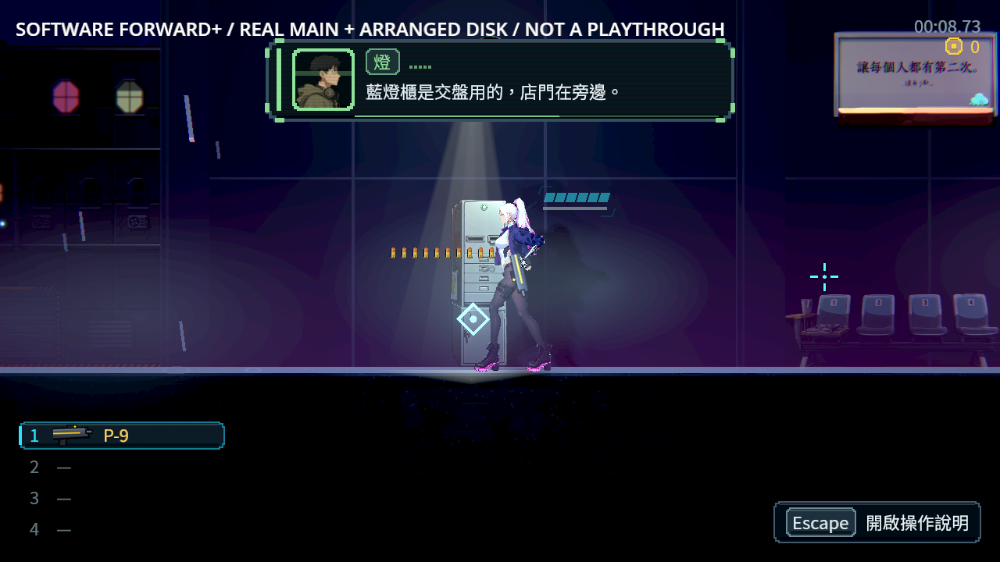
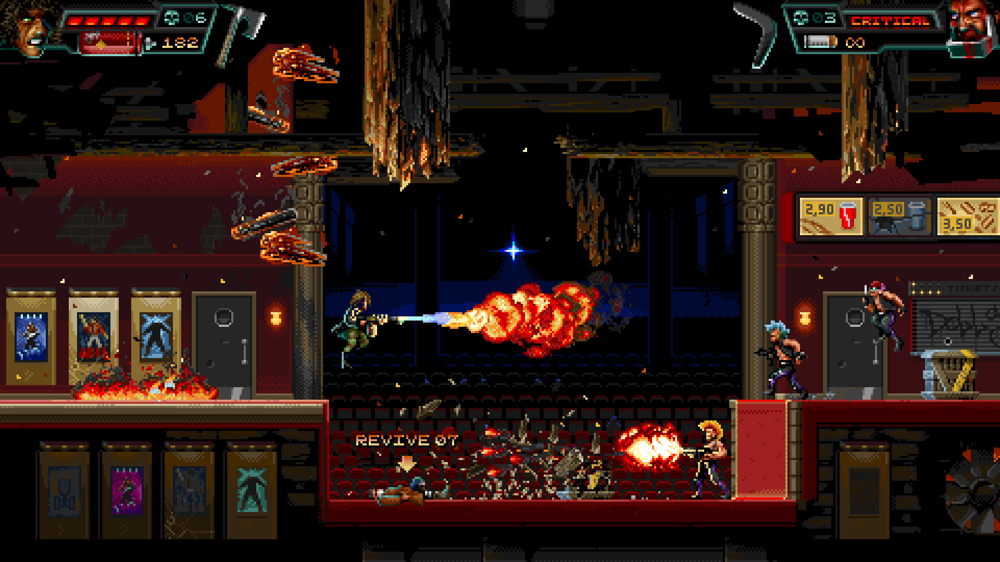

# ST-10：真實地圖的交盤與取回執

2026-10-26。正式交接櫃現在有取盤、送入、出紙、握住同一紙張、收起與收手；原盤、回執、副本、錢包與完成旗標仍由既有成功保存發布。櫃體落在實際地板，人物走到有地板且無障礙的站位，開口依採用圖的實際像素校準。診間原櫃沒有替換。

## 真實畫面

| 原盤送進插口 | 掌心接住正在出紙的同一張回執 |
|---|---|
|  |  |

| 折收至身側 | 結果成功保存後回執消失、燈轉綠 |
|---|---|
|  |  |




## 驗證與界線

原選擇器83組、97,568項、0新／0已知失敗、517秒；15個原生程序225／0，0引擎ERROR／洩漏；機械／資料／來源／一般凍結續玩86／0（保留原刻意損毀fixture日誌）。

正式受影響範圍、原生程序數與逐項結果以 [validation.json](validation.json) 為準；[manifest.json](manifest.json) 列出所有原檔 bytes／SHA256，壓縮檔全部讀回核對。`raw*.zip` 是最終來源、實際圖片、日誌、退出碼、真存檔與重跑工具；`history*.zip` 保留失敗來源、退件圖及中斷測試。重複原圖以 `raw-references.json` 指向 raw 內同 SHA 的檔案，沒有假造遺失原圖。

最終引擎使用 Godot 4.7.2 ed1daf0bf 的 NE-280 音訊生命週期修補；來源／patch／二進位收據在validation與raw內。Vulkan llvmpipe、Forward+、HDR2D、Dummy audio保持。先前各輪官方引擎結果另保留，不混稱同一二進位。實際 Main／Level／NpcActor／PlayerVisual 正常執行；前置原盤透過正式物品入口安排，探針呼叫真櫃互動並選擇真選項、推進台詞。這些畫面不是人類整章通關、實體手把、硬體 GPU 或主觀手感驗收。

- 正常互動：原盤到插口後縮入；紙尾先碰掌心再由同一個紙張節點交給手，人物腳底保持地板320。取消把同一張紙放回原出紙口，收回自己持有的外觀與鏡頭。
- 真 Escape：只在已明確選擇交付／取紙之後略過，沿用原有段尾結果，不靠手寫旗標。
- 真路線阻擋：自己建立的實體牆擋住角色時安全退回，原盤與完成事實不變，顯示「前方受阻，換個站位再試。」移除自己的牆後同一路線可達。
- 真 writer 拒絕：在真正暫存檔目的地建立自己擁有的目錄，原主檔／備份與 live 事實不提前改。每段兩次拒絕再按正式重試，動作物件與已完成時間不重建，交談結算一次；觀察者的普通支出／新通知已讀保留。
- 段尾保存提示原本就是只能重試。本次不發送不可見的取消按鈕訊號；另以支援的外部 Story 重設驗紙張回收與後續冷讀。
- 中途續玩：真正 Main 退出寫入完整原入口與未完成段落，另程序繼續由原實體 NPC 等待／結算；原盤與取紙各驗。另把修前失敗的完全相同主檔直接複製至新槽再讀，SHA256 `19e068594b950ca1bc4e6863bd33cc95deba8d2c08c2a1c33122df6f5d4dadd3`，不改 envelope 或 checksum。
- 最終正常原生的整條掌心路徑誤差以該 result/log 為準，門檻0.25世界單位；360個獨立待機姿勢的掌心誤差0.0000863167是另一組機械控制，不能混稱整條真實路徑。
- 官方引擎的 v11／v12／v13 原生225／0與全部退件留在history；最終另以 v14 凍結來源及 NE-280 修補引擎重跑相同15程序225項。v14只修正一般凍結續玩fixture的量測邊界，遊戲實作與v13相同。舊`reset-cold-v2`名稱重用的舊v8原圖／日誌已保存為`reset-cold-before-v2`，最新修補版各程序都使用全新名稱與存檔目錄。
- 一般凍結續玩的負控制從真正排入還原的邊界量測：6項1失敗、多跑7步；只在實體道具演出等待物理初始化後，同測6／0、多跑0步。實體場景在排入還原之前已有的物理步不算額外執行。

## 退件與修正

| 失敗 | 最終處理 |
|---|---|
| 首輪 JSON 的1.0被整數陣列比對拒絕 | 有限數值明確驗±1，保留型別／非有限負控制 |
| main-v2 斷言12／0但手從世界零點飛來，實際掌心差32.979 | 首段從真正閉掌點開始，不能以該次斷言過取代看圖 |
| camera WeakRef 回傳值推導 Variant，warning-as-error不能啟動 | 明確型別，原parse失敗退出保留 |
| 舊取紙斜拉(-2,+2)在360待機姿勢有2處搆不到；writer-v1 59／16 | 改向下1單位的真可達拉紙，不加長手臂；原360控制0不可達，所有原流程重跑 |
| 演出改動 Player.facing，與原瞄準不配對，恢復槍時出現交錯姿勢；15項1失敗／15次狀態改動 | 只改骨架呈現輸入，遊戲面向／瞄準保持配對；同探針15／0 |
| 途中退出續玩5項4失敗：只認then、不認選項，且首個物理步之前先凍結 | 原來源的有上限then／選項追蹤，加真物理初始化等待；同一修前磁碟槽另程序5／0 |
| 第一次途中退出探針沒推進確認台詞、舊Escape探針重用釋放事件 | 修正探針、保留舊輸出，沒有拿錯誤工具當產品結果 |
| 三輪受影響測試分別因漏生成主題、面向問題與一般續玩多跑物理步而中止 | 只停止本Session明確辨識的程序樹；保留中止收據，不當成通過；第三輪另有真正C++崩潰，見下文，不能歸為單純中止 |




第三輪受影響測試第4支在完成PropsSuite後出現 `/root propagate_notification` 跨執行緒錯誤、signal11與heap corruption，日誌比本Session停止程序樹早78.45秒，是真崩潰，不歸為停止造成。原完整日誌與mtime收據保留；原main與候選的同11組、原main同八程序未重現皆留存；兩次真正音訊崩潰由[NE-280](../../../Nest-Egg/attachments/NE-280-audio-lifetime/README.md)修補退休資料與混音的同步邊界，最後原83組使用修補版。沒有改錯誤filter、known_failures、門檻或停用正式功能。

一般凍結負控制的前兩版私有探針只等四個物理影格，尚未等到真正scene_started，屬無效工具結果。第三版從scene_started看到3／1與7步，但原八程序測試抓到從物理回呼建場景時，排入還原之前可以合法已有物理步；不能把絕對步數0當產品保證。最終從排入還原當下計算差值，保留原實作負控6／1與7額外步、正式6／0與0額外步；所有舊日誌保留。

## 同類遊戲與引擎依據

採用 HUNTDOWN 的側視角色／互動設施分層，及 The Final Station 的機器功能部位與緊湊可讀尺度。只比較可見構圖，不推測其內部保存實作。以下為官方 Steam 商店圖的原檔副本，原網址、SHA及採用理由保留；素材不作本作遊戲資產。




來源見 [research/sources.json](research/sources.json)。前批返家與進食另含 Spiritfarer、Eastward 等參考：[關爐裝水](../ST-10-kitchen-actions/README.md)、[持筷進食](../ST-10-meal-actions/README.md)。Godot [暫停／process mode文件](https://docs.godotengine.org/en/stable/tutorials/scripting/pausing_games.html)用來界定暫停中的外觀更新；沒有解除整個世界的物理暫停。Sébastien Bénard 的 [Dead Cells GDC2019簡報](https://media.gdcvault.com/gdc2019/presentations/Benard-Sebastian-DeepCells.pdf)已讀文字頁面，CLI取PDF回403後停止，沒有PDF截圖也沒有重試。

## 素材、尺寸與重跑

櫃體19.5×57世界單位，正式地板320，櫃頂263；原盤世界寬5、紙寬3.6長8。採用圖734×2142，兩開口實量(330,495)／(590,495)，燈(437,99)。提示詞要求的y≈0.30不等於實際生成位置；正式接點用495/2142校準。採用原圖、前一參考、編輯提示詞與雜湊在 `assets_src/candidates/st10_handoff_1026/manifest.json`，原圖不覆寫。前一參考的完整生成提示詞已不可得，明列null；工具未提供seed／model／job亦留null，不冒稱全生成可重現。

沿既有共用素材流程重建，舊14份成品保持不變；場景126.3/160MiB、共享23.6/60MiB、匯入政策0不合規，原始報表見raw。主題產生器另在暫存目錄只生成handoff，核對新增道具包與正式相同，不全量覆寫其他地圖。

重跑：在repo使用封存的 `source/after/work/st10-handoff/` 私有探針（正常模式preview、lifecycle各模式、writer、mid），使用獨立輸出／存檔目錄；runner包含實際完整命令。使用[修補引擎建置指引](../../../../tools/godot_audio/README.md)與相同渲染條件，先匯入資源。原受影響選擇器 `GODOT=/path/to/4.7.2 SHARDS=8 tools/run_tests_changed.sh`，不得放寬known_failures或錯誤filter。單位探針有原本刻意損毀反應fixture的ERROR日誌，只有正式原生程序宣稱0 ERROR。

本次的物件與演出驗收可結束ST-10。ST-9通用故事結果保存與最新整章審查仍由該票未勾條件追蹤，不因本票代為完成。


## 引擎崩潰對照收據

```json
{
  "base": "9055c63a1a8071aacbceeed98b6f7f8a2642c8f5",
  "groups": [
    "ReclaimerSuite",
    "Chapter2EnemiesSuite",
    "UiScreensSuite",
    "Chapter2ExpansionSuite",
    "PropsSuite",
    "ExposureSuite",
    "AreasSuite",
    "LocomotionSuite",
    "TransitionSuite",
    "ProtagonistMotionSuite",
    "Chapter2ArtSuite"
  ],
  "processes": 1,
  "boundary": "Same exact 11 groups, one process each, rather than the original eight-process pressure. Green repeat does not establish crash root cause.",
  "baseline": {
    "checks": 8709,
    "new_failures": 0,
    "known_failures": 0,
    "wall_seconds": 353,
    "log_sha256": "77b93af249a2e2bb517a3bcde97a501d7c52188ae42fc079aeb77391bab10368"
  },
  "final": {
    "checks": 8709,
    "new_failures": 0,
    "known_failures": 0,
    "wall_seconds": 350,
    "log_sha256": "9252235aa6793f847099c834efd6ee63928dc806104d743e9637456638b0d7e0"
  }
}
```
