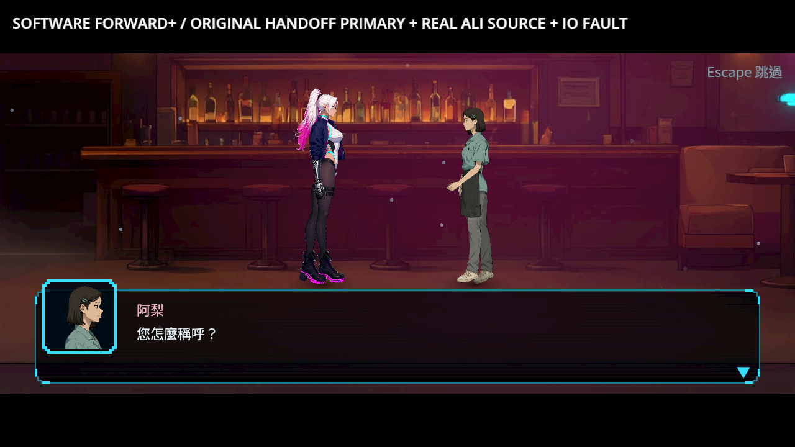
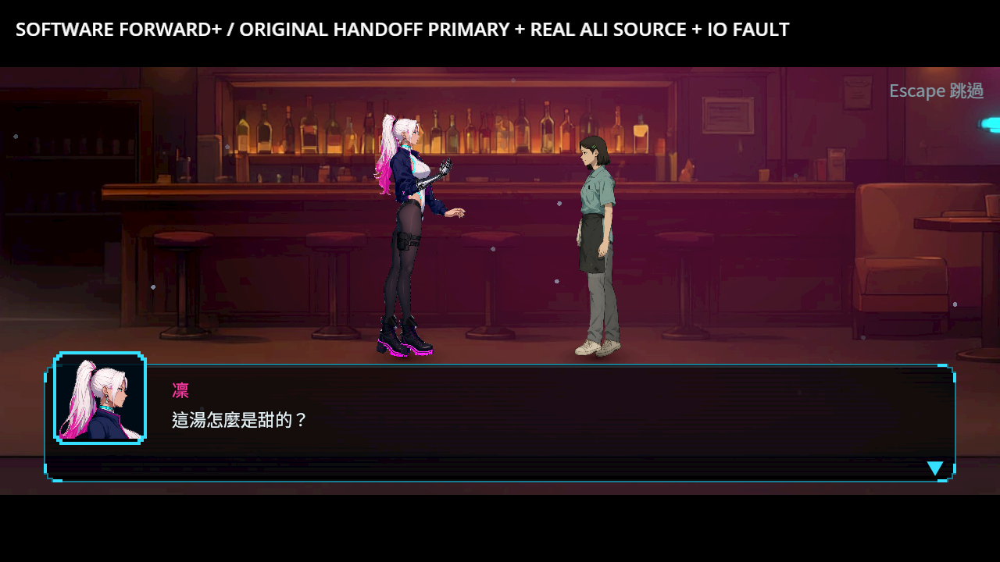
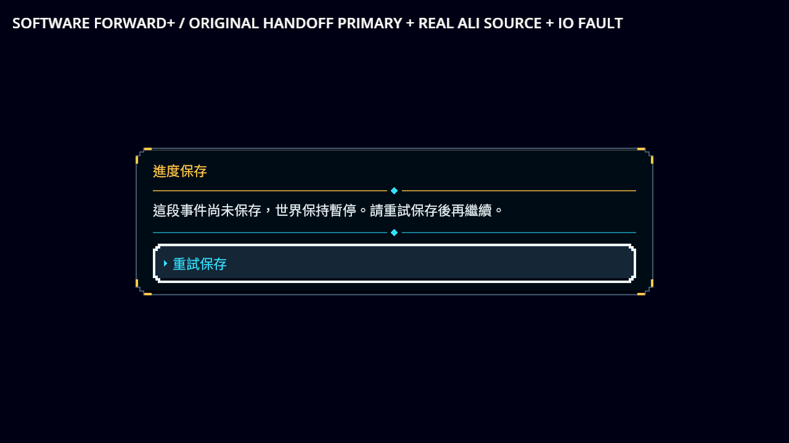
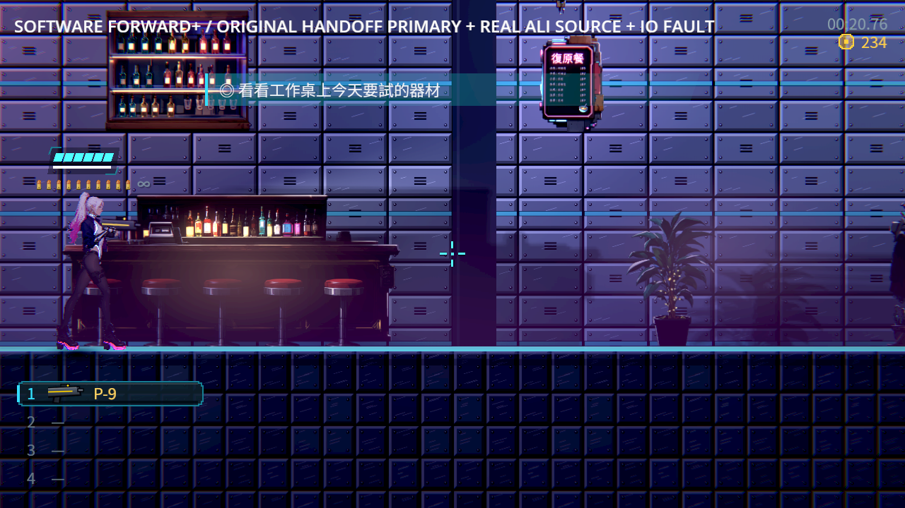
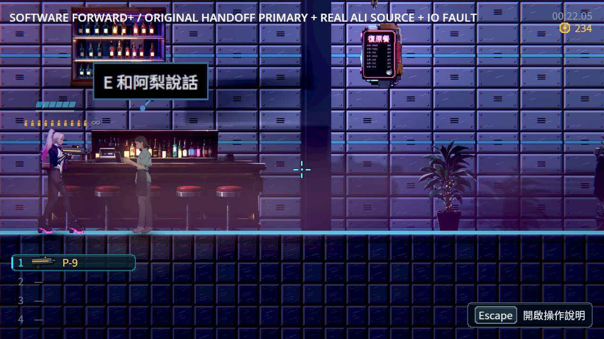

# ST-9：阿梨的名字、晚間交談與下班結果保存

互報名字、晚間話談完、真正下班是不同結果。每一步先保存對應旗標、已讀與正確接續；名字及真正收尾才結算一次原NPC交談，中段保留原來源、原等待者與下班段落，不提前隱藏阿梨或開放原出口。

真正拒寫時保留同一段與重試提示，再次拒寫沒有部分結果。重試不重播剛結束的舞台；接受中段後取消，只保留已談的部分，阿梨仍可互動。冷讀原主檔後，走同一位作者來源完成剩餘收尾，沒有重複加次數或覆蓋普通花費。

## 正式原圖











[逐張圖像檢視](visual-review.json)保留原檔SHA、實際階段與觀察。完成圖的原入場招呼氣泡在阿梨離場後仍可見，保留於[未加工的完成圖](../../images/ST-9-ali-accepted.png)與原始證據；交NE-228接續調查真正來源，不把另一張未見氣泡的圖當成已修好。這批沒有替換角色、背景、台詞、價格或舞台動作，也沒有代稱整體畫風或全介面驗收。

## 來源與驗證

起點是前批真正Main交盤及獨立讀取產生的原主檔，從已交付ZIP逐bytes核對複製。更早的磁碟與237信用點是明示安排的前提，交盤與兩次普通花費後保留235；沒有直接補上本次名字、晚間完成或NPC次數。餐酒／只坐的前置走原NPC與原選項。原主檔及其來源SHA見[驗證收據](validation.json)，沒有重編封套或製造保存成功。

| 項目 | 結果 |
|---|---|
| 同一份五邊界真拒寫探針 | 82項／20失敗 → 82項／0失敗，原探針SHA保持 |
| 原受影響選擇器 | 8組、3,822項、0新／0已知失敗、129秒，四程序 |
| 保存相容與來源契約回歸 | 647／0，原拒絕條件及損毀資料檢查保留 |
| 最終獨立無頭程序 | 12程序306／0，兩份原途中主檔逐bytes複製另程序續玩 |
| 最終軟體Forward+真Main | 8程序241／0；0引擎ERROR／腳本錯誤／洩漏 |
| 原閱讀畫面補驗 | 另兩程序85／0，原完整首句、人物與舞台；沒有加工圖片 |
| 原耳機、週日與交盤回歸 | 17程序615／0、8程序133／0、2程序107／0 |

最早成功重試探針把無回傳值的保存呼叫當布林值，造成腳本錯誤及退出241，當時完整來源與輸出保留。之後只修正探針的API使用：呼叫保存後讀實際原主檔，核對位置、錢包及三個世界投影，沒有改正式保存API、已知失敗或過濾器。

原改前／改後探針保持同bytes；公開的共用探針只把種子位置改到正式測試fixture，保存拒絕斷言保持。補拍腳本另外延後略過，等原首句真正可見，繼承全部保存與重試斷言，沒有改正式資料或演員。

[逐檔SHA](manifest.json)、[原始來源／存檔／全部失敗與最終輸出](evidence.zip)及[驗證收據](validation.json)分開記錄每個程序。能力僅限本批四個正式旗標邊界及同一NPC的有限接續；原點餐、付款、物品等其他故事結果依各自驗收，通用atomic_v1與整章條件保持原狀。

```sh
python tools/run_ali_completion.py --godot /path/to/repaired/godot --output /absolute/new-ali-evidence
python tools/run_voice_completion.py --godot /path/to/repaired/godot --output /absolute/new-voice-evidence
GODOT=/path/to/repaired/godot SHARDS=4 tools/run_tests_changed.sh da6026e5e77622877a0dd0336144564952b619a0
```

前批語音版本da6026e5遠端完整CI實際97,976項、0新／0已知失敗、559秒；混音、交盤107、週日133、語音17程序615也成功。[實際job收據](previous-voice-ci.json)、[原始job與metadata](previous-voice-ci.zip)。不以此前批結果代稱本批遠端CI。

## 相近類型作品與保存依據

[Katana ZERO官方商店](https://store.steampowered.com/app/460950/)三張原圖已逐張查看，第一張是安靜室內、其餘兩張是戰鬥。本批只使用安靜室內作人物與家具比例、地面支撐及局部暖光的觀察參考。[官方URL、原圖與SHA](research/sources.json)保留，圖片屬原權利人，未作為本作遊戲素材；不能由商店圖推論保存機制或玩家偏好。


[前批Night in the Woods／Oxenfree／Spiritfarer官方原圖與來源](../ST-9-sunday-choice/research/sources.json)，以及[Ink保存完整state](https://github.com/inkle/ink/blob/master/Documentation/RunningYourInk.md#saving-and-loading)、[Yarn Spinner Godot變數與對話位置](https://yarnspinner.dev/docs/godot/gdscript/05-connecting-to-your-game/04-variables-and-storage/)持續作依據，沒有引入另一套runtime。軟體渲染與明示前提不代替真人整章、實體手把或硬體效能驗收。
