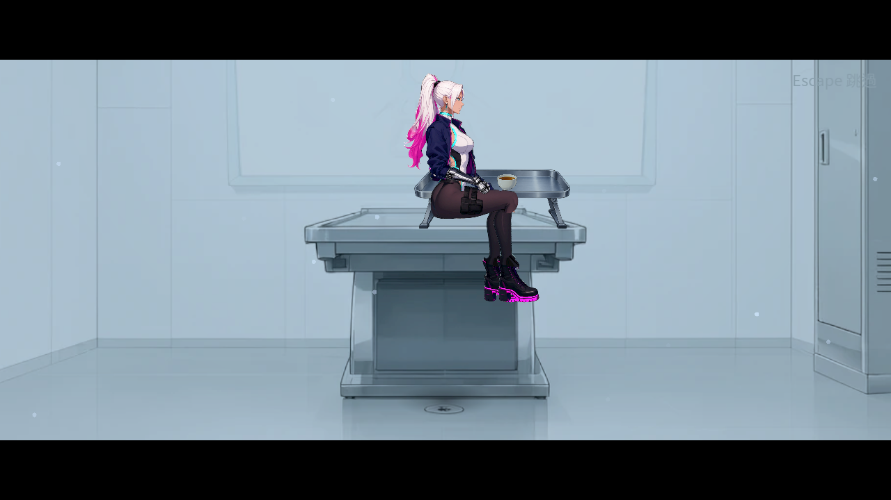
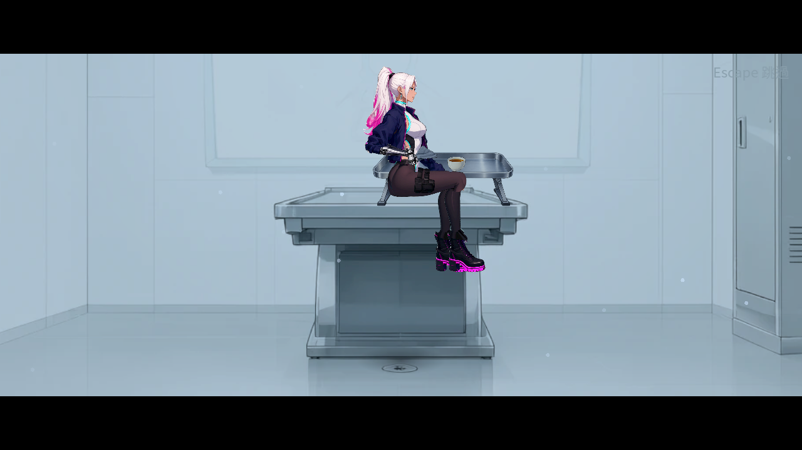
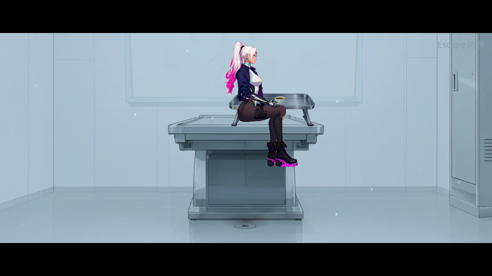
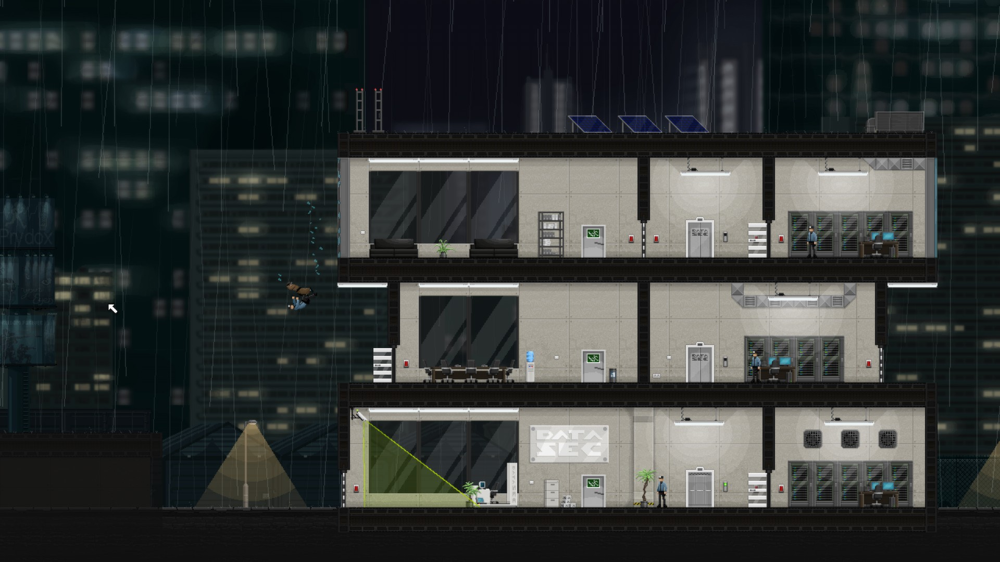
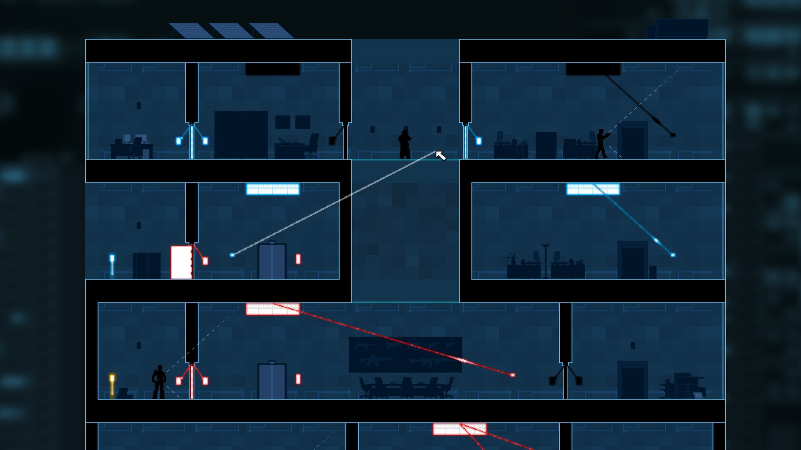
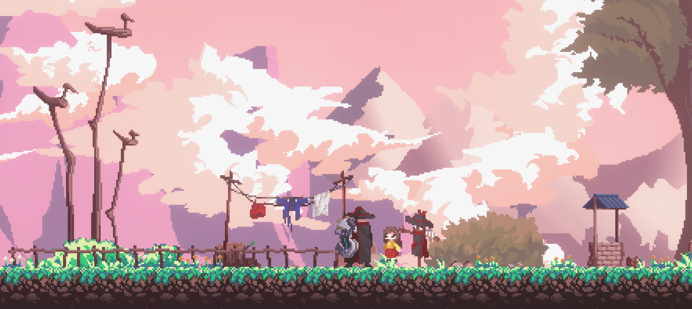
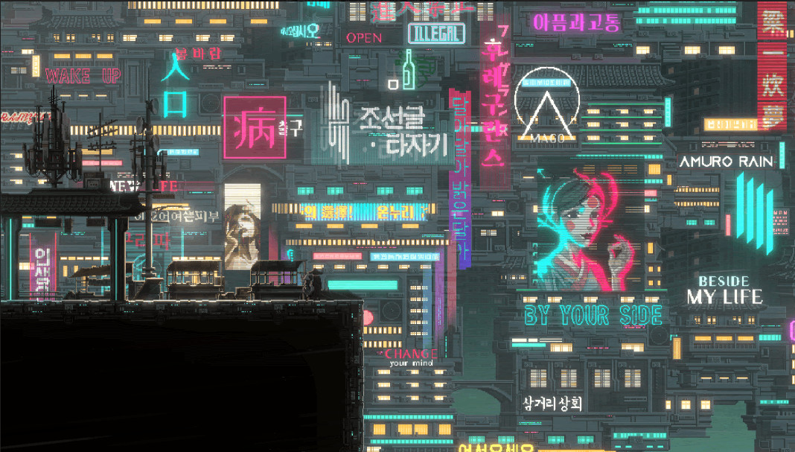

# ST-9 首次診間：挪杯、收布與原保存邊界

2026-10-26。原「實際挪杯收布、茶不拿走」選項只有台詞與淡出。現在完成選擇後，原坐姿的手實際握杯、水平提起、挪到托盤另一側並放下，再握住灰布角、移到外套後收起。茶杯留下，布角仍由已交付的首次死亡來源在保存成功後給一次。

## 驗證與實際來源

| 項目 | 實際結果 |
|---|---|
| 真Main首次死亡、正常取布／拒寫兩次後重試／持杯中途取消／原主檔新程序冷讀 | 無頭四程序147項、0失敗 |
| 同四流程軟體Vulkan Forward+、HDR2D | 四程序147項、0 ERROR／SCRIPT ERROR／退出洩漏；十一正式原圖逐張查看 |
| 受影響原測試 | 44組56,234項、0新／0已知失敗、573秒、四工作；獨立四分片DummyTexture退出檢查0 |
| 原首次診間保存／未讀接續／略過／取消 | 29程序385項、0失敗、371.976秒 |
| 編譯政策 | 原六測試全過；139場景、10任務；只有取布段新增16動作，其餘故事欄位逐值相同 |
| 素材重建 | 隔離目錄重建原色／法線逐bytes相同；原色RGBA逐像素等同生成原圖 |

接觸採原圖不透明握點，六個握／支撐點alpha均至少230/255。四條原上／下臂長在所有取樣影格差不超過0.001舞台單位；持物掌心誤差不超過0.25，實際最大低於0.001。杯的整段角度保持0，放杯底回同盤面，位移13。布角到外套點後才隱藏；未完成的動作不取得物品／持有旗標。產品沿用原弱參照持物及變換，不在每幀讀圖或建立法線。

正常流程兩選項都走原實際菜單。拒寫是在原結果邊界製造本程序槽的真`.tmp`目錄障礙，不是假報writer失敗；第二次拒寫仍不發布，解除後真正重試不重播動作。中途取消發生在原杯確實被手持時，回主選單釋放原舞台與綁定，保留原未讀Take主檔逐bytes，沒有布角。冷讀由另一程序直接讀同一原檔，不重新編碼、授旗標或拼造存檔。原29程序另檢查其他診間分支。

## 視覺退件及素材

40寬的第一個托盤預覽雖數值接觸成立，杯身實際被坐姿大腿擋住，沒有當成合格畫面。最終等比例改為80寬床上托盤（0.552H），不拉長骨架、伸展素材或強改前後圖層；腳落原檢查台y194，盤內接觸線y174.310。杯高0.058H，布寬0.103H，原H145。早期原圖及動作取樣均保留；那些預覽沒有凍結全份產品來源，不冒稱同來源回歸基線。

第一輪擷取要求同一步驟四影格，軟體渲染不足而只抓到淡出；第二輪改抓實際觀察到的第一格，不修改動畫時間。v2低盤遮擋退件，v3可見，正式公開來源另跑四流程。[十一張正式原圖及其SHA、逐張觀察](visual-review.json)；其他原PNG為保留的補充影格，不宣稱每張都完成正式審閱。

原復原電話亭提示仍偏大，保留真正復原圖供NE-228接續；本批沒有把它藏掉或裁掉。軟體Forward+不代表實體GPU、手把、完整自然通關或整體角色畫風的人工驗收。

新atlas為獨立原創透明生成三物件。原圖保留，來源SHA、完整prompt與標準建置配方俱在；原色像素未手改，既有背景家具、角色／骨架及背包圖標未改。新法線由既有流程數值生成，診間Sprite目前仍用原色與既有統一調色，沒有宣稱新增動態打光。詳細幾何及決策見[設計](../../../../design/20-campaign-experience/FIRST_CLINIC_ACTIONS.md)。

Poly Haven模型API一次403後停止；ambientCG回覆三筆都是杯圈／污漬表面材質，不是可用物件，沒有匯入。獨立美術venv只新增固定OpenCV4.11.0.86，既有環境未改；首輪缺cv2失敗也原樣保留。

## 同類作品參考

[官方來源、下載URL、SHA及權利界線](references/sources.json)。Gunpoint（側視潛入解謎）參考亮室內與暗外部的空間辨識；SANABI（側視動作平台）參考人物與背景的輪廓閱讀。四張官方圖已於本輪先前研究逐張查看，沿用於此資料包。SANABI這兩張沒有可見鉤索線或控制教學，不以猜測補觀察；圖片也不能證明其內部存檔或玩家偏好。僅參考，未作遊戲素材。

## 重跑與證據

使用固定修復Godot4.7.2，SHA `319aaea8c619fa1edc5d08a33158ab2bfd069e329a1bcd672db9654af53f35e2`，聲音保留、背景載入保留。執行`python3 tools/run_clinic_actions.py --godot "$GODOT" --output /abs/new-directory`；原診間用`tools/run_clinic_completion.py`，受影響回歸用`GODOT=... SHARDS=4 tools/run_tests_changed.sh origin/main`。新版CI診間步驟已接上四個動作流程。

[完整原始封包](evidence.zip)，28,726,887 bytes、739 entries，SHA `b0ae945667822788ee7b51b10d3db6b34411d4699742a9db83b1dd677e6295cc`；內含無頭四流程／軟體原生四流程、舊診間全部流程、四分片輸出與退出檢查、所有早期預覽／取樣、真主檔、凍結來源、素材來源、API原回覆及重建收據。每個entry均以索引SHA重新讀回核對。詳細索引與計數見[evidence.json](evidence.json)。

GitHub詳細CI查詢先前回401，未重試或繞過；本批遠端CI未知，本機數字不代稱遠端CI。整票其餘條件保持原勾選狀態。
