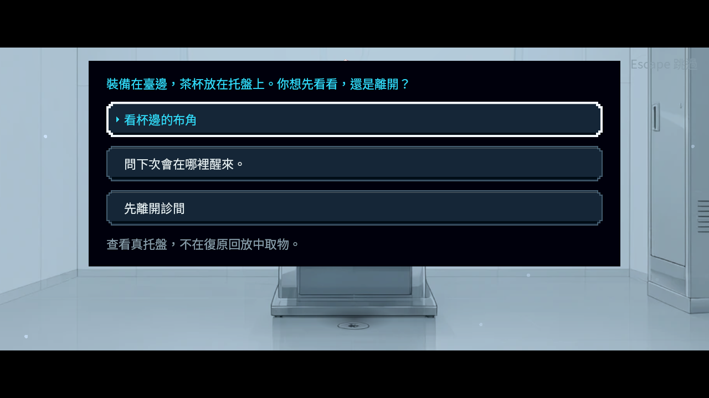
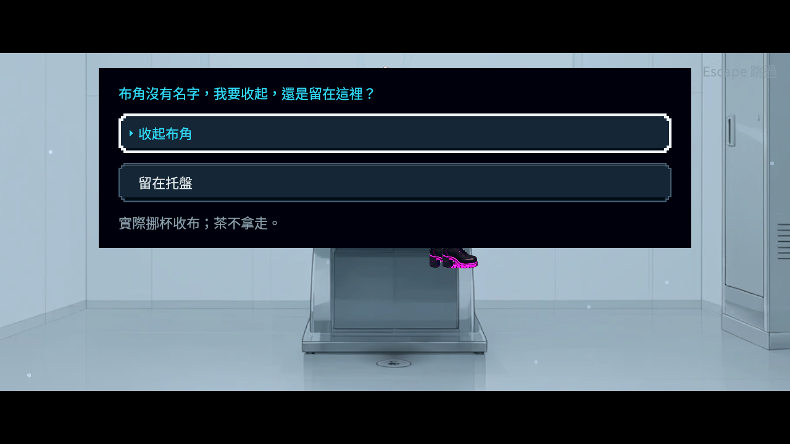
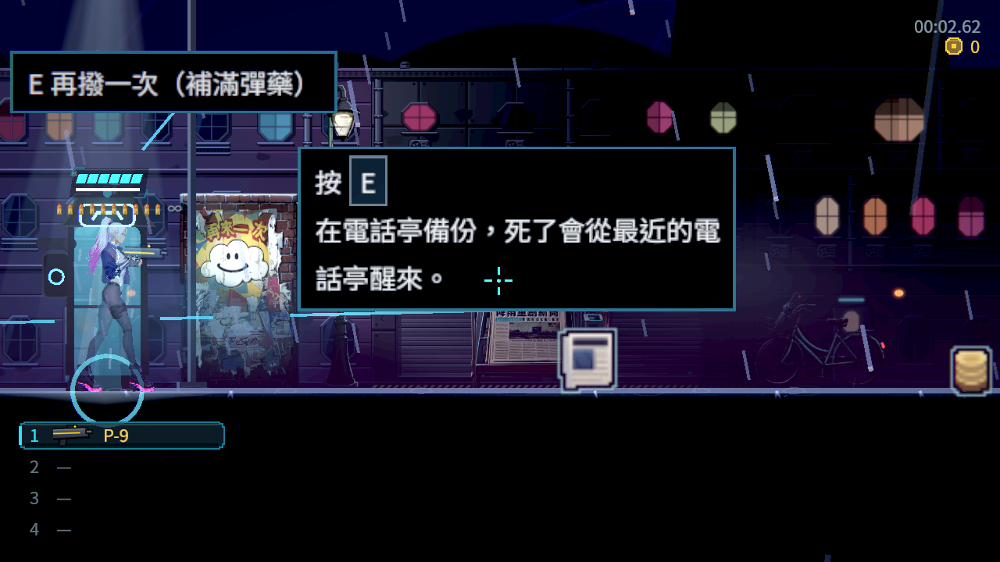

# 首次診間：保存結果與原未讀接續

原 Main 新遊戲，沿原換區入口到電話亭巷，再讓原玩家真正承受一次致命傷；沒有直接設定診間旗標、物品、完成歷史或金額。測試等待原關卡交接與唯一有效死亡監聽者，避免把工具安排的同影格重入誤算成正式缺陷。

建檔、查看與取布若真實存檔寫入失敗，原本仍發布結果，沒有原段的保存重試。現在先保存成功才發布；重試同一已演段落，保留原條件與原物品。正常對話保留原未讀下一段；手動略過建檔／查看仍沿原規則直接復原，不強制取布或開選單。第一次死亡保持免費，也不再計算第二次死亡。

讀取原 Main 真正產生的未讀托盤主檔，現在接回同一原對白與選項；不再因根段已完成而卡在死關卡。診間的臨時情境由原死亡請求持有，完成或實際離開主選單時釋放，不補成永久世界旗標。

## 參考

沿用已實際查看的側視敘事遊戲官方圖：[Forgotton Anne 圖一](research/Forgotton-Anne-0.jpg)、[圖二](research/Forgotton-Anne-1.jpg)，[來源與權利紀錄](research/sources.json)。參考室內對話與人物、道具位置的閱讀關係；圖片不證明其內部保存方法，也不是玩家偏好調查，不放入本作遊戲資產。

另直接讀取官方商店資料並擷取、逐張查看 [Gunpoint](research/additional-games/Gunpoint-0.jpg)／[電路視圖](research/additional-games/Gunpoint-1.jpg) 與 [SANABI 的安靜對話](research/additional-games/SANABI-0.jpg)／[霓虹街景](research/additional-games/SANABI-1.jpg)，[原始來源、開發者、URL與SHA](research/additional-games/sources.json)。Gunpoint 的明亮室內與電路狀態、SANABI 清楚的落腳邊界及安靜人物構圖，供後續引導與互動回饋參考；這四張不能當成內部存檔或玩家偏好的證據。

保存責任分工參考已閱讀的 [Ink Running your ink](https://github.com/inkle/ink/blob/master/Documentation/RunningYourInk.md) 與 [Yarn Spinner：Variables and Storage](https://yarnspinner.dev/docs/godot/gdscript/05-connecting-to-your-game/04-variables-and-storage/)。本作是否正確以原 Main、真 writer、原主檔冷讀與原畫面驗證，不由其他作品畫面推測。

## 重跑

```bash
python3 tools/run_clinic_completion.py --godot /absolute/path/to/repaired/godot --output /absolute/new/isolated/output
```

每個案例使用獨立保存槽及程序；冷讀逐 bytes 複製前一程序由 Main 真正產生的原 checksum 主檔，不重新編碼。沿用嚴格錯誤與退出洩漏檢查。原單元／冒煙斷言、時間、旗標條件及閱讀台詞保持。

## 原探針限制

原 v2 冷讀要求30影格後已在選單，但沒有推進其前面的未讀台詞；修後已接回正確對白，因此該舊斷言仍失敗。原輸出保留。v3 僅加入正常玩家的有界對白推進，保留原五項斷言；同引擎及同一原主檔的修前／修後對照另行記錄。不為了通過探針而讓產品自動讀完。最早 instant 交接同影格致死的無效安排、初稿的編譯錯誤，以及新探針過早把死亡等待期判為已復原的失敗，也原樣保留並區分原因。

診所圖由軟體 Vulkan Forward+／HDR2D 產生，沒有實體 GPU、手把或真人整章驗收；這次保存邊界不證明「挪杯收布」的實體道具動作已完成。


## 最終驗證

| 項目 | 實際結果 |
|---|---|
| 同一原探針三個寫入邊界 | 42／6 → 42／0 |
| 同一 v3 正常對白推進冷讀 | 5／1 → 5／0；原 checksum 主檔未重編碼 |
| 診所公開重跑器 | 29 程序、385 項、0 失敗 |
| 真地圖撿錢再首次死亡 | 17 項、0 失敗，實際物理觸碰原金幣堆，不直接設定金額 |
| 原存檔套件 | 745 項、0 新／0 已知失敗、70 秒 |
| 原受影響選擇器 | 72 組、4 程序、93,743 項、0 新／0 已知失敗、720 秒 |
| 完整原始分片退出貼圖檢查 | 4 份原 log，0 DummyTexture 退出診斷 |
| 作者編譯一致性 | 139 場、10 任務、0 缺譯；正式資料僅四個保存政策欄位改動 |
| 軟體 Forward+ | 5 程序、71 項、0 失敗、0 ERROR／腳本錯誤／退出洩漏 |
| bubble-state | 1 程序、52 項、0 失敗 |
| bubble-source | 1 程序、54 項、0 失敗 |
| ali | 12 程序、306 項、0 失敗 |
| voice | 17 程序、615 項、0 失敗 |
| sunday | 8 程序、133 項、0 失敗 |
| handoff | 2 程序、107 項、0 失敗 |
| reception | 10 程序、244 項、0 失敗 |
| supper | 47 程序、1,253 項、0 失敗 |
| repeat | 1 程序、40 項、0 失敗 |

七張原始 viewport 圖均已逐張查看。最早補充圖是尚在打字的原台詞；以下正式圖透過正常對白推進顯示真正選單。沒有裁切、診斷覆蓋、後製或虛構新畫面。








[完整來源與量測](validation.json)、[逐張原圖檢視](visual-review.json)、[逐檔SHA](manifest.json)、[原始來源／主檔／程序輸出／所有失敗](evidence.zip)。封包 6,764,299 bytes、1269 檔，SHA-256 `d9df152c0ce18e3ae9764933b1bf844c8a0d215b2d72d560af0eac262dc12a94`，已逐 entry 解壓讀回核對。

GitHub 詳細 CI 查詢曾回傳 HTTP 401，沒有重試或改用其他憑證；本批遠端 CI 未由本機驗證代稱。前一 BG-51 的成功結束監看與存取限制、NE-228 實際推送及 main 同步收據一併留存。
