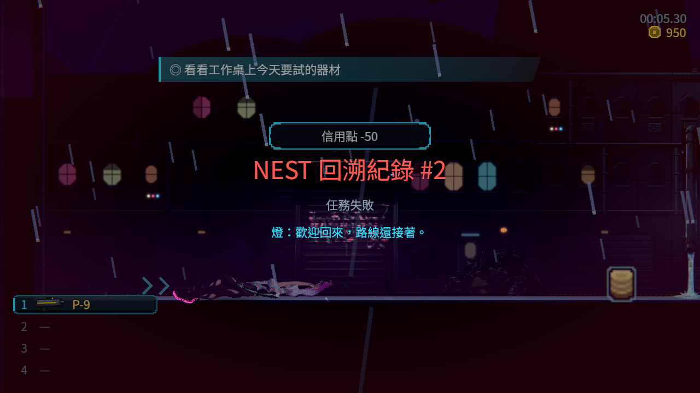
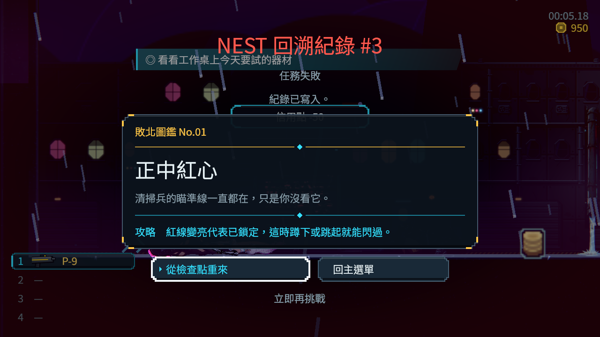

# 正式死亡序列的次數門檻

原正式資料到第三次死亡才縮短、第五次才可略過；初次建檔已計入死亡次數，第一次回電話亭仍重播完整版。三章沿用同一作者來源，現在第二次直接用簡化序列，第三次及之後可按確認、互動或取消略過。只改每章兩個門檻；原台詞、翻譯、每步時間、診間優先、費用、復原點及保存流程保留。

基準為 `2fa7bde15a08d0744d968c796ed9c5c4bf614015`。原測試不刪除，新增十項正式資料與真致命傷害入口檢查。原版 55 項／10 失敗，修正後 55／0；原選擇器十一組 4,345／0，自然退出 0、263.682 秒、4,943 份程式與資料前後相同，沒有腳本或退出資源洩漏診斷。預期負向 ERROR 保留，不宣稱整批零 ERROR。

`native-02` 為實際第一章電話亭關卡、正式生命傷害及死亡畫面，RX 9070 XT／Forward+／HDR，1280×720。先前死亡計數與診間完成由情境安排，本次確實觸發致命傷害；第三次的公開確認事件立即顯示記憶卡。這是合成輸入與局部流程，並非真人連續通關、實體控制器或三秒內完整復原驗收。PNG 編碼會阻塞兩次觀察之間的主執行緒，因此記錄的等待時間只用於確認略過事件，不能當整段遊戲時間量測。

原 `native-01` 的四格拍在既有雜訊轉場與進場通訊重疊期間，作為診斷保留，不列為清晰畫面驗收。第二輪只讓原進場通訊自然跑完、轉場超過原 0.45 秒後才讀圖，沒有變更演出、字級或隱藏 HUD。兩輪皆自然退出 0、零 ERROR／警告／洩漏；18,947 份來源前後一致，兩服務的內外前後佇列與主工作樹保護清單均驗過。這不代表 GPU 排他效能測試。

可攜 ZIP 包含兩輪原生 raw／PNG、原始命令、完整輸出、紅綠測試、來源前後清單、六檔基準與候選、重新生成檢查及索引。每個成員均核對 SHA／bytes／ZIP CRC；原生浮點圖另用獨立公式逐像素檢查 sRGB 與 alpha。主工作樹已有第二章美術資料，採用時只修改其中兩個門檻；提交使用經測試的純主線版本，沒有夾帶既有未發布工作。

重讀：`python -X utf8 verify.py`，需 NumPy 與 Pillow。不需原驗證工作樹。要重跑紅測試，在基準的獨立 checkout 只覆蓋 ZIP 內候選 DeathFlow 測試；要重跑綠測試，覆蓋六份候選後執行原 `tools/run_tests_changed.sh`。

