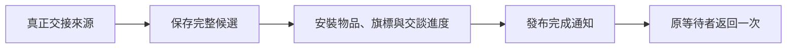
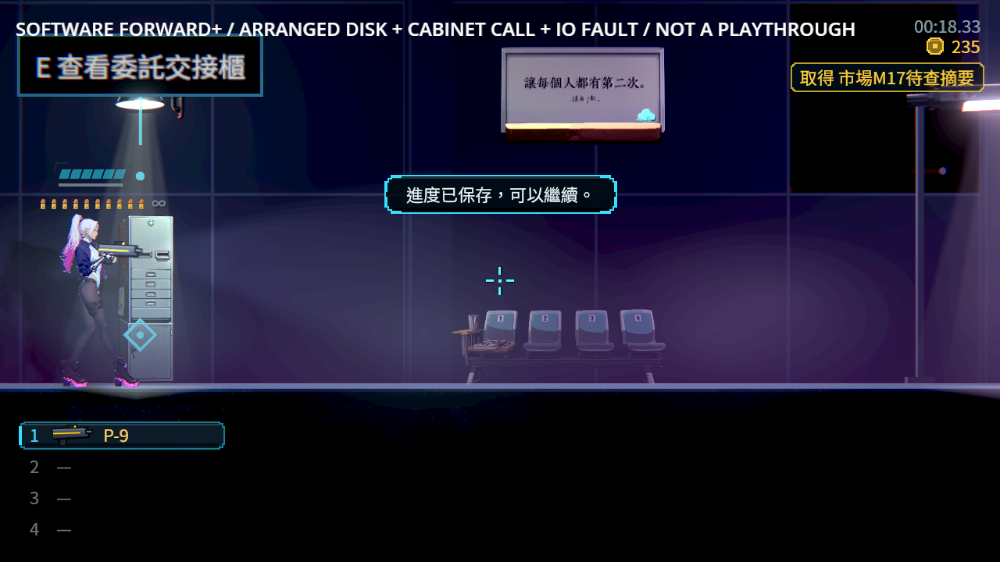
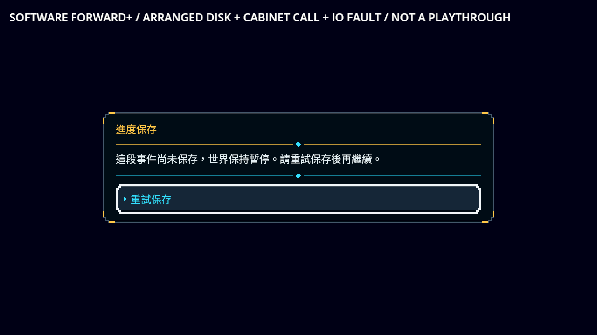
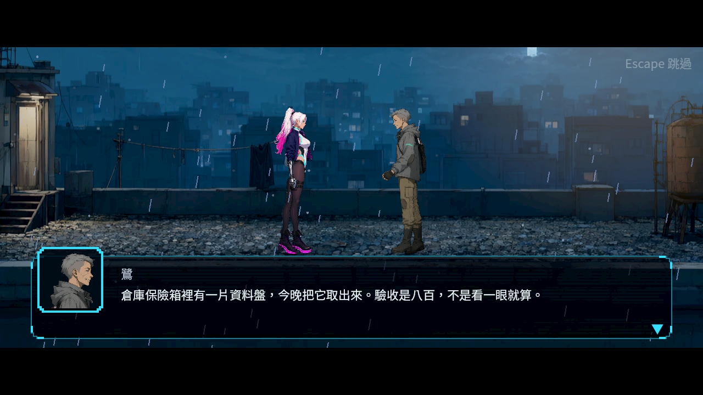
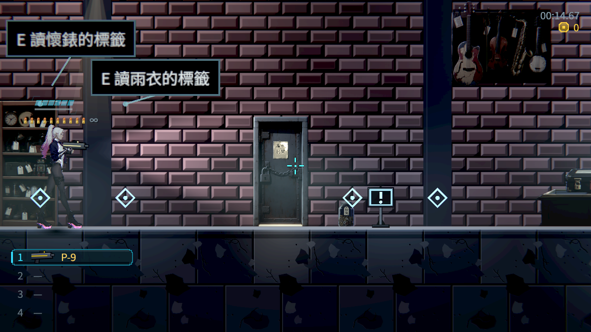

# ST-9：交接通知前保存 NPC 交談進度

2026-10-26。交盤、取回執與存摘要的物品、完成旗標、NPC交談次數與世界快照一起保存，再發出完成通知。真正磁碟拒寫仍維持原選擇與重試；原NPC等待者只結算一次，通知內的普通花費與NEW已讀保留。

| 第一次完成通知內 | 原版live／主檔三份世界投影 | 修後live／主檔三份世界投影 |
|---|---|---|
| 交盤 | 0／0、0、0 | 1／1、1、1 |
| 取回執 | 1／1、1、1 | 2／2、2、2 |
| 存摘要 | 2／2、2、2 | 3／3、3、3 |

資料在原等待者與後續自動保存之前擷取，直接解碼原主檔與checksum，沒有經過讀取修復。當下的完整主檔都保存於[evidence.zip](evidence.zip)。同一探針修前103項15失敗，修後103／0；原探針SHA一致。正式NPC來源仍要符合實際spawn、關卡、正在進行的交談、原索引與作者的分派／選項路徑。



## 驗證與畫面

- 原受影響7組3,610項，0新／0已知失敗；rebase至386d37ab後重跑仍3,610／0，138秒，原選擇器與錯誤篩選保持。
- CI方式的獨立write／read兩程序107／0，三次通知的raw主檔／live次數一致，冷讀保留次數3、物品與普通花費／已讀。
- 原五個NPC來源、翌日當舖入口及人物／物件冷讀，8個原生程序176／0。沿用先前接受的原探針，核對來源SHA及父工具完全一致。
- 原始交盤與取紙中途主檔的相同bytes，另兩個原生程序10／0，原索引／選擇由真正櫃檯續玩，沒有改flags、envelope或checksum。
- 原生使用軟體Vulkan／Forward+／HDR2D、Dummy混音；正常／拒寫／重試是實際Main與NPC操作。安排原盤、路由與輸入推進有明示，不代稱人類整章通關、硬體GPU或實體手把。

[逐項結果及平台界線](validation.json)、[逐檔bytes／SHA-256](manifest.json)。壓縮檔全部讀回核對，包含修前／修後來源、原始日誌／退出碼、當下主檔、保存槽、重跑工具與真實原圖。較早CI方式工具版本和最後的程序清理版本分別保存；修前／修後的GDScript探針保持相同。






畫面呈現正式操作與原有UI。交談次數的修補由上表及原始主檔驗證，沒有在產品畫面新增內部計數。

## 重跑與參考

先依[固定引擎建置指引](../../../../tools/godot_audio/README.md)建立已核對的環境，使用全新絕對輸出目錄：

```sh
python3 tools/run_handoff_completion.py --godot /path/to/repaired/godot --output /absolute/new/output
GODOT=/path/to/repaired/godot tools/run_tests_changed.sh
```

兩程序各使用獨立設定目錄，只有明確指定的測試保存槽共用。逾時、腳本錯誤、晚於結果行的失敗、崩潰與洩漏都判失敗；保留完整raw日誌。程序清理只處理自己啟動的群組，既有輸出目錄會拒絕覆寫。

[Ink官方完整故事state保存](https://github.com/inkle/ink/blob/master/Documentation/RunningYourInk.md#saving-and-loading)與[Yarn Spinner官方變數／對話位置說明](https://yarnspinner.dev/docs/godot/gdscript/05-connecting-to-your-game/04-variables-and-storage/)用來核對保存範圍；沒有把這些系統引入遊戲。[已檢視的同類作品原圖與來源](../../../Nest-Egg/attachments/NE-278-references/sources.json)涵蓋Katana ZERO、Hollow Knight、Ghost Song等；畫面用於閱讀空間與人物關係，不推論其保存實作。

本批限定既有無內建獎勵的終端段落。ST-9其他含續段／選項意圖的正式結果、最新整章演出與其他來源仍依票上未勾條件驗收。


## 前票的實際CI結果

前票ST-10版本386d37ab完整CI實際97,954項、0新／0已知失敗、690秒，修補引擎快取恢復並核對成功，實際混音檢查也通過。[實際run](https://github.com/deadline314/Nest-Egg/actions/runs/40260570827)、[原始job](previous-st10-ci.zip)、[收據與SHA](previous-st10-ci.json)。這是已交付交盤演出的完整CI，不代稱本次ST-9修補的遠端結果。
