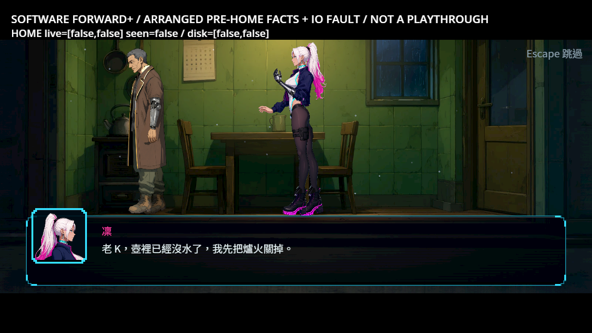
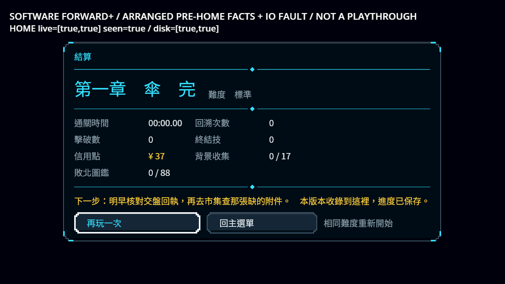
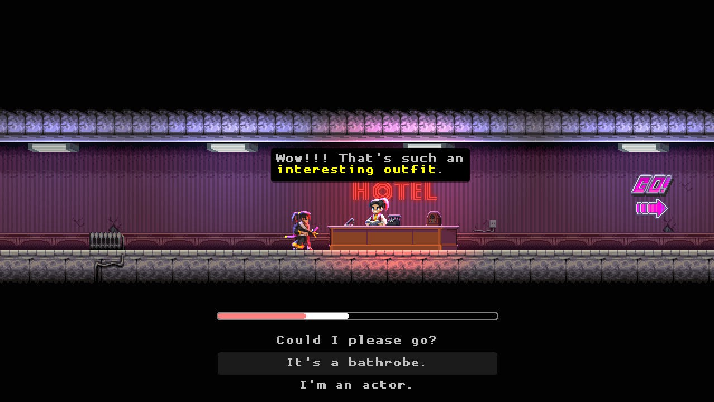
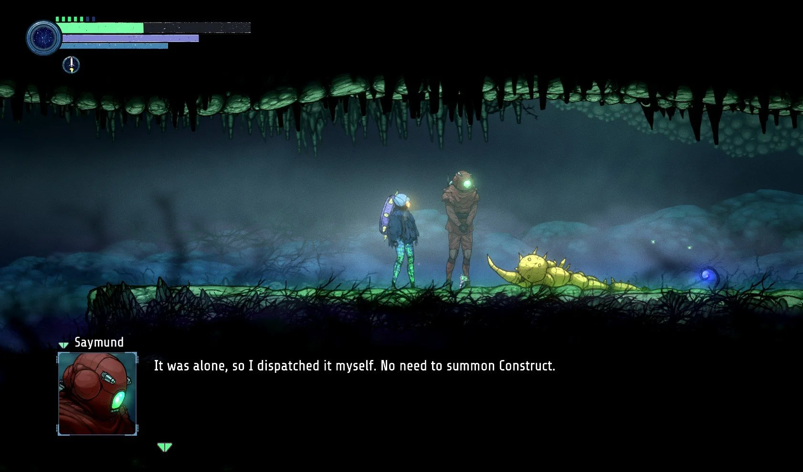
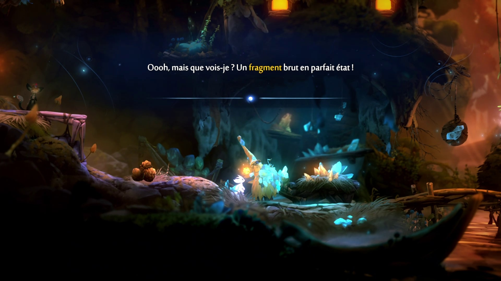

# 回家演出保存後才發布完成

回家演出或略過原本立即寫兩個旗標、完成紀錄，並讓 Level 繼續；寫入失敗時磁碟仍是未完成，現場卻已結束。現在由 Main 的共用旗標模組先寫完整候選，成功才靜默安裝旗標與紀錄、退休真正請求，再發布通知。失敗保留原入口與請求、持續暫停、明確重試。自動回家不提供會把玩家丟回結束世界的取消；三語重試提示使用穩定不透明底色。

正式來源只替目前自動回家的旗標段加入 main_flags_v1。其餘生成資料逐項相同；政策未知、非旗標結果、選項、續段、交付、自動道具或錯誤 intro 身分不在 Main 降級成 legacy 完成。原通訊入口、取消及原生工具 getter 保留。獨立演出工具仍是原來的呈現契約；這不是未來 atomic_v1 通用交易／物品／世界 coordinator。ST-9 三條未完成條件保持未勾。

[完整接續與恢復設計](../../../../design/20-campaign-experience/TERMINAL_FLAG_COMPLETION.md)。writer、格式、planner、GameState／Progression／StoryItems 的源碼、原通訊／耐久 writer 斷言與所有選測／filter／known failures 都未修改；Story 新增完成接點，既有靜默安裝方法沿用。

## 檢查結果

| 範圍 | 結果 |
|---|---|
| 正確修前負控制 | 最終同一 RunSave 535 檢查、7 預期失敗，0 腳本錯誤，50秒 |
| 專項收斂 | RunSave＋UiScreens 941檢查、0新／已知，48秒；其後僅事件遮罩調整，亦納入下列最終範圍 |
| 原選擇器固定 cdd6fc7c | 66組含 main、65262檢查、0新／已知，604秒 |
| 前一批保存修正的完整 CI | cdd6fc7c：95589／0，473秒；這是基底證據，不冒稱本 ST-9 提交的 CI |

新測試從載入的正式結果操作安排交接摘要／不點餐前提，實際取得市場文件；再啟動真正 Story.play_and_wait 回家請求，以實際 .tmp 目錄拒絕保存。四個資料投影、主檔／備份、完成通知、旗標觀察者及等待者逐一檢查；只有真重試提交後才各完成一次，觀察者同時看見安裝與磁碟上的兩旗標。這是明示安排的邊界，不是完整第一章遊玩。

合法空檢查點與裝備字典每次保存都會編成完整格式，state 依同一 canonical 規則比較；物品與錢包仍與實際 owner 比較，遷移留給整輪讀取。第一次過度嚴格的 raw-state 比較與其11失敗保留。另一新增 fixture 曾把晚期 rename 回滾錯當備份檔名也必須不變；改以真正輪替前 .tmp 拒絕，原斷言不改，並增加實際建立／移除檢查，原 writer 的晚期 rename／失敗回滾測試仍在。原535／7負控制使用修正後同一組斷言，不把舊531／5混作最終結果。

## 真 Main、演出、略過與新程序

| 程序 | 檢查 | 失敗 |
|---|---:|---:|
| before | 11 | 4 |
| refuse | 12 | 0 |
| refuse-cold | 6 | 0 |
| retry | 18 | 0 |
| retry-cold | 5 | 0 |

修後四個程序共41檢查、0失敗。五次採用的 v4 軟體 Forward+／Vulkan llvmpipe 均0 ERROR／SCRIPT ERROR。使用正式第一章末區與 through-ch1版本、真自動 intro、已顯示的兩演員及完整第一句、公開的略過動作、真檔案系統拒絕及實際提示按鈕。先保留故障再按一次，仍不得完成；解除本探針阻擋後才能繼續真正 Level 結尾與已保存結算。另起兩個新 OS 程序：拒絕者恢復未完成回家演出，成功者讀到兩旗標、完成紀錄與結算，錢包均一致。

前提由正式結果操作安排；新遊戲起點到該前提不是自然通關。初始序章自動略過、動畫轉場 instant 僅限探針，回家則真的建立舞台並呼叫正常略過路徑。冷續玩未完成者處於正常電影暫停，不誤要求所有 GameplayLock 都為0。完成者則不得殘留恢復鎖。

初版探針把「已完成步數」誤當第一句已出現，留下逾時；改驗兩演員與完整台詞後，v2完成／IO檢查皆通過。後來預覽中辨識不到部分文字，獨立核對發現原PNG其實有完整、不透明文字像素，view_image回傳資料也與磁碟SHA一致；未證實遊戲或PNG缺字。v4額外以真正文字像素驗每張擷取，九張均等1影格；亦以獨立PIL像素與英文OCR核對。不要把預覽辨識差異寫成遊戲故障。新增輔助程式曾有 Vector2／Vector2i 型別編譯錯誤，保留原 v3 log，未當成乾淨通過。所有版本、失敗、修正理由與獨立核對都在 raw。

66組原始輸出仍有刻意壞資料與既有引擎診斷，見[逐條訊息](engine-errors.json)，不宣稱所有 headless raw 無 ERROR。此證據不取代真人完整章節、實體手把、硬體GPU或母語審查。

## 本作畫面

頂端 LAB 文字是探針的真實 live／disk旗標與完成紀錄，未加入正式遊戲介面。演出／人物／道具美術未改，不把本張圖當作 ST-10 道具或 NE-250 動作已驗收。

## 同類作品圖片與採用範圍

開始前讀 User-guide／continuity-qa，實際重新檢視以下五個來源。只借清楚的閱讀區、狀態與動作，不從圖片推測保存技術或宣稱玩家偏好一致。技術核對 [Godot FileAccess](https://docs.godotengine.org/en/stable/classes/class_fileaccess.html) 與 [inkle 保存整合](https://github.com/inkle/ink/blob/master/Documentation/RunningYourInk.md)。

| 作品 | 實際參考圖 |
|---|---|
| Katana ZERO：對話與下一步 |  |
| Hollow Knight：穩定閱讀區 |  |
| Ghost Song：人物與對話階層 |  |
| Blasphemous 2：場景與字幕分開 |  |
| Ori：簡潔明確的訊息 |  |

[原來源、日期與圖片SHA](references.json)。

## 重跑與原始資料

在自己的 cdd6fc7c checkout，依raw中 audio/路徑放回產品／測試／UID／來源 JSON，正常匯入，執行原 RunSaveSuite 及固定基底原選擇器。修前控制一次恢復七份原源碼和未使用的原UI helper，保留最終新測試，RunSave預期535／7；finally復原全部候選及驗13SHA。不要替換其他Session的來源或正式 user 槽。

原生工具 st9_home_probe_v4.tscn 放 work/，獨立 XDG／絕對 save-dir／out。refuse_write 後新程序 refuse_read；另一槽 retry_write 後新程序 accept_read。探針只移除自己的阻擋。兼容原程式的完整 source-swap driver、各版本工具與 exact來源均保留。

[完整raw：192檔](raw.zip)／[逐檔SHA](manifest.json)／[基底、13凍結輸入、保護檔案與原生結果](source.json)。
