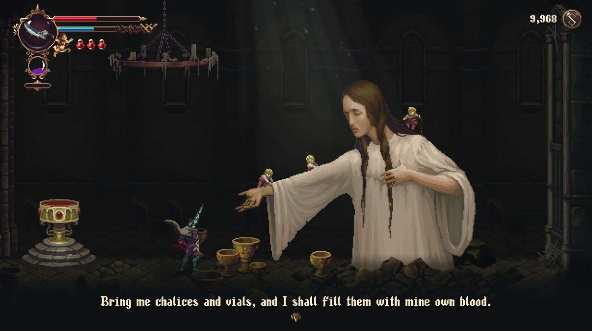

# ST-9：標籤與差事簡報先保存，再完成

四個當舖標籤與屋頂首次差事簡報，現在以真Main的完整保存為完成邊界。寫入失敗保留原讀取、原次數與結果，保持暫停並可重試；成功後一次安裝完成、旗標與NPC次數，再通知。writer成功後來源消失，讀取已保存結果仍有正確次數，不依賴已不存在的等待者。[設計與參照](../../../../design/20-campaign-experience/NPC_TERMINAL_COMPLETION.md)、[收據](validation.json)、[全部原檔](raw.zip)、[SHA](manifest.json)。

原ad8正式程式以真Main／真標籤／真tmp目錄拒絕：14項／5失敗，0ERROR／0SCRIPT ERROR；原槽未變，卻已提前發布旗標、已讀與次數。兩個探針前提失敗（headless等render、缺匯入）先保留，補齊原匯入後才取上述負控制；不冒充產品失敗。正式compiler重生資料，只多五個明確producer政策，無其他故事文字／結果變動。

原自動回歸只追加檢查：NPC原流程加4項、RunSave標籤檢查加56項、修復邊界另加6項；原斷言／輸入／等待逐位元重建相同。原RunSave＋實際四個標籤、真writer／真磁碟／共用area／通知回呼後補存：政策停用控制586／8→啟用606／0；早期版本578／8→594／0也保留。負控制失去重試前提時不呼叫無效retry、跳過成功後檢查，故總數不同；正向沒有減判準。最初原NPC＋RunSave含四項新檢查1644／0、109秒；最後受影響選擇器含全部66項新檢查。

中途退出另有真writer保存首句、原context與未完成結果。新政策啟用但未修來源接回時，同一凍結原檔cold reader5／1，原NPC分派沒有接回等待者；修後同一份bytes12／0，恢復真正NPC、真IO拒絕、公開重試及單次結算。不是只驗完成後續玩。正式來源先解析舊旗標下原dispatch，再保留原then邊界，不允許其他producer或已完成結果重播。

另驗無關的整輪修復：明示讓「已拿到盤」旗標與空物品容器矛盾，原候選若從已修復資料建立，會在讀標籤時偷偷補發資料盤；同原回歸611／3→611／0。改保留真實owner資料的深複本，writer的整輪修復差異必須先拒絕；未提交時提供載入原進度，最後另加一項UI語義檢查，不誤說新結果已保存。

最後整合基準a651df03：checks: 63403, new failures: 0, known failures (tests/known_failures.txt): 0  (wall time 1187 s)，含準備1187.60秒。原runner／selector／filters／known_failures保持，全部分片與來源SHA保留。

最終十五個原生程序，共246項／0失敗、0引擎ERROR／0退出洩漏診斷：五來源各真IO拒絕／重試／獨立冷讀，翌日當舖的懷錶亦真跑；加上提交後來源消失的正式重載、首句退出與另一程序續玩。每個cold reader先核對真正writer凍結bytes SHA。最新30張PNG逐張檢視；首次十程序165／0及20張原圖也保留，當時鷺reading圖在演員出現前，標籤首句仍逐字中，不能當作完整畫面驗收。最終只等正式演員與完整首句，不改動畫時長或代按略過。

先前整合十五程序245／0雖功能檢查通過，逐張圖卻發現中途冷讀背景錯位；原61組只完成部分便主動停止（197.97秒），不當作通過。鏡頭global已在(666,279.9977)，實際screen center仍(77.7,32.6664)，主角畫面點(1246.016,731.6761)在viewport外。純force-scroll控制維持暫停、同request及NPC次數0，就把畫面正確回到當舖；同frozen bytes原生18／1→18／0。正式snap同步發布捲動座標，不改平常平滑、震動、縮放或世界時鐘；最終加實際viewport中主角可見的斷言，再完整重跑十五程序與原61組。舊30圖與部分回歸完整保留，不能用功能數字代替看圖。

較早探針一律把人物位置移36px，原懷錶位置其實更靠近雨衣，產生8／2的來源前提失敗。真實磁碟context已證明讀到雨衣；沒有改最近互動規則。物件使用原8px、人物36px，先核對實際互動目標與對應場景；所有失敗腳本、log與原圖保留。

軟體Forward+ HDR／llvmpipe與Dummy音訊，真Main／Level保留PAUSABLE、觀察節點ALWAYS。新遊戲後安排公開換區與位置；鷺明示加入先前晚飯前提，從未注入目標旗標／完成。標籤讀取圖的主角有些在邊緣或場外，反映工具安排的位置／當刻鏡頭，不作自然鏡頭或角色接點驗收。來源消失明示在真正PRIMARY_COMMITTED hook排除實際actor；不是自然隨機離開。這不是人工整章、實體手把／GPU、所有NPC獎勵／選項／續段或通用atomic_v1；整票條件不由這五來源代勾。

實際重看Ghost Song的講者／繼續層次與Blasphemous 2的互動物關係；來源URL／SHA與原件附zip，圖片不證明保存機制或玩家偏好。版權保留原作者。

原檔1314項、29,274,766bytes，zip SHA `7e209edca5e20d1911e36dfe1319103091852f165642f87c93d4aca869a6f47f`，逐項解出核對完成。
