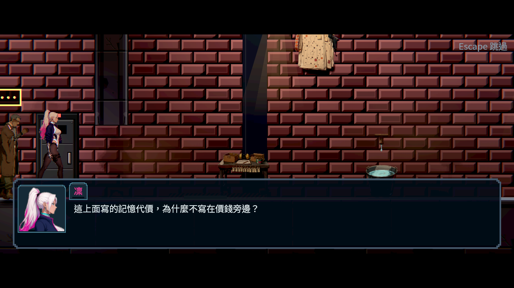
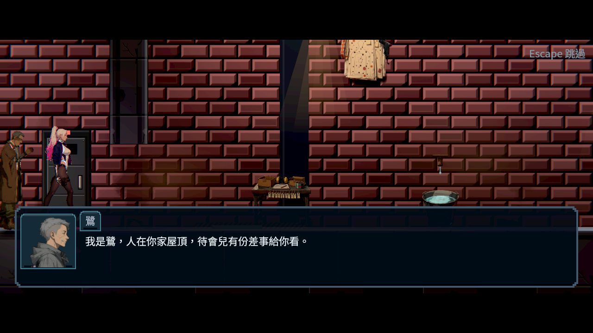
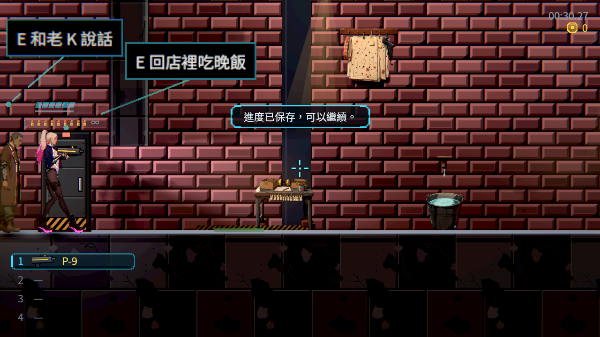

# 序章櫃台：故事結果先保存

原Main新遊戲，沿原真輸入探針完成走、跳、射擊、近戰、格擋、衝刺，真的回櫃台和老K互動。倒地變體由原訓練器打停；乾淨變體先舉盾擋住第一次攻擊，不灌教學旗標、死亡、金額或交談次數。兩種復原說明與鷺的收尾電話原本在真存檔拒寫時仍發布結果，沒有保留原段重試。

現在三個有限段落沿用既有原人物保存邊界。先保存原旗標、完成歷史及同一原櫃台人物的次數，再通知並釋放等待者；失敗保留原段和真正重試。連續重試不重播、不重算人物次數；取消不記為讀完，原途中主檔可逐bytes在新程序接續。保留原對白、人物、教學動作、價格與派生出口規則。

新正式故事結果必須明確登記保存政策；沒有政策或拼錯會在編譯時指出原段落。執行時仍獨立核對真正原人物、關卡、請求、條件及結果；政策字串不等於授權任意來源。既有重要旗標通訊保留其原Main保存擁有者，不因這次檢查改成另一種呈現。

## 參考

直接讀取官方商店資料並逐張查看 [Gunpoint室內層次](research/Gunpoint-0.jpg)、[電路狀態視圖](research/Gunpoint-1.jpg)、[SANABI安靜人物構圖](research/SANABI-0.jpg)、[霓虹街景](research/SANABI-1.jpg)，[原始URL、開發者、權利及SHA](research/sources.json)。Gunpoint將可玩房間與裝置狀態分清，SANABI在淡色林景或密集城市裡仍保留地面與人物的位置關係。這些圖供引導與層次參考，不能證明作品內部存檔或玩家偏好，也不放進本作遊戲資產。

## 重跑

```bash
python3 tools/story/test_completion_policies.py
python3 tools/run_prologue_completion.py --godot /absolute/repaired/godot --output /absolute/new/output
```

公開重跑器先跑三條完整原真輸入路線，再由這些路線真Main產生的三份原主檔驗證原人物重試、原途中主檔冷讀、取消及完成後冷讀。每案獨立程序與保存槽；原checksum主檔逐bytes複製，不重新編碼，不手填旗標。快速原人物案例把原玩家移到同一櫃台的互動範圍，完整輸入路線則用原移動操作走回櫃台，兩者證據分開。

本次不以局部邊界代稱真人序章計時、實體GPU／手把或整體角色畫風通過。正式對話圖仍見原人物靠近相機左緣，世界提示偏大；原圖保留，沒有靠裁切隱藏。


## 最終驗證

| 項目 | 實際結果 |
|---|---|
| 同一原真輸入探針三條路 | 58／6 → 58／0，零死亡 |
| 同份原主檔的快速原人物控制 | 33／6 → 33／0 |
| 公開重跑器 | 27 程序、337 項、0 失敗；含原三條真輸入與三份原途中主檔冷讀 |
| 編譯政策負控制 | 6 測試全過；移除／拼錯政策、重要通訊取消凍結或暗加獎勵／交付皆拒絕 |
| 作者編譯 | 139 場、10 任務、0 缺譯，正式資料只新增三個政策欄位 |
| 原受影響選擇器 | 8 組、4 程序、3,936 項、0 新／0 已知失敗、135 秒 |
| 原始分片退出貼圖檢查 | 4 份 log、0 DummyTexture 退出診斷 |
| 前批診所原回歸 | 29 程序、385 項、0 失敗 |
| 軟體 Forward+ | 五程序60項、0失敗、0ERROR／腳本錯誤／退出洩漏，六張原圖逐張已看 |








[逐張原圖檢視](visual-review.json)、[實測與界線](validation.json)、[逐檔SHA](manifest.json)、[原始來源／完整輸出／原主檔與所有控制](evidence.zip)。封包 4,718,974 bytes、665 檔，SHA-256 `9b6d59fc849799b6480f26e41e475fecbbfbddcae03f94722d296b6f95a00793`，已逐 entry 解壓讀回核對。

全部34個有結果／旗標／交付的正式演出都有明確政策或既有重要旗標通訊擁有者。這是政策宣告與編譯審查；世界事件與自動物品來源仍需各自核對，不把本次小表格當成全票條件。

前批診所a4c4c93e已由正常推送合入main且主支同步；原推送及同步收據附在封包。本批GitHub詳細CI查詢仍受先前401限制，沒有重試或繞過；上述本機結果不代稱本批遠端CI。
