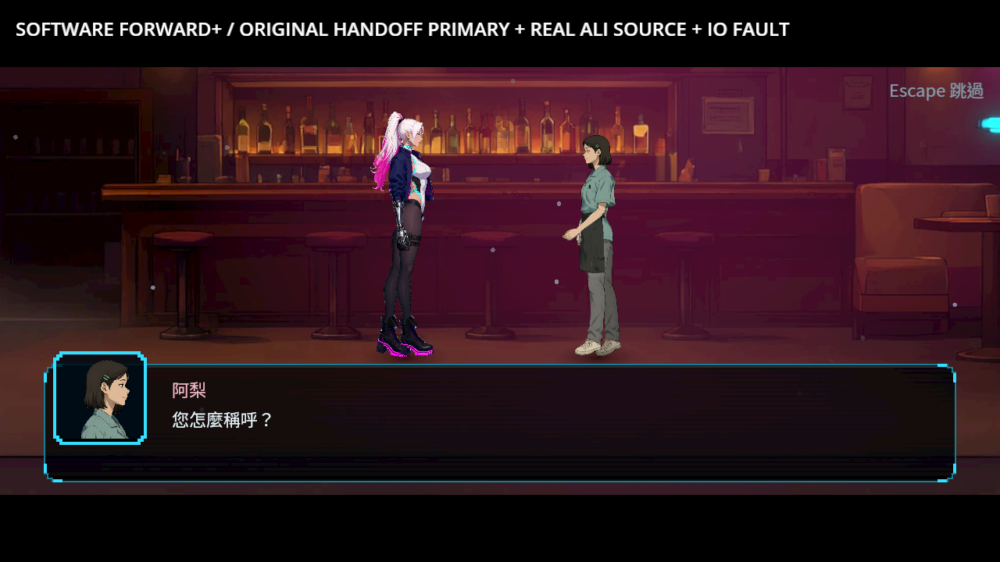
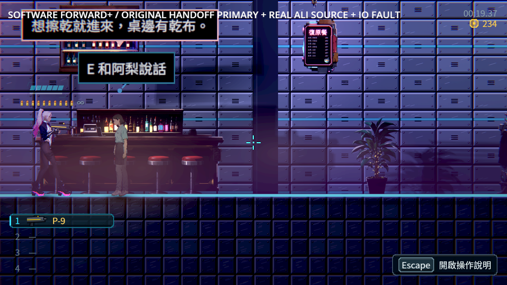
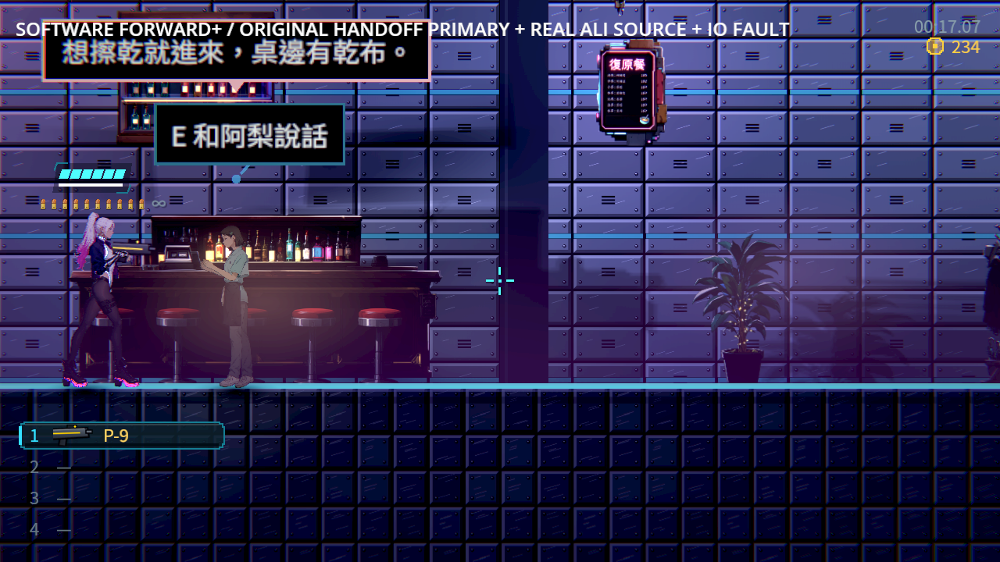
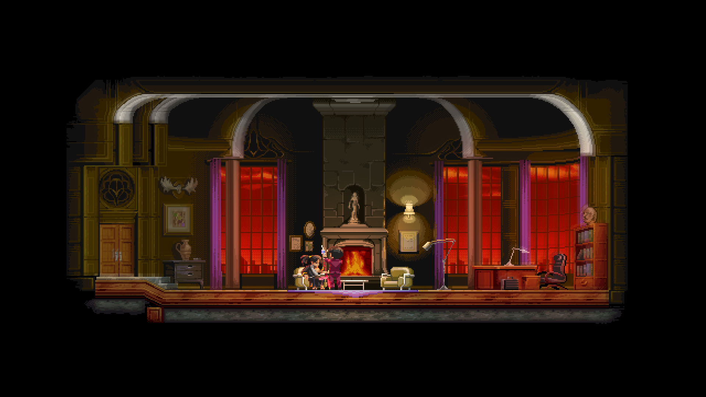

# ST-9：阿梨首次點餐與只坐的結果保存

點餐當下不扣200，先一起保存餐酒明細、原訂單憑證與接待選擇，再開始互報名字。只坐不產生帳單或訂單。保存拒絕時保留原段落、原人物等待者與重試視窗，不能靠略過提前發物或跳到名字。

成功重試不重播點餐動作，亦不提前增加交談次數；原途中主檔保留真正阿梨與未讀名字。讀完名字才結算一次。取消後可從原人物接續，另一程序讀原始bytes也不重建帳單；通知內普通扣款及NEW解除保留。








[逐張檢視](visual-review.json)保留全部八張原生PNG來源及公開圖SHA。頂部白色是探針診斷，產品不增加此文字；保存視窗的原不透明底板保持。完成圖阿梨仍在場，原招呼有合法來源，不是前批離場後仍讀舊泡的問題。軟體llvmpipe Forward+／HDR2D與明示安排前提不代稱實體GPU、實體手把、真人整章或整體畫風驗收。

## 真來源、前提與控制

起點沿用[原交盤主檔與來源證明](../../../../tests/fixtures/ali_handoff_seed.provenance.json)，逐bytes讀原封套，透過正式阿梨和原菜單選擇；沒有補接待、名字或本次NPC次數。較早的資料盤及237信用點是明示安排的前提，原交盤及兩次普通花費後為235；本批通知內再花1，保留234。點餐建立200明細，這不代表已付款，也不影響明早的委託報酬。

| 驗證 | 結果 |
|---|---|
| 相同兩路真.tmp目錄拒寫探針 | 28項／8失敗 → 28項／0失敗 |
| 原受影響選擇器九組、四程序 | 5,442項，0新／0已知失敗，157秒 |
| 保存與有限來源契約 | 667項／0失敗，原旗標策略仍禁止交易／物品 |
| 最終獨立無頭程序 | 10程序244項／0失敗 |
| 軟體Forward+真Main | 4程序114項／0失敗；原途中主檔另程序讀取 |
| 原交盤／週日／耳機／阿梨／氣泡回歸 | 107／133／615／306／54，最終各0失敗 |

來源策略只登記本批兩個正式接待段落，核對原交易、物品、旗標、同一NPC及名字接續；既有旗標策略不擴權，也沒有宣告通用atomic_v1。新探針沿用原阿梨的同一套真人物、選項、拒寫及等待者流程，避免複製整套測試。

首輪成功探針直接用整個陣列比較JSON數字與整數，四項誤判，原主檔三份投影實際都是0／1。保留當時來源及輸出；改為如原探針逐一比較三份數值後重跑，不改正式保存API或放寬數值。

原週日回歸第一輪observer_reset的31項行為全過、退出0，但退出診斷有1個ObjectDB物件與1個DummyTexture RID未釋放，因此共用嚴格執行器判失敗並停止該輪。原輸出保留。修改前f8286413與本次固定來源各另三次verbose同情境均未重現，沒有足夠資訊定位那一個物件；不宣稱根因已修或基底已重現，也未調整錯誤過濾器。

[驗證收據](validation.json)、[逐檔SHA](manifest.json)及[全部原輸出、失敗、途中主檔與來源](evidence.zip)保留可重跑證據。原測試的缺圖／損毀資料等刻意錯誤依原規則處理，專項程序另嚴格拒絕ERROR、腳本錯誤與退出洩漏。

```sh
python tools/run_reception_completion.py --godot /path/to/repaired/godot --output /absolute/new-reception-evidence
GODOT=/path/to/repaired/godot SHARDS=4 tools/run_tests_changed.sh f82864137b021eeb43011f899907e1bbe5bea4d2
```

## 相近作品與依據

重新逐張查看[前批Katana ZERO官方室內原圖與URL](../ST-9-ali-completion/research/sources.json)，室內家具與地面支撐、人物間距及局部暖光作視覺參考；[Night in the Woods／Oxenfree／Spiritfarer官方圖](../ST-9-sunday-choice/research/sources.json)作橫向敘事互動參考。圖片留在原附件，屬原權利人，不重複包裝為本作資產，不由商店圖推論玩家偏好或保存實作。



[Ink保存完整故事state及遊戲元件封裝](https://github.com/inkle/ink/blob/master/Documentation/RunningYourInk.md#saving-and-loading)、[Yarn Spinner Godot變數與對話保存](https://yarnspinner.dev/docs/godot/gdscript/05-connecting-to-your-game/04-variables-and-storage/)作保存位置與結果一致的依據，沒有引入另一套runtime。餐酒原選項短說明維持「現在不扣款」與「只坐不欠200」。

前批NE-228來源離場版本f8286413之遠端完整CI實際97,999項、0新／0已知失敗、567秒；真混音與交盤107／週日133／耳機615／阿梨306／來源54均成功。[實際job與固定引擎來源收據](previous-ne228-ci.json)，原始job與metadata在本附件ZIP的previous-ci。這是前批結果，不代稱本次遠端CI。
