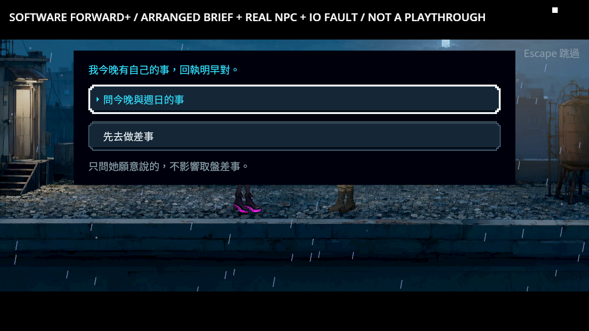
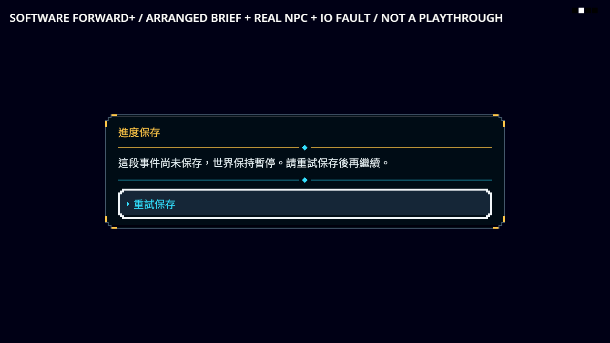
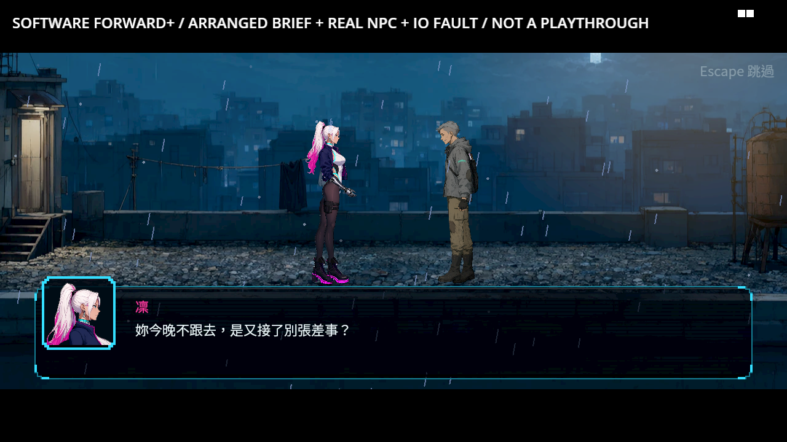
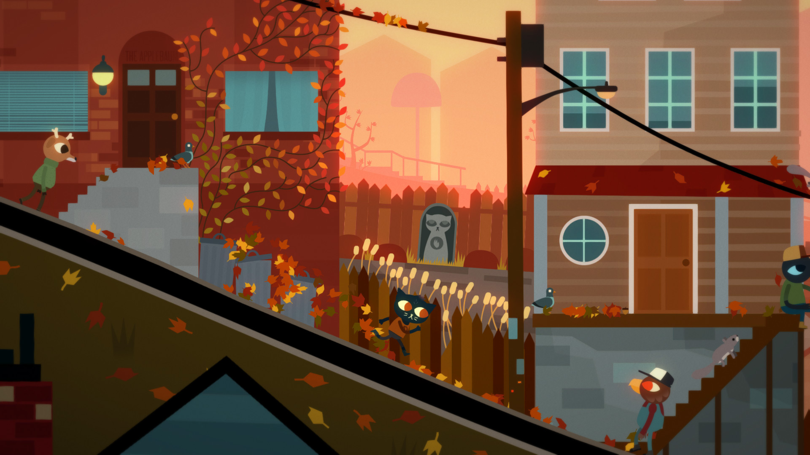

# ST-9：自願追問週日，保存後才接續

原本點「問今晚與週日的事」時，寫入被拒絕仍會發布接受旗標、離開選單。現在先保存接受、接續位置與原互動來源；拒寫停在同一個選擇並提供重試。選擇成功不代表對話已讀，接續對話真正完成後才保存已讀與交談次數。

「先去做差事」與未回答就略過維持不接受此支線。拒寫待重試時不能換另一選項或略過繞過保存。取消待保存互動不發結果，已成功保存的選擇能從真正原主檔接回原 NPC，原等待者只結算一次。







## 驗證與可重跑證據

這是安排好「已聽簡報」前提、真 Main／鷺 NPC／正式選項與檔案系統拒寫的情境。畫面為軟體 Vulkan Forward+／HDR2D，使用 NE-280 固定修補引擎；不當成真人整章通關或硬體效能驗收。

- [驗證收據](validation.json)與[逐檔 SHA](manifest.json)對應 [原始證據封包](evidence.zip)。原始 log、失敗退出碼、截圖、通知當下主檔與測試來源都保留。
- v4 同一份探針在修前有 17 項、6 失敗；修後 12 項、0 失敗。數量不同是修前錯誤發布了接受通知，觸發 5 項同步觀察；修後拒寫沒有通知。不能以後續自動保存倒推第一次通知的耐久性。
- 最終八程序覆蓋拒寫兩次後重試、接續段再拒寫／重試、完成冷讀、原主檔途中冷讀、外部取消、主動返回、預設略過，以及接受通知請求延後取消後再冷讀續問。各通知讀原主檔的 checksum 封套，不先經讀取修復；NPC 的三份磁碟投影與 live 在接受時皆為 0，閱讀完成時皆為 1。
- 接受通知裡可以普通扣款和標記 NEW 已讀，並驗證後續保存與冷讀；重入故事、另一選項及路由不能插入發布中的結算。
- 擷取加上逐張改變的黑白標記及實際說明／按鈕可見性檢查，排除尚在原點的容器把診斷字誤算成介面。八流程之後只改擷取判準，另以真 Main 重拍 49 項全過；擷取以外的探針邏輯及全部遊戲來源 bytes 不變。早先「視窗未畫完」是檢視工具錯誤回傳 application/octet-stream 的預覽問題，11 張原 PNG 均含 9,206 個可見白像素；相同原 bytes 用 image/png 重看完整，沒有影像修改，也不列為遊戲修復。
- 途中讀取首輪探針在場景初始化後過早檢查，後續改成等待真 NPC 演出恢復。程序管理的首輪逾時測試也過早觀察尚在處理終止訊號的子程序，改為在 2 秒內確認它已終止；兩者均保留原失敗，不改遊戲門檻。

重跑（獨立且原先不存在的輸出目錄）：

```sh
python tools/test_runtime_probe.py
python tools/run_sunday_choice.py --godot /path/to/repaired/godot --output /absolute/new-sunday-evidence
python tools/run_handoff_completion.py --godot /path/to/repaired/godot --output /absolute/new-handoff-evidence
GODOT=/path/to/repaired/godot tools/run_tests_changed.sh 598c2324b247c0b9a256f1697b4e37cef41da261
```

通知內請求取消依既有規則在整份結果發布後執行；這是合法取消，不要求被取消的閱讀繼續完成。第一輪把取消插入一般閱讀案例，後面的正常閱讀斷言因此有 5 項失敗，後續拆為獨立取消／冷讀案例。原輸出保留；已保存的接受及普通扣款不能因取消消失，未讀對話也不能代填已讀。

程序管理共用原隔離存檔、獨立設定檔、完整原始輸出、逾時清理及嚴格 ERROR／洩漏判斷。交盤原三次通知的強制核對維持。這個接續權限只給原屋頂週日選擇，沒有開放任意支付、交物或其他接續；ST-9 其他驗收依原票保持。

## 實際讀過與看過的參考

[Ink Saving and loading](https://github.com/inkle/ink/blob/master/Documentation/RunningYourInk.md#saving-and-loading) 保存完整故事狀態；[Yarn Spinner Godot Variables and storage](https://yarnspinner.dev/docs/godot/gdscript/05-connecting-to-your-game/04-variables-and-storage/)說明變數與對話位置的整合界線。本作保存自己的整輪狀態、接續場景與原 NPC 來源，沒有引入另一套故事引擎。

以下是 2026-10-26 實際取得並看過的官方 Steam 商店原圖，來源 URL 與 SHA 見 [sources.json](research/sources.json)。只作同類橫向探索／人物對話的視覺參考，不放進遊戲資產，也不能由圖推論其磁碟保存方式或宣稱玩家偏好調查。



Night in the Woods 的商店說明明列探索、故事與人物；這張圖可參考可走空間和人物分層，沒有顯示對話選擇或存檔行為。


Oxenfree 這張圖可參考人物附近少量高辨識提示，以及暗場中的清楚互動焦點；不照搬即時對話或時間限制。


Spiritfarer 這張圖可參考閱讀區與人物所在場景的層次。本作沿用既有像素 UI、鍵盤／手把焦點與一句後果說明，錯誤復原時明確標示尚未保存。
