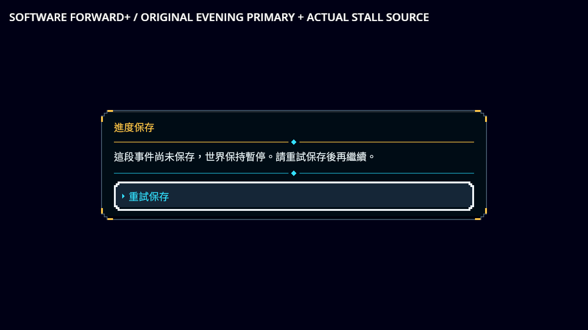
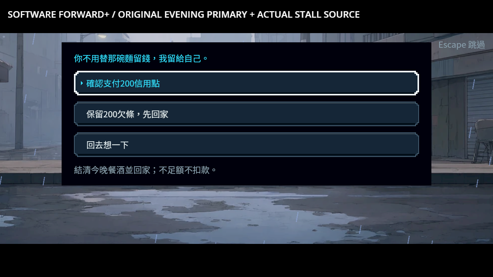
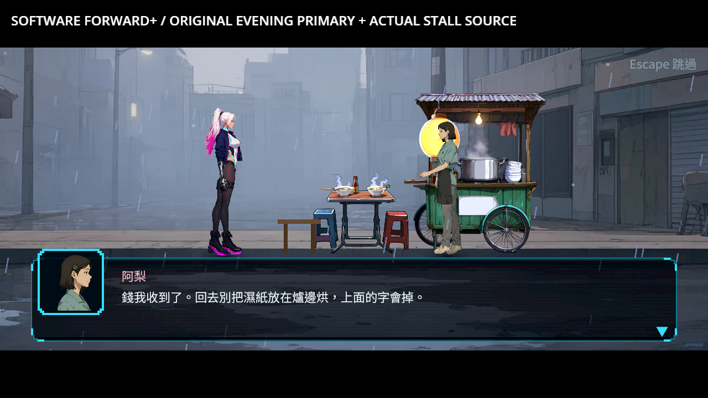
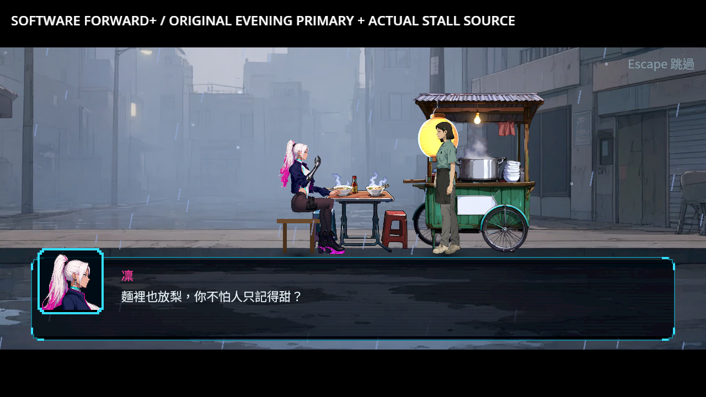
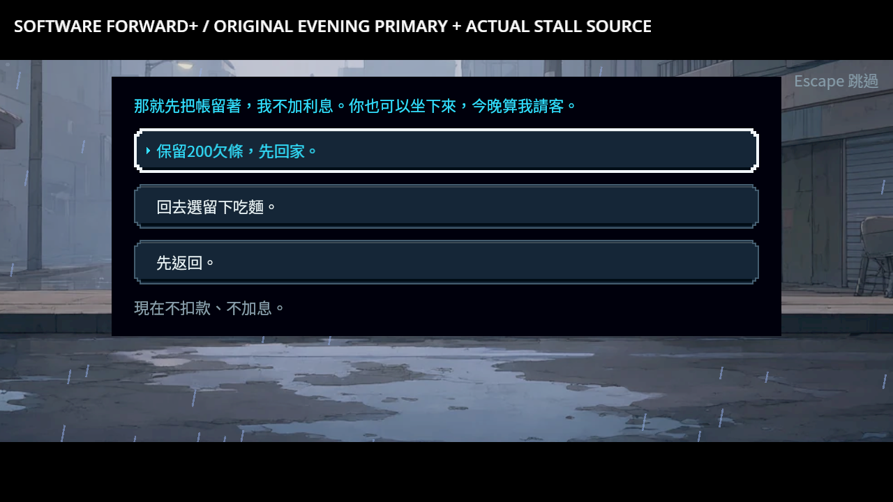
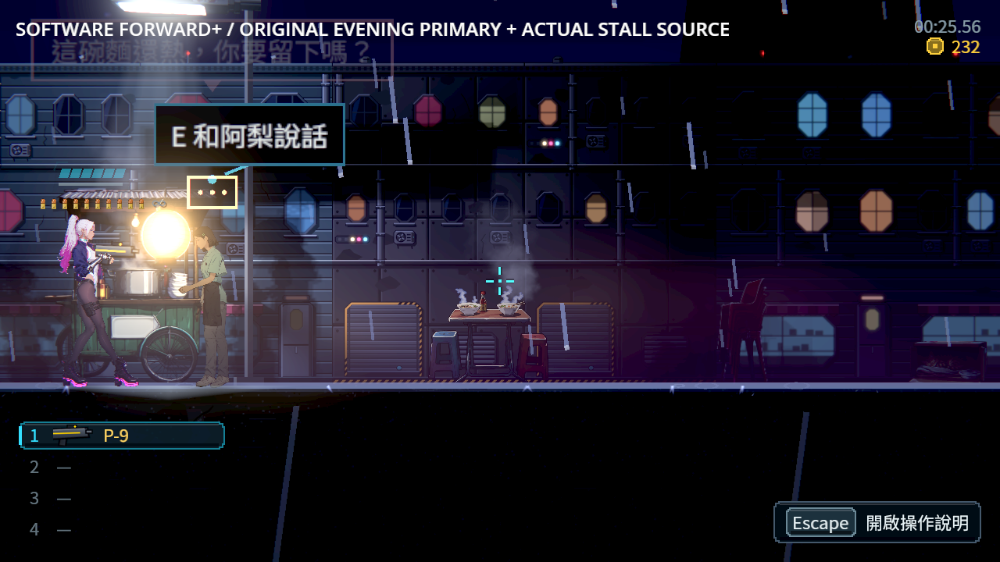
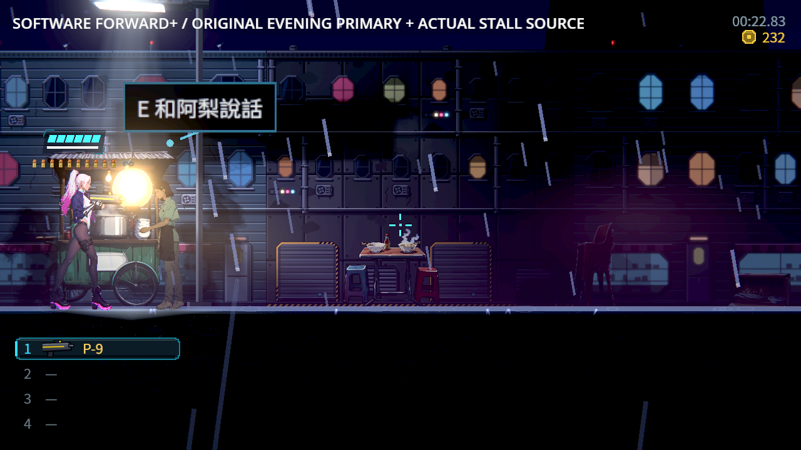

# ST-9：攤位選擇、餐帳與未讀接續

選擇離開／留下不等於已付、已接受招待或吃完。現在原選項、付款200、200欠條、招待、真正吃完與讀到地址分開先保存再通知。中段保留同一位原攤位阿梨與未讀下一段，終點才結算一次交談；拒寫保留原段、原選項與同一重試視窗，重試不重播演出。

現金不足不扣款、不標記已付，保存原不足額選項的位置後再讓玩家決定；該位置也拒寫才顯示重試。直接略過、接受招待後取消、原bytes另程序冷讀，都不能重付、造單或提前取得未讀地址。回去想一下可真正重選兩次，原未付訂單仍在，次數1／2與主檔一致。

## 正式原圖















[二十張原圖逐張檢視與SHA](visual-review.json)。圖上白字是探針診斷；保存底板保持原不透明設計，沒有加工圖像或以透明掩蓋文字。233是原晚間主檔的實際起點，探針刻意在通知內普通花費：已付圖32＝233−200−1，招待完成228＝233−5，招待本身不扣200。途中原主檔冷讀保留其當下錢包，不重演寫入程序的通知花費，因此不要求與另一條寫入後繼路線的最終餘額相等。

已付款、吃完或簽欠條後的原地圖仍短暫顯示舊「你要留下嗎」招呼，[未加工原圖](../../images/ST-9-supper-stale-greeting.png)保留。阿梨仍在場，但原條件已不成立；這和前批離場來源不同，交NE-228接續。冷讀沒有舊泡不能代稱已修；取消圖中自然淡出也不是本批修正。

## 真來源與驗證

兩份起點是上一批真Main、真原人物與原選項產生的晚間主檔，已與3a8b0b1b交付ZIP內的原entry逐bytes比對。[不可變來源、entry與SHA](seed-archive-provenance.json)；沒有補本次晚餐、地址、錢包或攤位次數。更早的資料盤及237信用點是明示安排的前提，這不是自然整章遊玩。原對白、選項、金額、條件與演出資料逐項比對，只有十個正式完成策略欄位新增，缺譯0。

| 項目 | 結果 |
|---|---|
| 相同12邊界真拒寫探針 | 194項／40失敗 → 194項／0失敗，SHA不變，最後每案均核對實際IO原因 |
| 原受影響選擇器67組、四程序 | 67,793項，0新／0已知失敗，656秒 |
| 初次有限來源與保存契約 | 714項／0失敗，原斷言保持；最終原回歸另完整執行 |
| 最終獨立無頭程序 | 47程序1,253項／0失敗，13份原途中主檔另程序續玩 |
| 重複真重選 | 另1程序40項／0失敗，兩次原互動，未重複開單或扣餐酒 |
| 軟體Forward+真Main | 10程序351項／0失敗，二十張原圖；0引擎ERROR／腳本錯誤／洩漏 |
| 原耳機／首次接待／阿梨／週日／交盤／氣泡 | 615／244／306／133／107／54，最終各0失敗 |

有限契約按攤位家族獨立整理，純來源驗證與磁碟／live協調分開；接續圖有64節點上限，跨來源、錯誤結果、條件與預設皆拒絕。候選帳本供衍生旗標及接續條件使用，不能用live舊帳誤判「已付200」。不足額只承認原失敗路徑，位置保存不捏造付款已讀。兩個道別僅在原成功段已提交、同人物／同入口且真正未讀時接續；原人物來源、出生格與等待者仍核對。未宣告通用atomic_v1。

## 退件與控制

最初正向探針有一處動態型別無法推斷，保留來源與Parse Error，核對PID／命令後只終止該失敗程序。成功路線再抓到真缺口：候選帳務仍讀舊live，造成付款後永遠無法接續；修正為原純帳本驗證後讀候選。早期194／0僅證明當時沒有提前生效，可能被語義前檢擋住，不代稱已真的到IO；最後同探針逐案核對真目錄拒寫並成功重試。

多旗標同批通知的後續讀者會見到前一通知的合法花費；探針改為核對原提交金額加同批已花費，及最終新捕捉，沒有改正式程式去逐通知重寫磁碟。另一稿略過帶選項的台詞而觸發原安全返回預設，冷讀不足額也曾因情境名稱選了返回；都保留原輸出，改為透過原選單明確選取，外層一致性檢查及新增冷讀結果斷言保留，沒有補旗標掩蓋。

[逐檔SHA](manifest.json)、[驗證收據](validation.json)與[全部來源、失敗、原主檔、日誌及原圖](evidence.zip)可追查各版本。原測試過濾器、已知失敗與既有斷言未放寬；保存套件只加新契約檢查入口。軟體渲染與程式輸入不代稱真人整章、實體GPU／手把或全角色／全場景畫風驗收；ST-9原整章條件保持。

```sh
python tools/run_supper_completion.py --godot /path/to/repaired/godot --output /absolute/new-supper-evidence
python tools/run_supper_repeat.py --godot /path/to/repaired/godot --output /absolute/new-repeat-evidence
GODOT=/path/to/repaired/godot SHARDS=4 tools/run_tests_changed.sh 3a8b0b1b42260692d0d262b7947f46f5dbee872b
```

## 相近作品與依據

[Forgotton Anne官方商店](https://store.steampowered.com/app/542050/)兩張原圖均已查看；街邊攤位、家具支撐、局部暖光與近景作構圖參照。[官方URL、原圖與SHA](research/sources.json)，原權利人保留權利，未作為本作素材；不由商店圖推論玩家偏好或存檔內部。


[前批Katana ZERO官方圖](../ST-9-ali-completion/research/sources.json)、[Night in the Woods／Oxenfree／Spiritfarer官方圖](../ST-9-sunday-choice/research/sources.json)、[Ink保存完整故事state](https://github.com/inkle/ink/blob/master/Documentation/RunningYourInk.md#saving-and-loading)及[Yarn Spinner Godot保存](https://yarnspinner.dev/docs/godot/gdscript/05-connecting-to-your-game/04-variables-and-storage/)沿用為來源與接續依據，沒有引入另一套runtime。

前批首次接待3a8b0b1b遠端完整CI實際98,021項、0新／0已知失敗、665秒；真混音與六組專項成功。[實際job／固定引擎收據](previous-reception-ci.json)，原始job及metadata在本ZIP的previous-ci，不代稱本次遠端CI。
