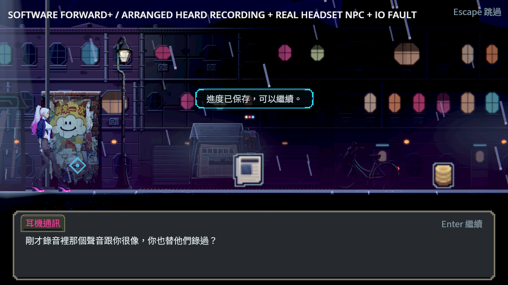
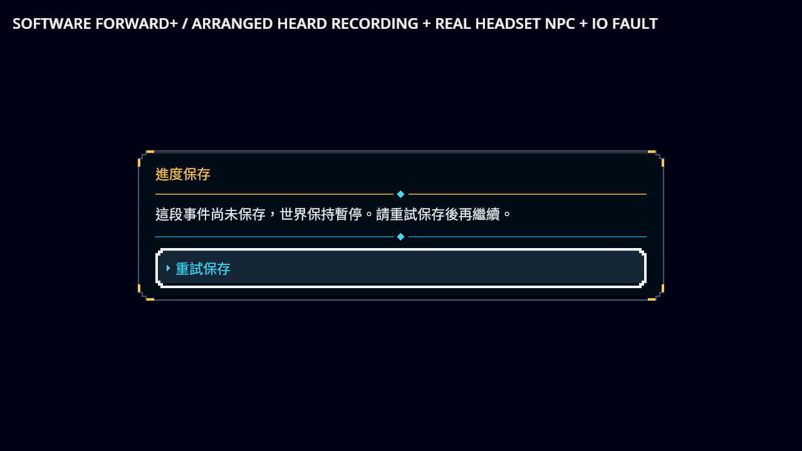
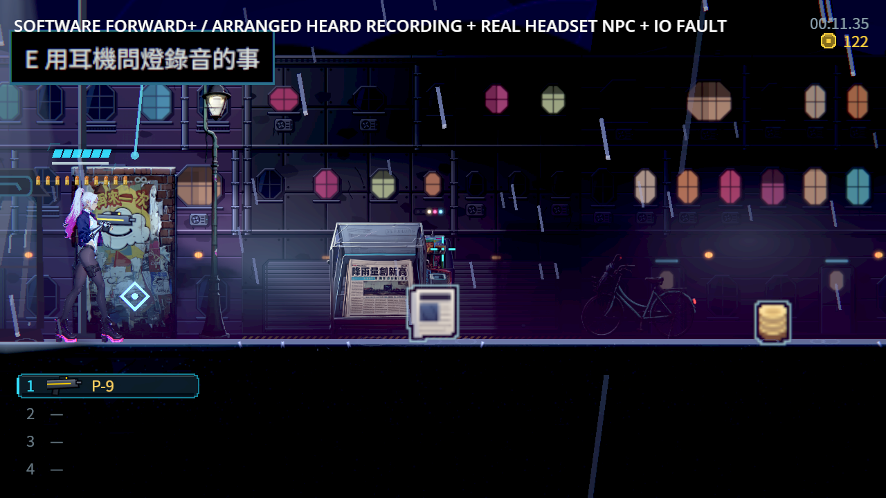
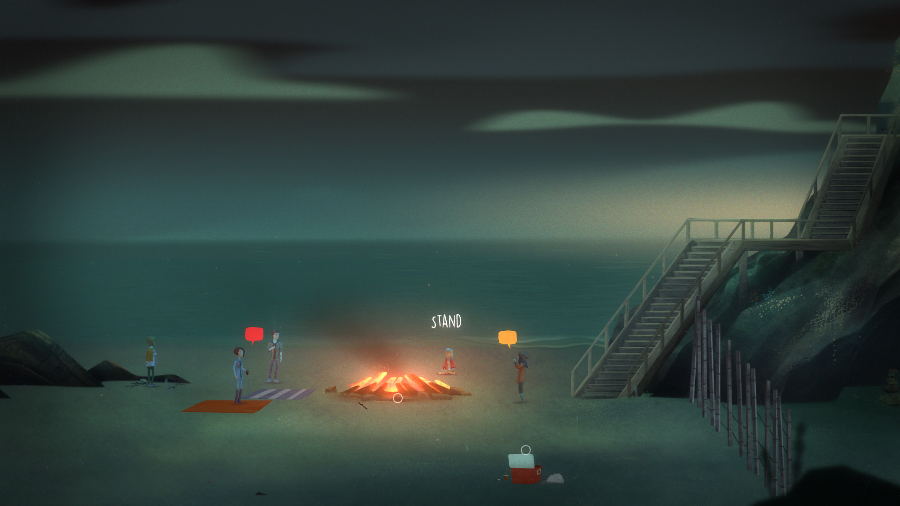

# ST-9：追問燈的保存與原互動接續

接受問題、讀完第一段、再問第二段是不同結果。每一步先保存接受／已讀、正確接續位置及原耳機來源；中段不增加交談次數。第二段或「先不問」回應真正結束，才一起保存閱讀與一次交談次數。

拒寫保留同一個選擇或已結束的閱讀、原等待者和重試介面，連續拒寫不發部分結果。正在顯示問題時略過、略過到尚未出現的問題、自動略過，都等同一個保存結果，沒有每影格重試磁碟。

「先不問」保留第一段線索，回訪仍可再問。有限問題可以重選，只有不發獎勵的回應可以重複保存；一般已完成結果的防重複規則保留。兩次「先不問」後第三次再問，原主檔及live交談次數依序1／2／3。先返回再來問、接受後取消再續問，也不會被問題的閱讀歷史鎖住。

問題的選項資料損毀或正式預設選項被改動時，拒絕借用原接續權限並安全返回；保留之前已保存的第一段及普通花費，不讓播放器等待一個不存在的重試。旗標數字與字典比較的GDScript型別錯誤曾在負面測試中出現，最終先驗型別再比較。

## 原圖與證據







[驗證收據](validation.json)、[逐檔SHA](manifest.json)與[原始證據](evidence.zip)記錄來源、原主檔、前後控制、每個程序的退出碼及原始輸出。檔案透過原校驗封套核對，不先經讀取修復；途中主檔只複製原bytes，不重編封套、不補旗標或次數。

這是明示安排既有「已聽錄音」前提，走真Main、原安全亭旁耳機NPC及正式選擇的情境，沒有注入本次接受／第一段已問／第二段線索。未聽者的反例也驗證不提供此互動。畫面是軟體Vulkan Forward+／HDR2D與NE-280固定修補引擎，不當成真人整章通關或實體輸入／硬體效能驗收。

## 可重跑驗證

```sh
python tools/run_voice_completion.py --godot /path/to/repaired/godot --output /absolute/new-voice-evidence
python tools/run_sunday_choice.py --godot /path/to/repaired/godot --output /absolute/new-sunday-evidence
python tools/run_handoff_completion.py --godot /path/to/repaired/godot --output /absolute/new-handoff-evidence
GODOT=/path/to/repaired/godot tools/run_tests_changed.sh 2360ea4c067d4981fc9aa92b5b5a24c281746583
```

主驗證包括17個獨立程序：完整拒寫／重試、完成冷讀、三份通知／選擇當下原主檔的途中冷讀、再次先不問與第三次追問、三種略過、先不問後冷讀再問、主動返回、未聽錄音、接受取消及冷讀、改壞正式預設選項的按鈕／略過回退，以及先返回後再問。不同程序各有自己的設定檔；原檔複製有SHA收據，通知讀三份磁碟世界投影與live。

五份原拒寫探針保持相同bytes：修前67項／19失敗，初輪修後67／0。實作中的回訪控制另外抓到問題已讀會鎖住重選，修成只允許原有限的冪等問題重選；普通獎勵沒有放寬。最初重複流程的最後次數斷言寫成1，第三次真正交談應為3，已按真實訪次修正，原兩項失敗輸出也保留。

最早正控制把已釋放的播放器直接轉型而報錯，之後先檢查有效性；生產路徑的自動略過同樣保護弱回呼與請求。已進入略過的選單不能再由驅動器重按一次選項，初輪這項探針失敗亦保留，後續等待原略過流程結束。這些都不以更改已知失敗或過濾器通過。

原選擇器首輪67組出現502項新失敗及10筆腳本錯誤，從獨立播放器／回放的略過等待未釋放暫停鎖開始，後續戰鬥與介面失敗隨之擴大。保留完整原輸出與當時14份來源；修正獨立播放不要求正式Story請求，舊請求則只退場自己的播放器，再重跑原斷言，不把這輪失敗加進已知清單。

第二輪原67組為67,699項／1失敗：十二個爆炸的額外耗時14.12 ms超過原6 ms門檻，沒有腳本錯誤。保留當輪完整輸出。原五組前置順序在改前、改後各單程序3,461／0，爆炸增量分別−0.40／−2.61 ms；沒有因此宣稱已定位先前耗時根因。環境CPU配額為四核，最後以四程序重跑相同67組，所有測試、十二個爆炸及6 ms門檻不變；最終67,699項、0新／0已知失敗、657秒，該次爆炸增量1.85 ms。

來源登錄與純契約已從保存控制器分開，新增能力限定原第一章耳機／屋頂來源與旗標接續，沒有宣稱通用atomic_v1。ST-9完整演出、其他故事結果與原人工條件依原票維持。

## 參考依據

[Ink保存完整故事state](https://github.com/inkle/ink/blob/master/Documentation/RunningYourInk.md#saving-and-loading)與[Yarn Spinner Godot變數／對話位置](https://yarnspinner.dev/docs/godot/gdscript/05-connecting-to-your-game/04-variables-and-storage/)支撐狀態與接續位置一起保存，沒有引入另一套runtime。

[同日實際看過的Night in the Woods／Oxenfree／Spiritfarer官方原圖及URL、SHA](../ST-9-sunday-choice/research/sources.json)保留於前一批，這裡直接引用。它們是橫向探索、人物閱讀和互動焦點的視覺參考，不能由圖推論磁碟保存方式，也沒有玩家偏好調查。




圖片仍屬原權利人，未作為本作遊戲素材。

## 最終驗證結果

| 項目 | 結果 |
|---|---|
| 同一份五邊界拒寫探針 | 67項／19失敗 → 67項／0失敗；原bytes與SHA保留 |
| 獨立播放器／回放及戰鬥、介面重點回歸 | 原四組3,441項、0新／0已知失敗、219秒 |
| 修正後原受影響選擇器 | 67組、67,699項、0新／0已知失敗、657秒 |
| 最終軟體Forward+真Main矩陣 | 17個獨立程序、615項／0失敗；退出0，無引擎ERROR／腳本錯誤／洩漏 |
| CI方式正控制 | 17程序、615項／0失敗；此輪早於僅修正獨立播放器略過路徑，來源SHA另存 |
| 舊五來源、翌日入口及冷讀 | 8程序、176項／0失敗 |
| 原交盤與週日追問 | 2程序107／0、8程序133／0 |
| 共用程序工具故障檢查 | 7項／0失敗 |

最終來源與首輪失敗的來源分開存放。原受影響回歸保留刻意故障fixture的輸出；沒有腳本錯誤或新增已知失敗。原生正控制逐程序另作嚴格ERROR／洩漏檢查。

前批週日版本2360ea4c遠端完整CI實際97,956項、0新／0已知失敗、517秒，混音八程序、交盤兩程序107項及週日八程序133項皆成功。[原job與收據](previous-sunday-ci.json)，不以此前批結果代稱本批遠端CI。
