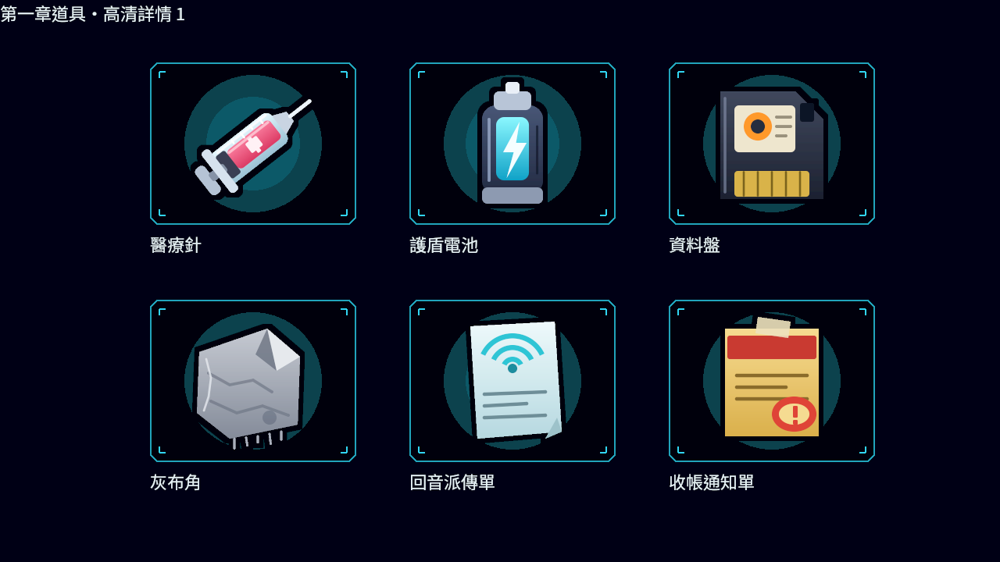
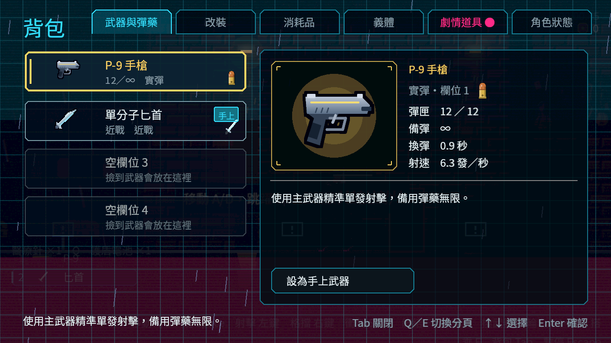
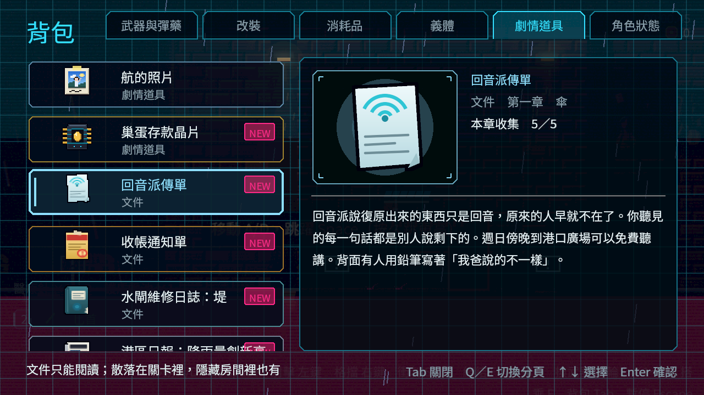

# ST-8 Commit-3 current validation evidence

Fixed base: `842dcd6c3561352b1c9f0df3b13119e7efd46b5f` (Godot 4.7.2 stable, Forward+, NVIDIA GeForce RTX 4070 SUPER).
CPU: 11 affected suites, 2,801 checks, 0 new failures, 0 known failures, 59 s. Item icon validator: 294 checks, 0 failures; 14 catalog entries, 18 resource icon IDs, 50 PNG assets, 51 SHA-256 entries.
Native capture review: 3 item-icon overview pages plus 11 inventory screens; each PNG is 1280×720. Screenshots show the selected Weapons & Melee, Consumables, and Story Items pages and their detail panels. No manual pickup or full in-game ST-8 gameplay is claimed.

## Screenshots

- [`item_icons_1.png`](../ST-8-current-item-icons/item_icons_1.png) — 1280×720 RGB; SHA-256 `eb6f4ad398445bfe989a671ad0fb685fa1d3a8c65be64939d6d80b9668df7d3b`
- [`item_icons_2.png`](../ST-8-current-item-icons/item_icons_2.png) — 1280×720 RGB; SHA-256 `d765a9b1e937b23e5a1a47eb10af113fad61611b7dfc9b85bbf12759d13abba7`
- [`item_icons_3.png`](../ST-8-current-item-icons/item_icons_3.png) — 1280×720 RGB; SHA-256 `e9b7d693922b64ad1e72e6f32ba8478dd3364978faffe0b97b6e64b0ea4308e6`
- [`item_inventory_0_0.png`](../ST-8-current-item-inventory/item_inventory_0_0.png) — 1280×720 RGB; SHA-256 `b0cd8bbb85381bb0443527a5cb3976b36acc07d8f9782a557c67c0d82ff9ca1e`
- [`item_inventory_0_1.png`](../ST-8-current-item-inventory/item_inventory_0_1.png) — 1280×720 RGB; SHA-256 `3cb444757ccbac329d6d5b0a0c7d980ca3cce7b0edd9dfc6db1eebcfedef3b4c`
- [`item_inventory_2_0.png`](../ST-8-current-item-inventory/item_inventory_2_0.png) — 1280×720 RGB; SHA-256 `b89a7f6a839d5207fc3c29cba7757e5303fdbc123f805dbc63aacab337689b2f`
- [`item_inventory_2_1.png`](../ST-8-current-item-inventory/item_inventory_2_1.png) — 1280×720 RGB; SHA-256 `2d05b45c2e4c362f6ad802bd9eef4414c793a9fccdabbbc2d1c7e92d2bd7581a`
- [`item_inventory_4_2.png`](../ST-8-current-item-inventory/item_inventory_4_2.png) — 1280×720 RGB; SHA-256 `2aacbc7473019f5ebf9926926250d4e434069ba4e1c76b713ef29193a9a98bbe`
- [`item_inventory_4_3.png`](../ST-8-current-item-inventory/item_inventory_4_3.png) — 1280×720 RGB; SHA-256 `0ff80eca9cd8fc1e04bde64175e91c84522f94062e8daca3fa7d53fd0eeb44d1`
- [`item_inventory_4_4.png`](../ST-8-current-item-inventory/item_inventory_4_4.png) — 1280×720 RGB; SHA-256 `6d2eef07530267b26e1698186ee28c55c810694a92ba21370f88716e9cd6b7dc`
- [`item_inventory_4_5.png`](../ST-8-current-item-inventory/item_inventory_4_5.png) — 1280×720 RGB; SHA-256 `bf141c737fc22de327d112cc6de20e584f13f90b58e29decae9ca19b655b87c9`
- [`item_inventory_4_6.png`](../ST-8-current-item-inventory/item_inventory_4_6.png) — 1280×720 RGB; SHA-256 `e529d61b0b9f699d06c56d8b5edb735df3a6eb2d28b81a3b8296d38eee8c2c01`
- [`item_inventory_4_7.png`](../ST-8-current-item-inventory/item_inventory_4_7.png) — 1280×720 RGB; SHA-256 `24043b202e97e7f2e1e6953738049466bd85deb9dc9d01ebb881627f285641a5`
- [`item_inventory_4_8.png`](../ST-8-current-item-inventory/item_inventory_4_8.png) — 1280×720 RGB; SHA-256 `9d8b6895db26f4eb479d76dbec3619fb4d10b390b5171cac87ef9884ed4b94bb`

Representative previews:

## Logs

- `root-suite-result.txt` and `shard_0.log` through `shard_3.log`: selected affected suites and the completed shard summaries.
- `root-item-icons.txt`: in-memory regeneration and all source/output hash entries.
- `icons-native-capture.log` and `inventory-native-capture.log`: native screenshot save records and actual engine shutdown diagnostics.
- User-data and per-run Godot app-data logs were excluded. Paths in copied logs were sanitized to `[workspace]`.

## Scope notes

CPU-selected suites: `UiKitSuite`, `CollectiblesSuite`, `StoryContentSuite`, `FloodPitSuite`, `Chapter1MapSuite`, `AreasSuite`, `EconomySuite`, `ProgressionSuite`, `SupplySuite`, `FxMeleePickupsSuite`, `MeleeWeaponsSuite`.
Not tested by these screenshots: manual pickup interaction, full chapter playthrough, flood-pit death/return interaction, or all world pickup renders. The selected CPU tests cover their existing data/UI/persistence contracts, not a human playthrough.
Logs retain expected negative-test `ERROR` fallback diagnostics and engine teardown RID/ObjectDB/resource warnings; test summary still reports zero failed checks and zero known failures. The inventory screenshot process reports 212 ObjectDB instances leaked at shutdown.
