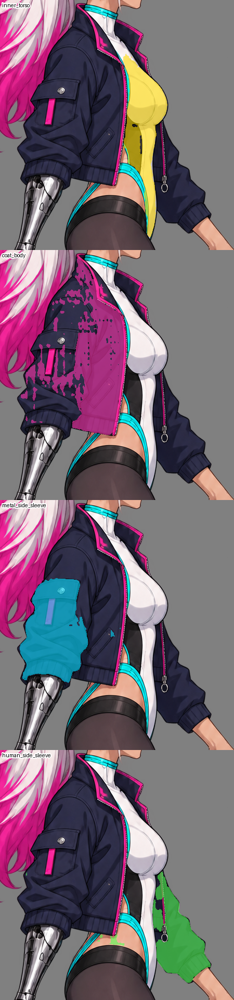
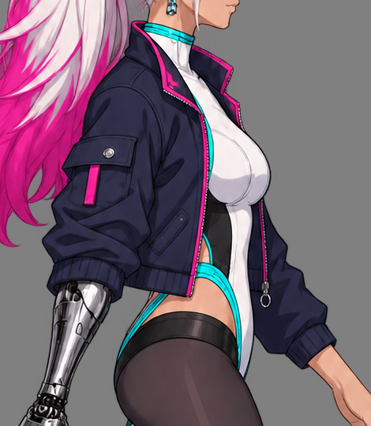

# 未採用的凜自然走路來源：停工歸檔

**REJECTED / NOT ADOPTED。** 此包只保存停止前已產生的原始來源、prompt／receipt、SAM輸入及主要語意拒收證據。不是正式角色資源，不提供人體、綁定、動畫或遊戲通過結論。本次沒有再次生成。

## 原位置與歸檔對應

| 歸檔位置 | 原位置 | 界線 |
|---|---|---|
| `raw/source.png`、`prompt.txt`、`source.json` | `art_src/characters/rin_walk_source_ig02/` | 1037×1517 RGBA；未正式切件／掛載 |
| `torso_underlayer/` | 同一來源目錄下`torso_underlayer/` | 1037×1516 RGBA，生成器重構圖；未對位 |
| `sam/` | `D:/NestEggVerification/ne222-neutral-walk-ig02/sam/` | SAM3.1四mask／點位／workflow，點位通過但語意拒收 |
| `semantic-review/` | 同一驗證目錄下`semantic-review/` | 原始review.json及四張主要原尺寸診斷；完整29輸出與私有腳本留原驗證區 |

保留的JSON為原生成及檢查紀錄，沒有改寫其相對路徑、絕對路徑與狀態。receipt中的IG01參照相對於**原art_src路徑**，不是本歸檔；原來源為已發布的 `art_src/characters/rin_walk_source_ig01/raw/source.png`。這不是可直接餵進正式配方的路徑配置。`manifest.json`列歸檔檔案與SHA，可核對原始bytes。

IG02來源SHA `bf3eb04ae13460f9ffe1349cfcdcf511f08fc964fbec78532e36e75a030d92c5`；底層SHA `ff9bda4aed98116d01b1ba9763796dcafa5e9652410e88fcc46abeb759fb0cc6`。工具未返回seed、模型ID、graph，metadata記null；這兩張是內建image_gen結果，不冒稱Qwen。

## 拒收原因

四mask符合列出的正／負點不等於部件語意正確。人工核心探測區中28,503個alpha≥128像素有1,646未認領、2,660多重認領；探測區不是完整輪廓。外套28連通件與大缺口，自然手側衣袖誤收457個露膚像素，內衣mask還跨腰與下半身。不得整包採用或依最近owner自動補洞。

新底層重新構圖，領／腰／袖窿不同，尚未與新走路來源對位。近遠側、肩袖隱藏根部、完整腰髖底層、來源關節、固定骨長、inverse bind、單骨與全動作驗證都未完成。

下面是原圖和分割overlay的原尺寸裁切，不是Godot畫面；colored outlines與塗色只為診斷。

修復方向與接手限制見 [技術交接](../../character-art-2026-10-11.md) 及 [使用者指南](../../../user_guide.md)。
