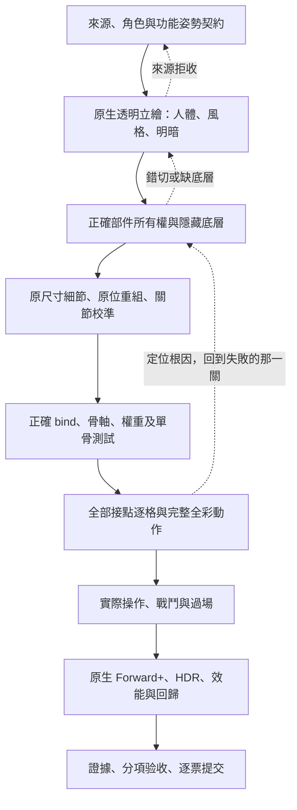
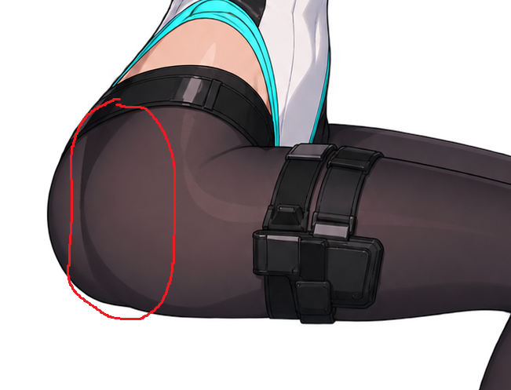
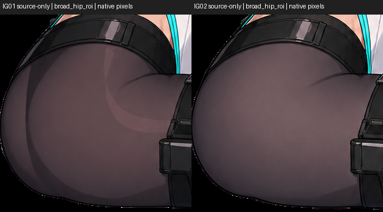
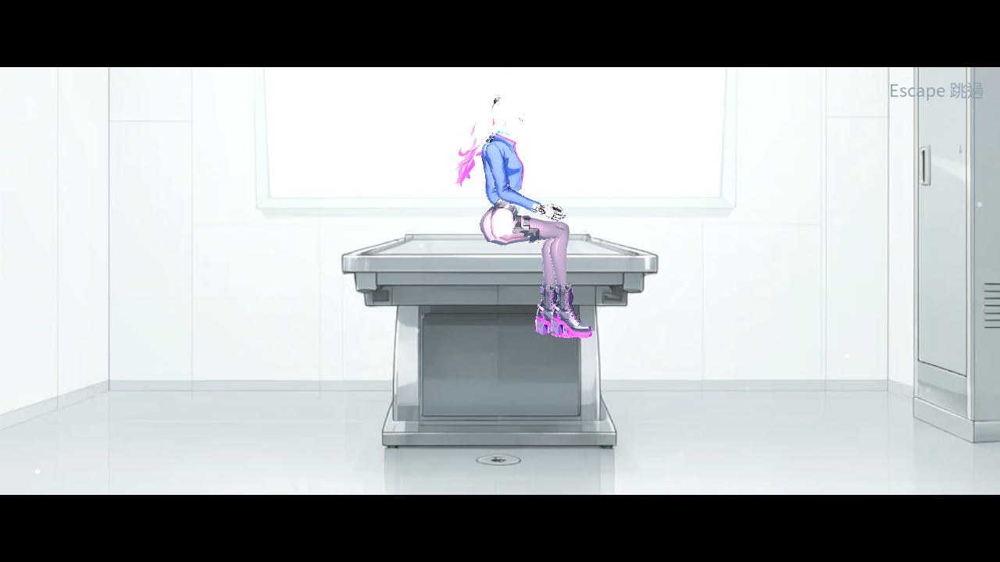
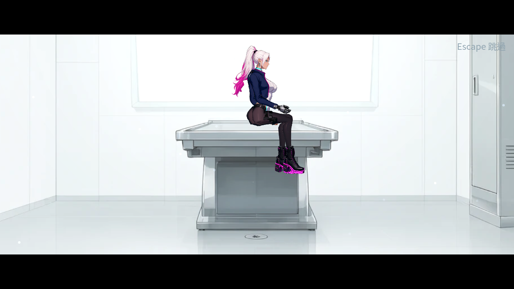
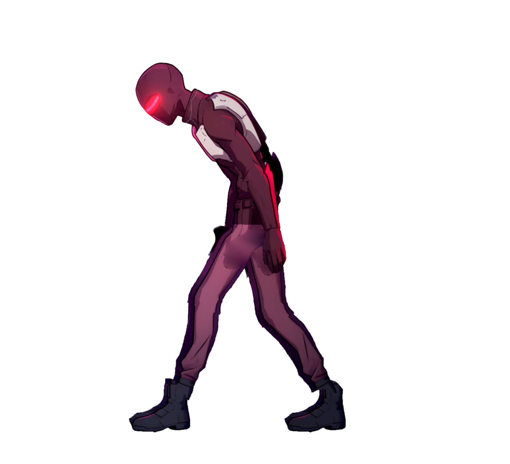
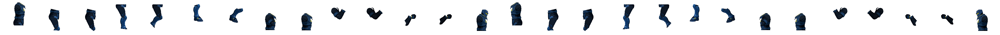

2026-10-24（NE-264）：比較位移須對齊更新時鐘。物理取樣可能跨到累積兩步的UI畫面更新；三段平滑回歸改用受控60Hz元件步進，保留24px、原判定／輸入／等待，正式HUD不改。原30fps195／1、最終30與60各195／0；立即換邊故障仍114.4px失敗。[原始紅燈、時鐘圖、故障與原33項回歸](Nest-Egg/attachments/NE-264-test-clock/README.md)。原生每繪製格與固定邏輯步的數字不能混比。前票65bccc55完整CI實際96,428／0、647秒。

2026-10-24（NE-222）：接點放大圖的標記必須限於原檢查範圍，焦點落在真異常像素，代表姿勢跨程序固定。先保留同一輸入對照，再判斷自然衣物開口與素材缺口；不能靠補色或放寬判定歸零。[五項負控制、原生固定四筆與完整報告](Nest-Egg/attachments/NE-222-joint-sheet-band/README.md)。原30,720筆／1,688失敗完整保留，68個凍結來源一致，這次工具修正沒有代勾角色完整驗收。前票441f622b完整CI實際96,428項、0新／已知失敗、540秒。

2026-10-24（ST-21）：交盤受領書英文必須保留「閱覽權不是原盤持有權」，不能只列M17／付款附件而省略限制。原800、10%與預計720尚未入帳保持；[757項回歸、128項原生與兩張全文圖](ST/attachments/ST-21-disk-rights/README.md)。原生能完整顯示舊文不代表語義完整，缺漏另用真資料控制抓出；不代勾整章或全部三語審查。

2026-10-24（NE-237）：持續按住扳機的類比變化不能重新排入點按；只加鎖存仍會漏掉暫停中放開，兩者須分開做負控制。原四裝置五武器矩陣不改；[28組45602／0、原生與儀器圖片](Nest-Egg/attachments/NE-237-trigger-edge/README.md)。圖片是命令診斷，不代稱自然戰鬥或實體手把。前票be4e5db5完整CI實際96,418／0、544秒已核對，不能用推算數字代替原log。

2026-10-24（ST-21）：文件翻譯不能為了窄欄漏掉付款證明限制、額外報酬與次晨說明。M17英文補正保留原數字與三份查核資料；原高度測試拒絕兩稿後才接受。[756項回歸、128項原生及修前後圖](ST/attachments/ST-21-market-notices/README.md)。只檢視本輪兩張M17全文圖，不代稱全部三語文義、硬體或人工整章已驗收。

2026-10-24（NE-228）：有body的關鍵物品須能從正式背包讀全文，不能只驗通用詳情元件。摘要／全文分開，圖示留清單，Back先回同一物品且維持暫停；原英文照片也要查真頁界，不能為重複大圖犧牲文字。0.98閱讀底板會透字，實際產品底層顯示／隱藏像素須相同。[330項原生、十組6049／0、負控制與全部原檔](Nest-Egg/attachments/NE-228-full-text/README.md)。三語指既有物品資料與新增文案，不冒稱全UI翻譯；真寬視窗含KEEP黑邊，四張區域控制另標，不代勾整票。前票1bbac54e完整CI96,422／0、541秒已核對。

2026-10-24（ST-9）：拾取與非NPC末段的整輪修復拒寫也要提供原進度，不能留不可能成功的重試。真sensor與自然晚飯鏈原生32／6→32／0、writer625／2→625／0；[八圖、前置失敗、合併複驗與完整原檔](ST/attachments/ST-9-repair-owners/README.md)。原event／pickup不透明底板是既有設計，不能為了展示世界而隱藏；沒有代勾整票。前一票4f164615完整CI40078751935實際96,404項全過，並非取消後假稱綠燈。

2026-10-24（NE-229）：同步與物理步驟末尾延後停格要分開驗。f508完整CI96,404／0、530秒後，補查仍130／2；只保留原引擎尚未結束的輸入邊緣，接受／過期／暫停即清，不另加秒數。正常上車後長按遇較晚停格不能意外下車，範圍外過期操作不能稍後重播。[130／0、原main、原生六圖與fixture污染原檔](Nest-Egg/attachments/NE-229-deferred-input/README.md)。

2026-10-24（NE-229）：停格若在同一步較早輸入輪詢後才開始，也不能吞掉上下車；保留停格、長按、距離與保護。f546完整CI三項失敗的真停格狀態與較早callback順序證據分開，不補造唯一根因。[123項負控制、原main、原生六圖及中途失敗](Nest-Egg/attachments/NE-229-hitstop-order/README.md)。原生延遲讀回與原斷言時刻分開，仍不代稱實體手把。

2026-10-24（NE-228）：通訊也須避開主角、敵人與HUD；預設8單位邊距無解再查共用4單位邊距，安全矩形、卡寬與字級保持。完整滑入無空間時保留淡入，不讓動畫經過人物。大字卡要查安全區上下邊界，不能只整格跳位。任務列須在暫停回呼前同步讓位，並保留原文字與閒置計時。三份日文物品說明以原中文高度契約核對，精簡仍須保留所有數字與限制；該元件契約不等於正式背包已提供全文入口。代理截圖函式若內含等待，幾何與圖像須在真正同格取樣；PNG尺寸亦須核對；寬視窗的Viewport內容可能不含黑邊，真正視窗取圖與內容取圖要分開記錄。[正式街道負控制、三語／大字／尺寸與原始失敗](Nest-Egg/attachments/NE-228-radio-actors/README.md)。

2026-10-24（NE-232）：被排除腳本的檔名不是隱含全域類別；發行閉包需核對真正class_name，保留大小寫與底線，不誤拒絕一般成員。[84項控制與同來源8,542檔隔離對照](Nest-Egg/attachments/NE-232-symbol-audit/README.md)，正式章節就緒仍false，沒有代勾Windows原生啟動。

2026-10-24（ST-9）：整輪資料修復造成的拒寫不能只提供永遠失敗的重試，須經Main載入原進度；仍不得先發布新結果。[真磁碟負控制、原生恢復與截圖](ST/attachments/ST-9-radio-repair/README.md)。本輪已重新獲授權持續接續未完成票，上一輪停止不限制本輪；實體裝置與使用者驗收維持真正證據要求。

2026-10-23（ST-9）：正式標籤與首次差事簡報，保存前不先發布已讀／任務／交談次數；同一份中途存檔要接回真正NPC，不能只有畫面重播。冷讀立即暫停時，須核對真正viewport已定位、主角在視野內，不能只看鏡頭世界座標。提交後來源消失時，已保存候選也要帶正確NPC次數。[五來源、翌日當舖、中途續玩與完整原圖](ST/attachments/ST-9-npc-completion/README.md)。原探針錯位、空舞台與逐字中途圖保留，最後依真正來源／演員／完整首句拍攝；不以局部完成代勾整票或通用保存coordinator。

2026-10-23（NE-228）：世界氣泡也要避開固定HUD、真正取得紀錄與動態彈帶；目的地方向字沿邊讓位，世界閱讀優先。[五團隊十張研究圖、負控制、35張逐張檢視原圖與合併複驗](Nest-Egg/attachments/NE-228-hud-reading/README.md)。首次7a整合7358／1暖檔失敗保留，HUD來源不變，接上BG-50後再驗畫面與原選擇器。只移除本次新探針與既有契約衝突的方向字16格下限，原路牌至少16格與所有重疊判定保持。人物閱讀矩形不冒充全輪廓／關節驗收，原整票版面條件維持未勾。

2026-10-23（BG-50）：因本格預算延後載入，不能先丟背景已讀完的標記。真競爭5／2→5／0，原三組2368／2→2368／0；[兩輪回歸失敗、整合結果、退出診斷與正式場景原圖](Nest-Egg-BG/attachments/BG-50-budget-readiness/README.md)。首次原生退出留存尚未定位；最後成功不抹除失敗。軟體GPU與安排路線不代勾硬體冷啟或親手實玩。

2026-10-22（NE-228）：通訊真正可見性改變時同步更新背景說明守門，不等畫面輪詢；延遲未顯示、多來源與離樹一併核對。[原76／6→76／0、原生13／5→13／0與八張原圖](Nest-Egg/attachments/NE-228-hover-events/README.md)。畫面讀回晚於同次呼叫，舊版下一格也會正確，不能宣稱後圖拍到重疊；原兩項偶發失敗的唯一根因不補造。BG-50與HUD空間修改保存在各自分支，此項不代勾整票。

2026-10-22（NE-229）：受擊局部停格不該漏掉載具互動；同一鍵只執行一次，原上下車保護、距離、暫停與停格截止時間維持。[60ms負控制、原流程、原生六圖與完整回歸](Nest-Egg/attachments/NE-229-hitstop-input/README.md)。5bcc9f68完整CI實際為96,000項／3新失敗、634秒，原版未介入20輪320／0；控制重現一個真缺口，不補造原CI缺少的根因狀態，也不把局部交付當實體手把或整票驗收。

# Nest Egg：使用者重點與跨 Session 工作指南

更新：2026-10-22（Asia/Taipei）。這份文件保存 Stanley 的要求、設計依據與退回原因；票的實際狀態仍以各票為準。2026-10-17 使用者已授權持續接續未完成票，先讀本指南並研究相近類型作品與實際圖片，不需逐步詢問。下文歷史「停止」僅指當時 Session 的收尾，不限制本輪續作。詳細歷史分支、失敗紀錄與接手步驟見 [本次交接](SESSION_HANDOFF_2026-10-11.md)。

2026-10-22（NE-228）：世界文字要驗出現與移動途中，不能只拍最後位置；閱讀讓位的alpha不能被目標更新的閃亮動畫寫回。短通知要保留完整滑動範圍，方向標籤遇到閱讀內容也讓位。[六輪連續圖與全部中途失敗](Nest-Egg/attachments/NE-228-prompt-motion/README.md)，原斷言逐字保留；切換字型要保留舊資源直到同步重排完成，否則原生引擎會報fd=null。修後四組120／0、288格，六組30圖逐張看過。新圖另見拾取紀錄壓氣泡及方向標籤遮人物，已將NE-228版面條件改回未勾，整票進行中，盤點仍55張未完成。

2026-10-22（ST-9）：[世界劇情道具先保存再取得](ST/attachments/ST-9-world-items/README.md)，不能在拒寫時已發物、完成目標或移除世界原件。真拒寫、重試、放回再取、通知變更與獨立續玩均驗；已提交與原備份恢復文案分開。原63組65,130／0，成功原生七程序156／0，三語120%及720／1080p十八圖逐張檢視。早期「斷言過但SCRIPT ERROR」仍判失敗；續玩需等Transition真正釋放。整票原動畫／完整故事條件未代勾。圖中另見世界提示移動過程遮人物，交NE-228接續，不把新保存面板驗收外推全介面。

2026-10-22（NE-228）：世界文字要完整換行並同時避開人物、其他文字、HUD與黑邊；先夾回畫面再無界限推開仍會失敗。[正式長氣泡／路牌四組原生24圖與全部中途失敗](Nest-Egg/attachments/NE-228-world-text/README.md)，原baseline契約抓到的問題改產品metadata，保留原斷言後重跑整輪。英文／日文為明示排版fixture，不當全章翻譯。共同工具7bf96cfb完整CI實際為95,973項、0新／已知失敗、638秒（[CI39767506903](https://github.com/deadline314/Nest-Egg/actions/runs/39767506903)）；較早59c2642e的95,976項另有原始紀錄，不混算。

2026-10-22（NE-246）：[真正戰鬥、連續來源與獨立續玩](Nest-Egg/attachments/NE-246-real-combat/README.md)完成127／0與18張原圖；閱讀及暫停時同一世界身份／位置／生命／時計保持，最後原條件已勾、轉審查中。明示位置／舊存檔與存活下限，不代稱真人整章或實體手把。最新盤點為[55張未完成](unfinished-tickets-2026-10-22-latest.csv)、[56張審查中](review-tickets-2026-10-22-latest.csv)，歷史盤點段落保留。

2026-10-22（NE-246）：觀察用節點可在暫停執行，不代表它建立的Main也可繼承ALWAYS。已讓Main保留正式入口PAUSABLE；同一實際來源93／6→93／0，五次世界身份／位置／生命／時鐘快照保持。[全部原檔與驗證界線](Nest-Egg/attachments/NE-246-observer-policy/README.md)。舊Main探針的版面或旗標結果不能外推成凍結通過；一般Level直接放root的探針不受這點影響。所有比對舊程式存work，保留work/.gdignore，避免編輯器將同名舊class註冊為正式來源。

2026-10-22（NE-223）：實際敵人／增援清場、看門狗致命子彈、真踏板與flood死亡、真電話亭及冷續玩已核對；持盤仍保留中途指引。[原生69／0與12圖、全部中途失敗](Nest-Egg/attachments/NE-223-combat-producers/README.md)。新玩家出現不等於回溯卡結束，須等操作鎖、暫停與轉場全釋放。安排位置／非致命下限與虛擬搖桿只驗來源，不冒稱人工整章或硬體驗收。

2026-10-22（NE-228，完整CI核對）：b09d21f2真正時間遮幅修正已通過[CI39758965641](https://github.com/deadline314/Nest-Egg/actions/runs/39758965641)，95,971項、0新／已知失敗、630秒。原始job保存於水坑提示證據包；此結果不抹去前兩版完整CI失敗，也不代表獨立舊關卡退出250已修好。

2026-10-22（NE-228）：WorldPrompt的reach_check會取代radius；不能只傳「尚未完成」當可達判定。水坑已改保留原44單位距離、完成後停用，其他十處callback逐處核對。[遠距重現、近處與自然踩踏原圖](Nest-Egg/attachments/NE-228-flood-prompt/README.md)。目的地感應會稍後排通訊，拍提示前先讓事件跑再等真佇列清空，不能只查剛進區的一瞬。

2026-10-22（NE-228，後續更正）：前次物理階段修正在完整CI仍95,970項／1新失敗，不能稱已完整修好。取得真正時間與Tween累積差異後，改手動單調時鐘推進，完整0.28秒保持，短距離返回按距離縮時。最終原helper兩組各260／0、原回歸1496／0、CI前置571／0、原生60／0。[中途失敗、負控制與完整原檔](Nest-Egg/attachments/NE-228-framing-realtime/README.md)。新完整CI待推送核對；舊關卡退出250未修。

2026-10-22（NE-228）：頁首恢復的舊CI失敗已取得具體狀態：演出與鎖已清，剩遮幅Tween未歸零。原helper同負載260／3重現，遮幅與來源判定改同一物理更新階段後260／0；原0.48秒與原斷言保持。原兩組1494／0，正式Main三組原生60／0。[完整證據及舊關卡退出錯誤界線](Nest-Egg/attachments/NE-228-framing-clock/README.md)。不能再把這次已定位的殘餘動畫說成單純未重現；也不能把獨立舊關卡的退出250說成已修好。

2026-10-22（NE-228）：選項底板也要在HDR正式畫面驗背景通知透字，不能因為選擇與返回可用就稱可讀性通過。同一選項暫藏真通知的診斷控制證實來源後，底板改不透明；正式通知的淡出與故事規則保持。[修前／修後、四組尺寸與文字大小、原始證據](Nest-Egg/attachments/NE-228-choice-background/README.md)。前一票NE-223電話亭與追蹤的[完整CI](https://github.com/deadline314/Nest-Egg/actions/runs/39746377186)為95,965項、0新／已知失敗。

2026-10-22（NE-223）：電話亭與耳機互動範圍重疊時，共用最近來源選擇；撥號中不另開交談。播放開始不等於讀完，任務須核對正式完成與旗標。完成任務保留原釘選資料但不再標追蹤中。[真正撥號／自願追問、103項原生與跨程序證據](Nest-Egg/attachments/NE-223-phone-producers/README.md)；原60組回歸63,182項、0新／已知失敗。

2026-10-22（ST-10）：生成透明道具的alpha>0範圍可能含微弱殘點，不能當成壺底或手部接觸點；先核對主要材質、實際支撐與原生特寫。[廚房拆層候選、五作研究與浮起失敗](ST/attachments/ST-10-kitchen-candidates/README.md)。本批未採用至正式舞台；最新正式main a7c4f50a的[完整CI](https://github.com/deadline314/Nest-Egg/actions/runs/39739412574)為95,959項、0新／已知失敗。

2026-10-11 補充：使用者要求同步最新 main、清理其他 worktree／舊分支，並提供可直接貼到新 Session 的指令（在對話裡給，不存檔）。下一個 Session 已獲授權接續序章至第一章；舊停止要求只限制上一個 Session 的新增開發。未驗收來源先保存至[可恢復封存](attachments/worktree-retirement-2026-10-11/README.md)，不把失敗候選當作已合併成果。

2026-10-21（Asia/Taipei）最新續作指示：「還有哪一些票還沒做完？幫我做完，然後可以一次做多一點。」上一輪完成NE-246後的停止已執行；本輪重新授權接續，可批次推進但仍逐票提交、測試與整合。原生硬體／人類驗收保留真實未完成狀態。

## 2026-10-11 新增：角色拼接的驗收點（使用者一天內連續指出四次）

同一天，使用者四次從截圖指出角色拼接的問題，每次都是我已經交付、甚至寫了「沒有發現問題」之後。最後兩句話是：「好多角色的部件都有問題……為什麼你都會略過這些問題？」「我給的截圖只是 sample，事實上幾乎所有角色都有問題。」以下是每個角色交付前都要逐項看過的點，不是只看被圈出來的那一個。

**怎麼看**

- 每個角色看五組畫面，全部放大到看得清楚髖與膝（預覽工具 `--zoom=5` 以上）：NPC 站姿、NPC 八個姿勢（站、坐、倚、蹲、說話、聽、揮手、工作）、走路八格、戰鬥待機（兩腿前後分開）、有裝甲的看裝甲全掉。朝左再看一輪。
- 站姿和原立繪並排。**輪廓要和原立繪一樣：不多一塊，也不少一塊。**
- NPC 用 NPC 的站姿驗收。拿戰鬥待機給人看 NPC，站姿一定怪（我犯過）。
- 使用者圈出來的是樣本。同一類問題要把全部角色找一遍。

**看什麼（每一項都是使用者實際指出過的）**

| 部位 | 不能出現 | 使用者的原話 |
|---|---|---|
| 髖部前緣 | 腰帶底下、大腿前面多一塊方塊或圓鼓 | 「組合上下半身的時候……都會凸一塊」 |
| 髖部前緣 | 髖部削掉一塊、大腿像一根棍子掛在腰上 | 「大家的下半身都少一塊」 |
| 髖部缺口 | 走路或腿往後時，上衣下緣與大腿之間露出背景 | 「很多人的上下半身有殘缺」 |
| 坐、蹲 | 髖部下面多一顆球；大腿與骨盆之間有直線切口 | 截圖圈出利息坐著時髖下的球 |
| 兩腿 | 一前一後時交叉成 X；站著時腳不在身體正下方 | 「站姿都好奇怪」 |
| 膝蓋 | 大腿前面垂一條布、膝蓋有尖角或台階、膝旁凸出一片 | 截圖圈出鷺膝蓋旁的布片 |
| 髖部 | 關節不在大腿頂端的中心：一轉就一邊凸、一邊缺 | （四次修不好的共同原因） |
| 手 | 站著或走路時，髖的前後緣探出一隻看不到前臂的手 | 「這個是不是都多長出了很多手」 |
| 兩條腿 | 近側腿上的圍裙、口袋、裝備原樣出現在遠側腿上（兩腿共用同一張圖） | 「是不是把右腳的部件也拿去給左腳用了」 |
| 坐、蹲 | 腿上有深色硬塊、白色亮條，或凸出一根條（下襬零件上的綁帶、門襟跟著轉過去） | 「這個也直接出問題」（阿婆坐著的圖） |
| 大腿 | 大腿只有半條寬、像一根棍子接在外套下面（被另一條腿的遮罩吃掉一半） | （擲彈兵、精銳保全） |
| 腳踝 | 靴面有一小片跟著小腿，像刺一樣翻出來 | 截圖圈出收帳人打手的靴子 |
| 長下襬（圍裙、大衣、長外套） | 下襬被拆成骨盆一塊、大腿一塊，走路時裂開或像短褲 | 截圖圈出阿梨的圍裙 |
| 整體 | 破圖、碎片、浮在旁邊的零件（護膝、手） | 「護理師的有明顯破圖」 |

**交付時**

- 列在「還沒修」不等於處理了：使用者會直接看到。看到問題就修。不能因為「原本就有」「不是這次改的」「是畫本身的形狀」就記一筆帶過；真的修不了，要在票上寫明卡在哪、試過什麼。
- 自動檢查報 0 只代表它認得的幾種形狀沒出現。使用者說還有，就先相信使用者。
- 不確定零件該怎麼組，先查別人怎麼做，再動手。（這次前三次都在自己的切法裡打轉，第四次查了才發現問題在骨架。）
- 票上附放大圖：修前、修後、和原立繪並排。只勾真的逐項看過的條件。

詳細成因與修法：`pm/Nest-Egg/attachments/NE-255-lessons.md`；流程：`.claude/skills/portrait-to-godot/SKILL.md`。

## 2026-10-11 新增：光影要從光源出發，近戰武器要換一批

使用者看完場景與光影那批票之後的新要求（原話整理，與下文舊敘述衝突時以這段為準）。設計與票的清單在 [光源驅動的光影](../design/08-lighting/LIGHT_SOURCES.md)。

- **學 Leyla In Veil 的光影處理**：從光源出發，敵人與背景的物件都要依光源有對應的陰影；下水道或電力不足的地方有會閃爍的燈。
- **光源只有幾種，依情況使用**：路燈；部分自帶光源的敵人；主角的武器（槍械有類似手電筒的光，不同槍械可以有不同的光源效果，近戰武器也自帶光源）。
- **整體亮度可以暗一點**，用來凸顯光影效果。特殊的場景可以比較亮；光源少的場景要靠主角槍械的光。
- **近戰武器現在沒有賽博龐克的感覺**：換一批，音效也要換，可以的話設計連招。
- 做法：每一項先查業界最佳實例與玩家偏好，選 Godot 做得到的方式；把票開出來，參考資料與圖片放進票裡；開完接著做並驗證。
- 上一批票裡需要使用者確認的項目，使用者表示可以代為驗證後繼續進行。
- **近戰武器沒有握住的感覺、揮起來僵硬、而且畫在身體下面**（2026-10-12）：手要真的握著握把，武器要在身體前面，揮動不能像手臂多長出一截（NE-275）。可以補畫角色零件。
- **近戰不能只有基礎的揮動**（2026-10-12）：要有完整且獨立的近戰攻擊模組（NE-277）；鞭子要從頭到尾都是軟的，不能忽然變直再變軟（NE-276）。
- **做新東西先看別人怎麼做，而且要看圖**（2026-10-12）：至少 5 個不同來源，不要都是同一個遊戲或同一家公司；除了文字也要看截圖（看不到就開瀏覽器去看、去截），截圖留在票裡。不必照抄，取各家的特點做出自己的；但不參考別人就會一直在原地打轉。
- **每張票開始前先參考本指南**（2026-10-17）：優先比較同類型的橫向動作、射擊與探索遊戲；不要只看 Xbox 或無障礙指南。保留實際看過的參考圖、來源與採用理由，放在票或本指南，研究圖與本作驗收圖分開標示。
- **通訊對話框太簡略，「通訊 /」也不要**（附了「通訊 / 凜：聽得到。」的截圖）：對話框要好看、參考別的遊戲怎麼做；名牌前面的種類字樣是多餘的資訊。介面上能用樣子表達的就不要多寫字（NE-274）。
- **敵人頭上的框拿掉**：標示弱點的四角框看起來很突兀（NE-262）。介面式的標記貼在角色身上要很克制。
- **場景裡的燈不要再用那顆白色方塊加光圈**（使用者附了倉庫牆上那盞燈的截圖）：改成賽博龐克世界裡會出現的燈具，換幾種不一樣的，不要每個地方都一樣，依不同場景至少要有 10 種以上的變化（BG-36）。
- **看過新燈具之後的回饋（同日）**：路燈的桿子太高，要接近真實的比例（約主角身高的兩倍多）。光錐裡模仿光線的粒子很假，不要；有理由的地方（例如快壞的燈）才用火花。**光不能有明確的邊界線**，要像槍燈那樣往外漸淡，路燈的光錐也要照這個標準（BG-36）。被光照到的敵人要有影子，做之前先參考業界怎麼設計（BG-34）。

## 2026-10-11 新增：分工、成本與參考作品

這一段是最新要求，與下文舊敘述衝突時以這段為準（例如模型名稱、分支前綴、結案狀態）。各 Session 的指令直接在對話裡給使用者，不另外存成檔案（2026-10-12）。

**成本與做事方式**

- 克制 token：只讀本組需要的票與文件段落，大檔用搜尋或分段讀；不把整份 log、整張大票貼進對話；subagent 只回結論。
- 成本最小化：能交出去的工作先交 Haiku 5.5 subagent；結果有問題就修正指令再請 Haiku 做；同一件事超過 3 輪仍不行，改用 Sonnet 5.5。主 Session 負責驗收。
- 新東西，或試了幾次都得不到好結果，就去看別人怎麼做、查業界實例，不要每次硬幹。查到的寫明來源與實際看到的內容。
- 每個 Session 在自己的 worktree 與 feature branch 工作，做完並通過受影響測試後才併進 main。
- **依機器分工（2026-10-12）**：RTX 4070 Super 那台算圖快，負責 ComfyUI 大量的工作（角色立繪、分件、整批重畫）；Arc B580 這台算圖慢，負責少量的生成（依場景補需要的部件與擺設）。兩台的 Session 都可以開 subagent 同時做相關的 Godot 工作。不需要顯示卡的工作（程式、資料、測試、劇本、介面）拆成多個雲端 Session 平行做；雲端做不了的原生畫面、實體手把與試聽，在票上寫明「待本機原生驗收」，由本機的 Session 接手。
- 每個 commit 都要併進 origin/main（快轉推送），別的 Session 才用得到成果；驗收還沒全過的票照樣併進 main，只是票維持「進行中」並寫清楚待驗項目，不要把成果只留在 feature branch（2026-10-11，使用者）。
- 使用者新提的在意事項，隨時整理進這份文件對應段落（一兩句、講重點），讓之後少走彎路；有需要可以附截圖。
- 做完一張票改「審查中」，由使用者看過再結案。票上每次交付用「問題—改動—驗收」三段白話文，附截圖、簡短測試結果與提交連結。

**喜歡的參考作品**

- **Leyla In Veil**：美術設計，特別是地圖效果——光影、爆炸特效、可以撿地上的東西丟向敵人、丟油桶會爆炸；UI 設計也很好。可以參考很多要素融入 Nest Egg。**不同處**：它像單純的橫向平面關卡，沒有高低起伏與多方位地圖；Nest Egg 保留高低差與多方向路線（NE-254、NE-228、NE-95、BG-30）。
- **Project Revenant**：頭目戰設計——每個頭目有獨立機制與設計、不同的攻擊方式與攻擊習慣。Nest Egg 現在的頭目太單調，要改（NE-253）。
- 參考前先實際看過該作的畫面或官方資料；只借原則與手法，不照抄造型。
- 地圖需要的話可以加入斜坡。除了上面兩款，有需要也可以參考其他類似的高評價作品，同樣先看過實際畫面再借手法。

**本次回饋的具體問題**

- 看門狗的頭射不到（NE-252）。
- NE-206 的 NPC 動作還可以更好，要參考業界實例再做一輪（NE-250）。
- NE-213 之後過曝好很多，但第一次在水下死亡後在診間醒來時，主角的頭仍然很亮（NE-251）。
- 主角骨架與立繪（特別是 NE-222）的經驗，最後要整理成一套從立繪到放進 Godot 的完整 Skill，之後生成新東西都沿用；必須解決破圖、零件組合後稜稜角角、立繪出現奇怪的東西（NE-255）。

- 主角在畫面上太小（約四分之一高），希望至少三分之一（NE-256）；衣服、頭髮、胸部要有合理、克制的擺動（NE-257）。兩件事都先看業界做法再調。
- 蹲下不能是兩膝前抬、腳尖點地的懸空姿勢；持槍蹲下用單膝跪（NE-222 已改）。
- 決定不了的事，參考業界最佳實例或玩家偏好後自己拿主意，不用每件都問。
- 對話與通訊的名牌只寫講者名字，不加「交談／」「通訊／」「閱讀／」這類種類字樣；種類用面板顏色區分就好（2026-10-11）。
- 角色站著不能過度挺胸，也不能看起來像有兩隻手；新角色的畫風要和既有角色、世界觀一致，不能 AI 感太重。這三項加上「拼接後沒有破圖、沒切好與關節稜角」是每個角色的驗收條件（NE-218、NE-222、NE-242）。主角的立繪目前可以，只要手的位置合理。
- 2026-10-11：使用者授權主線 Session 持續把這批票做完；遇到決定不了的事，先參考業界最佳實例或玩家偏好再決定，不停下來等。

**期待**：做一個有趣又有特點的遊戲。使用者認為目前做得很好，希望看到有想像力、讓人驚艷的成果——在驗收標準不放寬的前提下，鼓勵提出有特色的設計。

## 交付目標與優先順序

1. 先把**序章至第一章從正式新遊戲入口完整玩完**，再交雲端打包；不是直接跳到倉庫、授予旗標或只跑測試場景。
2. 第二、第三章各自先寫完整劇本、審查動機與因果，再做關卡、主支線、演出、動畫、敵人、音效與章末。之後沿全章大綱逐章推進。
3. 每章完成保存一份獨立 Windows 單檔：「序章至第一章」「序章至第二章」「序章至第三章」，不覆蓋前一版。可玩範圍、版本、提交、大小、校驗碼與真正 Windows 啟動結果都要清楚。
4. 故事有深度、遊玩一直有新發現，靠有用途的角色反應、道具、場景動畫、支線、敵人與空間變化達成；不靠道路加長、重複遭遇或滿畫面特效。

整體方案：[逐章交付設計](../design/20-campaign-experience/DESIGN.md)、[工作分工](../design/20-campaign-experience/WORKSTREAMS.md)。章節與打包對應 ST-16、ST-2、ST-9、ST-10、NE-178、NE-223、NE-232～235；新第二、三章為 ST-18～21，不能把舊第二關當新版第二章完成。

## 畫面與素材：看得到合理，才算驗收

- 世界保留既有賽璐璐／賽博龐克身份，UI 是**高清像素風**。像素面板、填色、材質與焦點有層次；避免只有細線框、臨時幾何圖示和過多閃光。文字與危險優先。
- **動畫最重要，打擊感非常重要。**角色動作、預備姿勢、命中時機、收招、受擊、音效與擊退先成立，再加克制特效。需要豐富情境動作，不是每個物件永遠只有靜態圖。
- 所有物件都要核對大小、位置、支撐、用途與圖層；海報必須真的貼在牆面，不能只因程式算出矩形就認定有牆。使用者的「再來一次」海報曾漏審，BG-19 已由 BG-26 接手補驗；後續同類物件都要實際看。
- 高低差與跳躍裂縫保留玩法，建築立面、側壁與背景補到鏡頭會看到的範圍。不能拉伸整棟房子、塞裝飾或填平坑洞掩蓋漏空（BG-28）。
- 地板、閥門、梯子、可擊碎牆、電子看板、告示牌換正式合適材質；閥門有管線、梯子有上下落點、牆有完整／破壞狀態，牌有支架與安裝面（BG-20、BG-21）。
- **一般遊玩與普通對話拿掉持續全畫面雜訊。**只在有明確理由的回憶／特殊感知少量使用，離開後恢復。不要降低整體光影品質或關掉所有後製冒充減噪（BG-27）。
- 每個玩家、NPC、敵人的影子符合腳下支撐、姿勢與跳躍高度；不能在坑洞或樓板另一側畫固定黑橢圓。光影多樣但主次清楚，主角霓虹保留、頭臉不能過曝（BG-29、BG-30、NE-213）。
- 水管流水可用 Godot 水流、落地濺水和音效；霓虹、風、機械等依用途做有界動畫（BG-25、NE-240）。真的需要影片生成的缺口先留票，不為流水載入大型影片模型。
- ComfyUI 圖示和立繪要貼近現有比例、色盤、線條與細節密度，避免雜亂生成紋理與明顯 AI 感。保留來源、提示詞、seed、job、hash、透明邊界，逐件看手、衣服、比例與 alpha。
- 角色骨架的髖、腰、肩、腕、踝、頸與外套接縫，要在遊戲倍率和過場約 3.4 倍核對全部動作；生成成功或特寫一處通過不等於整隻角色完成。看門狗須真正四足素材與動作。

場景／角色原生畫面須用 Godot 4.7.2 Forward+／HDR。無頭與雲端軟體 Vulkan 不能替代真 GPU、實體手把與人工遊玩。

2026-10-20（BG-49）：光池巡覽移動鏡頭時，光影觀察位置也要跟燈移動，並記錄實際區域、霧量，不能一直取出生點設定。雨霧自然相位不同的兩次數字不可直接拼成修前修後；[保留所有光影層的同場景配對與圖片](Nest-Egg-BG/attachments/BG-49-local-pool-focus/README.md)另列為局部診斷。

2026-10-20（BG-49曝光）：矩形有全白像素時，不用背景面積稀釋敵人比例。可在確認無遮擋的固定取樣中，以真正不透明角色範圍建立保守上限；空遮罩要拒絕，原HDR與alpha另存以供獨立重算。[六張原生資料與圖片](Nest-Egg-BG/attachments/BG-49-exposure-bound/README.md)保留適用範圍，不代稱完整戰鬥驗收。

## UI、閱讀與操作

- 操作提示依眼前情境顯示當下必要動作；完整操作另可查閱，不把 A/D、Space、Shift、射擊、格擋的大表一直蓋在畫面。文字用完整、自然繁中，一句講一件事。
- 告示牌**文字避開／繞角色的呈現是使用者喜歡的設計，保留**；改善牌體、尺寸與支架，整併重複功能提示，留下必要教學與故事證據（BG-21、BG-22、NE-228）。
- 背包參考圖只借「左側清單、右側角色」版面邏輯，沿用 Nest Egg 配色、字體與物品資料。凜另做自然、中性的選單姿勢，不能用持槍瞄準姿勢，也不照抄參考角色（NE-243、NE-244）。
- 人物交談／電影入口接近時，16:9 黑邊平順過渡到 21:9，玩家可以退回；正式交談／演出使用對應構圖。告示牌、普通物件閱讀、普通廣播與氣泡不觸發人物電影預告。預告不能提前改旗標、送獎勵或鎖操作（ST-22）。
- **重要通訊讓世界 Freeze，玩家確認才推進。**敵人、玩家、傷害、彈道與計時停下，閱讀 UI 可用；普通閒談不要每句打斷操作。長按確認不跳句，先展全文再前進。
- 閱讀上再開暫停頁，關閉暫停後仍保持閱讀的凍結；取消、死亡、換區、退出只釋放各自的暫停責任。讀檔／保存失敗要有安全重試，不藉退出或選單繞過寫入（NE-246、NE-230）。
- 存檔與續玩的驗收要**真的關閉程序再開一次讀檔**，同一程序內的快照往返不算（2026-10-11）。各累積版本存檔分開保存：新版本可接續舊版本的進度且不改舊檔，舊版本看到新版本的存檔只說明該用哪一版（NE-230）。
- **資訊頁要有設計感，不是一排同重量的框和大字**（2026-10-11，看了任務目錄截圖）：版面先查業界實例（interfaceingame.com、官方截圖；gameuidatabase.com 在雲端被人機驗證擋住），再做二到三個範本讓使用者選；任務與地圖選定「終端機雙欄＋模糊遊戲畫面當底＋斜切目前目標橫幅」。依據與範本見 `design/18-quest-map-ux/VISUAL_RESEARCH.md`（NE-223）。
- 背景 HUD 的 Hover／聚焦說明不能蓋住通訊、講者、選單或確認提示。2026-10-11 介面 Session 已修正（暫停、交談、通訊出現時背景說明立刻收起，等待中的說明也取消），Forward+ 修前修後見 NE-228 Commit-4；實體滑鼠與手把待本機原生驗收。UI 參考 Leyla In Veil 的實際觀察整理在 `design/20-campaign-experience/RESEARCH.md`。
- 地圖與指引要表達上下層與多個方向（Leyla In Veil 是單純橫向平面，我們不是）：世界地圖的梯子是上下層、環狀路線看得出來，連線不能穿過別的區域框；名稱放不下先折兩行，真的放不下才折列（NE-223，2026-10-11）。
- 當下要做的動作優先：世界提示（訓練站、告示）壓到 HUD 目標列時，目標列淡出讓位，提示框不能被推出畫面（NE-228，2026-10-11）。
- 背包是左側清單、中間詳情、右側信用點與凜的中性立繪；立繪不壓文字或按鈕，自帶立繪的角色狀態頁收起右側欄。業界參考與取捨見 `design/20-campaign-experience/INVENTORY_WORLD_CLARITY.md`（NE-244）。
- 所有主要流程考量手把：開始／繼續、瞄準、戰鬥、聊天、機關、商店、任務、地圖、死亡和章末。確認／返回／分頁一致、焦點可见、返回恢復焦點；說明不只依賴滑鼠 Hover。近期裝置、改鍵、拔插與減震動都要驗（NE-229）。
- 2026-10-19（NE-229）：遊玩中手把斷線的暫停提示要持續保留，重接不自動開跑，鍵盤／滑鼠也能明確恢復；參考五款遊戲的實際圖片與取捨見[恢復介面研究](../design/20-campaign-experience/CONTROLLER_RECOVERY.md)。合成斷線與軟體 Forward+ 圖不能當成實體拔插驗收。

## 戰鬥與關卡

- 每把武器的姿勢、節奏、聲音、彈體、擊退與收招有辨識度。重武器連段少、慢而重，輕武器快且可選接續多；不只換色（NE-236、NE-238）。
- 子彈有對應槍種的彈头／短尾跡、散彈分散、爆炸彈或能量輪廓；視覺和實際命中、穿透、反射相符，拖尾不是傷害區。
- 現有盾是**方向格擋**，盾面大小與角度要對得上前方防禦，角色仍可讀。不能畫全身罩暗示不存在的全向保護；舉盾、普通受擊、完美格擋、破盾與收盾要能區分（NE-239）。
- 連段升級可選，短連段仍好用；完整前搖、有效段、收招和緩衝／取消窗。揮空不播放命中聲或停頓，每招每目標一次，多目標不堆無限停頓，不允許免費終段、永久硬直或無限取消（NE-237）。
- 頭目：每個頭目一個一句話講得完的核心機制、看得出個性的攻擊習慣；每招預兆 ≥ 0.5 秒且有閃、擋、打斷或利用場地的應對；顏色一致（紅＝要打到你、橙＝現在打得到、灰＝裝甲彈開）。看得到的部位一定要有命中回饋，打不動就要顯示「擋下」（NE-252、NE-253，[頭目戰設計](../design/15-combat-feel/BOSS_FIGHTS.md)）。
- 頭目不能換皮（2026-10-12）：每個頭目要有自己的機制與習慣，例如守門人被門禁工作架困住、玩家拆的是架上的零件、人物本身是保護區（NE-271）。部位的發光標記不要畫在臉旁邊：泛光會把臉蓋白，用「部件本身變亮＋細外框」。
- 普通敵人的巡邏要有範圍（2026-10-12）：留在戰鬥區裡，不能晃進電話亭、前室這些安全區；劇本寫「可以繞過」的遭遇，要用測試證明站在繞道上真的不會被打（NE-272）。
- 場地投擲（NE-254）：撿起丟出要在高低起伏、多方向的地圖好用——拿著時畫出拋物線與落點；油桶被射先燒引信再爆、敵我都傷，不能讓撿取卡住其他動作（Leyla In Veil 也修過這種卡住）。[設計](../design/15-combat-feel/THROWABLES.md)
- 拿不定的設計（2026-10-11）：先參考業界最佳實例與玩家偏好再決定，不卡住等使用者。
- 頭目不是換血量與換色（2026-10-11）：每個頭目要有自己的機制與攻擊習慣，玩家看預兆就知道怎麼應對；頭目場地可以用上高低差與投擲物（第二章阿勇：利息與結帳地墊，NE-265）。
- 命中回饋要出現在武器或子彈實際碰到的地方：打頭就在頭，不能在膝蓋或腳底（2026-10-11，NE-268）。
- 衡量首次傷害延遲、有效距離、整段輸出、操作鎖定、耗能、擊退、裝甲／頭目反制與多難度；最後 NE-241 統一驗收打擊感。
- **普通路線不要封牆強迫戰鬥。**NE-245 已交付；未来只有明確競技場／特殊空間才考慮鎖場，完整角色進入安全區才關門。取消牆不能直接贈送遭遇完成或破壞任務／頭目出場。
- 地圖有用途、路線、捷徑、秘密、落點、檢查點與地標，戰鬥與敘事有高低起伏，不硬塞同一模板。敵人符合地區生態與戰術；「跨章最多兩種重複身份」目前是專案暫定解讀，不是業界規則，配置時再依票核對（NE-97）。
- 主支線、地圖與 HUD 從同一正式故事來源讀取。實際完成、死亡、回訪與续玩會正確推進；不可手造第二份任務真相或讓可選支線變主線必做（NE-223）。

- 2026-10-20（ST-9）：段尾結果要先驗整份原始清單，不能略過壞項目後照常扣款。內容診斷與執行期檢查共用契約，旗標型別和續玩規則一致。[真正餐費負控制與修後證據](ST/attachments/ST-9-result-validation/README.md)。
- 升級／貨幣沿用既有商店、改裝、典當與死亡結算，記跨章收入／支出，正常不刷錢路線可推進並有有意義的選擇；勿另造重複系統（NE-231）。
- 成長要讓玩家敢嘗試：不刷錢、不做必刷支線也打得過每個頭目，每章都有錢選一項成長但買不完全部；購買前後看得懂效果、買了可以馬上試（2026-10-12，跨章帳本見 `design/20-campaign-experience/CAMPAIGN_ECONOMY.md`）。

## 劇本與演出

每場先說清楚誰在何處、想做什麼、為什麼、玩家怎麼參與及之後改變什麼。參考 `Cyberpunk_Edgerunners_Subs` 的口語與社會處境，寫原創、合理完整句子，不能複製台詞或靠一兩字斷句裝酷。核對角色認識、持有物、付款、位置、死亡與伏筆時機。

NPC 與過場演員的動作要有預備、主要動作與收尾，有重心與個性；節奏與幅度是每個角色自己的資料，同場兩人不同步（做法與坑見 [NPC 動作表現](../design/12-cast-redraw/NPC_PERFORMANCE.md)）。演出組只改 NPC 動作資料與演出邏輯；主角動作、零件圖與骨架切割歸角色組，需要新零件在票上記錄交接。可撿取投擲物屬戰鬥組 NE-254。人物對凜的短反應用身體、不用新台詞（初見、回訪、死過之後不同；開槍會縮、會躲），首批與交給其他組的調查／交付／修理需求見 [情境反應清單](../design/20-campaign-experience/SITUATIONAL_REACTIONS.md)。

使用者要求豐富過場、短對話、互動與動畫；舊「每章固定最多三過場／八分鐘間隔」不再是本輪硬性規則。每段演出要有資訊增量和作用、能跳過、重試不反覆強制重播；兼顧主動聊天、探索反應與可玩教學。序章練習倒地不能消耗真正首次死亡建檔（ST-16）。

## 已參考的業界資料，以及支持什麼

這些是本輪查過的原始設計資料／官方指南，不是所有玩家一致認可的唯一最佳方案。來源與樣本限制詳見 [研究紀錄](../design/20-campaign-experience/RESEARCH.md)及[畫面與閱讀研究](../design/20-campaign-experience/INVENTORY_WORLD_CLARITY.md)。

2026-10-17 補充實際同類遊戲圖片：[圖鑑回顧研究](../design/20-campaign-experience/CODEX_REPLAY.md)與[地圖交談收起武器研究](../design/20-campaign-experience/INTERACTION_HOLSTER.md)。NE-279 保存九款遊戲、NE-278 保存五款橫向動作／探索作品的來源圖與採用理由；票內區分研究圖片和本作修前修後畫面。圖片觀察不視為玩家偏好民調。

| 參考 | 用在 Nest Egg 的原則 |
|---|---|
| [Dead Cells 主設計師的關卡文章](https://deepnight.net/tutorial/the-level-design-of-dead-cells-a-hybrid-approach/) | 先做有功能與連線邏輯的區域，再放地形與敵人；多樣而不隨機塞滿。 |
| [Team Cherry 官方訪談](https://www.nintendo.com/au/news-and-articles/the-metamorphosis-of-hollow-knight-with-team-cherry-aussie-developer-interview/) | 可探索其他路線、回訪與有動機的人物；不照搬完全非線性。 |
| [Supergiant 的 Bastion 寫作](https://www.supergiantgames.com/blog/in-depth-writing-bastion/)與[Hades 更新](https://www.supergiantgames.com/blog/hades-updates/) | 玩家活動引出反應，角色事件有條件、優先序及重播規則。 |
| [Dead Cells 官方無障礙更新](https://dead-cells.com/patchnotes/29) | 文字、輪廓、攻擊預告、背景對比與粒子可調，重要威脅優先。 |
| [PlayStation 開發者談 God of War 戰鬥](https://blog.playstation.com/2022/10/04/game-developers-explain-what-makes-god-of-war-2018s-combat-tick/) | 動畫、聲音、受擊與短停頓共同表現重量；不只加震動和閃光。 |
| [GDC Skullgirls 動畫講座公開概要](https://www.gdcvault.com/play/1021657/Powerful-and-Effective-Animation-for) | 關鍵姿勢、預備、拖影與時序服務玩法。只查公開概要，沒有看會員影片。 |
| [Xbox XAG 116](https://learn.microsoft.com/en-us/xbox/accessibility/xbox-accessibility-guidelines/116)（Ori 對話例） | 文字留到玩家主動推進。Freeze 是本使用者的專案決策，指南不強制所有通訊凍結。 |
| [XAG 102](https://learn.microsoft.com/en-us/xbox/accessibility/xbox-accessibility-guidelines/102)、[107](https://learn.microsoft.com/en-us/xbox/accessibility/xbox-accessibility-guidelines/107)、[112](https://learn.microsoft.com/en-us/xbox/accessibility/xbox-accessibility-guidelines/112)、[113](https://learn.microsoft.com/en-us/xbox/accessibility/xbox-accessibility-guidelines/113)、[117](https://learn.microsoft.com/en-us/xbox/accessibility/xbox-accessibility-guidelines/117) | 可讀文字、完整輸入、一致導航、模態焦點與減動態。 |
| [Steam Input 官方指南](https://partner.steamgames.com/doc/features/steam_controller/getting_started_for_devs) | 全流程手把、裝置提示及拔插處理。 |
| [Godot 2D 光影](https://docs.godotengine.org/en/stable/tutorials/2d/2d_lights_and_shadows.html)、[自訂繪圖](https://docs.godotengine.org/en/stable/tutorials/2d/custom_drawing_in_2d.html)、[多解析度](https://docs.godotengine.org/en/stable/tutorials/rendering/multiple_resolutions.html) | 有限光源／陰影成本、快取繪圖及像素與文字各自適配；仍須本機實測。 |
| [Godot Windows 匯出](https://docs.godotengine.org/en/stable/tutorials/export/exporting_for_windows.html) | 嵌入 PCK 的獨立單檔、資源白名單與匯出體積限制；正式包須真啟動。 |

玩家討論只用來辨識「視覺雜訊、頻繁打斷、盾偏好」等遊測風險，未做具代表性民調。21:9 預告、殘影深灰、盾外形、連段數與敵人重複數都是專案選擇，不可寫成普遍業界共識。

## 不要再犯的錯誤

1. 沒有逐條達成驗收就結票；把工具、生成、語法通過、排列好的單場景或大綱完成說成整章完成。
2. 用舊來源的綠色結果證明最新 main；漏看原生 log 的 RID、腳本、編譯錯誤；把 shutdown ERROR 當作乾淨退出。
3. 修改測試選擇器、加 known failure、刪掉舊斷言或授予假旗標，讓正式故事 owner 缺口看起來通過。歷史格式測試可留隔離 fixture，新正式契約另驗，不回填已刪掉的開場到產品。
4. 用假存檔埠、假 Source、直接播放正式 scene 或手動送道具代替正式新局、NPC／世界觸發、真正寫入與冷續玩。
5. 測試 observer 的 ALWAYS 讓遊戲 Main 也繼承 ALWAYS，測出「凍結」但敵人／計時其實還跑。檢查實際遊戲節點處理模式及同一活子彈、敵人和時鐘。
6. 整批預等待、強制渲染同步、停用正常法線／效果或隱藏缺圖，讓渲染錯誤暫時消失後就宣稱找到根因。
7. 合成手把事件當真實手把驗收；把寬螢幕視窗截出的 16:9 KEEP 畫布稱為原生 21:9 內容。
8. 只看 CPU／設定值說光影、記憶體或 VRAM 已改善。此次 RAM 有觀察，VRAM 未可靠量測；貼圖快取估算不是整個程序峰值。
9. 混入別人的工作、全域 stash／clean／重設、推主分支 force，或刪未合併分支。新分支只收必要來源、精選證據與文件，不能帶輸出大圖、整份快取、無用途診斷和私人暫存。
10. 宣稱雲端已正確派工但未驗 Nest-Egg 和 Git。曾有雲端 runtime connected、Git 仍被 proxy8080 阻擋；連線狀態不能代替實際 fetch 成功。

## 執行、記憶體與協作習慣

- 本機原生驗收一次一個 Godot；ComfyUI 如要並行，先確認當前 RAM／VRAM 和模型占用，圖像先單張、小批，生成完回收。使用者最新明確允許**多用一些 RAM**，不必沿用保守的固定可用記憶體門檻；持續觀察實體可用量、系統 commit／pagefile 餘量、程序峰值與 VRAM，不讓耗盡、OOM 或過度換頁導致關機／重啟。新增批次或模型前依實際占用調整並行量，接近容量時先回收或縮批，不在已滿時繼續堆。
- 本機本次 RAM 約 31.76 GiB，收尾前觀察剩 8.49 GiB；不是永久可用額度。Intel Arc 的 VRAM 此輪未量測，不能因沒有 nvidia-smi 就說顯存為零。
- 雲端 Nest-Egg：CPU 約 4 核配額、無硬體 GPU，軟體 Vulkan可做邏輯／輸入／打包與部分畫面；每個 Session 先驗 repo／Git／Godot／實際 cgroup 記憶體／磁碟。本輪一個雲端 cgroup 實際 16 GiB，不能沿用申稱的 32 GiB。
- 可以平行用 subagent，複雜工作選 6.1 Sol、較簡單盤點可用 Luna；父 Session 驗收。subagent 是目前工作的子任務，新 chat 是侧欄獨立 Session，兩者不同。生成／GPU留主 Session；不同代理不要同時改同一檔案。
- 另一台電腦的 NE-222、NE-221、NE-218、NE-79～81、NE-90、NE-224 由原負責者處理；這個 Session 的收尾不停止或刪除它們。
- 一般設計選擇已有授權，不重複問問題；這次明確要求停止，交接後不要自動續開章節或重新啟動工作。

## 開票、提交與验收

先讀本專案 pm-ticket，需求進 design；新票先 fetch、取**該專案目录 origin/main 最大號 +1**，開完立即 commit＋push，不能沿用本對話早期 NE177／BG16。NE／BG／ST 分別編號，重複需求補既有票，依賴雙向維護。

每張實作票：原 `tools/run_tests_changed.sh` 選出的受影響範圍全過 → 真實截圖 → Commit 段落／完成／實際驗收勾選 → 獨立 commit＋push。文件和票不啟動遊戲測試；完整 CI 由既有排程處理，但框架更動若原 selector 要 ALL，不能自行縮小選擇範圍。測試失敗如實保留，CI 新失敗依 AGENTS 優先處理。

受影響測試的挑選工具出錯（git 失敗、基準不存在、繁中 Windows 的 cp950 編碼）時腳本會以失敗結束；看到「沒有受影響的測試要跑」卻改過遊戲程式，就是假通過，要查清楚再交付（[NE-263](Nest-Egg/%5BNE-263%5D%E4%BF%AE%E6%AD%A3Windows%E4%B8%8A%E5%8F%97%E5%BD%B1%E9%9F%BF%E6%B8%AC%E8%A9%A6%E8%A2%AB%E9%9D%9C%E9%BB%98%E7%95%A5%E9%81%8E.md)）。

分支用 `codex/`，推前 fetch origin main／必要 rebase；`git push origin HEAD:main` 只能快轉，確認本機 main＝origin/main。作者與提交者 **Stanley Li <stanley890314@gmail.com>**；commit 訊息沒有模型／工具署名和 Co-Authored-By。通常只刪已合併分支；本次使用者另明確要求移除其他 worktree／舊分支，未驗收內容須先封存、驗 hash 與恢復能力，再依清理紀錄移除。封存不等於程式合併或票完成；遠端拒絕不重試、不繞過。

2026-10-17 再確認：每次 push 前 fetch，遠端有新提交就 rebase 並保留其他 Session 的修改、補驗合併結果；僅非快轉拒絕可重新 fetch／rebase 後正常推送，403／權限拒絕停止。逐票推後再次 fetch，安全同步本機 main；不可 reset 他人的 checkout。只清本 Session 已合入且不再使用的工作區與分支，不能以舊清理授權刪其他 Session。

精選截圖放 `pm/Nest-Egg/images/`（BG／ST依自己的项目也可存），完整 raw／hash／必要來源放票的 attachments。`pm/.gdignore` 排除票據與 CSV 的引擎匯入，避免無用途的翻譯與 import 產物。必要歷史失敗保留一次、有清楚索引；無用途臨時腳本與重複輸出清掉。交接的 WIP 明示未採用、未驗收，避免混入正式遊戲。

---

## 角色美術 Session 專章（2026-10-11）

本專章補入本次NE-222角色美術Session的停止交接。上方是另一Session在`b4fd5ab9`已發布的紀錄，完整保留；其中本機／GPU／記憶體數字屬該Session，不能混用。本角色Session使用RTX4070SUPER、共享GPU鎖；此組已交付票仍依使用者指示為審查中，八票未完成仍進行中。這次角色Session也已停止新增製作。

> 2026-10-11：本 Session 已依使用者要求停止新增功能與素材製作，只收尾及交接。整理基準為 main `7daaa578`；後續程式與票狀態以最新 origin/main 為準。本文件是使用者需求與實際經驗的索引，不是「全部角色已完成」證明。

[本次技術交接與保留檔案](handoff/character-art-2026-10-11.md) · [角色生成 Skill](../.agents/skills/character-art-pipeline/SKILL.md) · [骨架動畫 Skill](../.agents/skills/rig-animation/SKILL.md) · [全部件验收清單](../.agents/skills/rig-animation/references/character-acceptance.md)

### 1. 使用者最在意的事

1. **所有角色的所有部件都要正確接合，動畫合理、沒有破圖。** 不限上下半身，也包含頸、肩、肘、腕、腰、髖、膝、踝、衣領、袖口、衣襬、手指、武器、護甲與附件。大洞、小缺角、單像素裂縫、浮片、尖角、錯層與不合理穿插都不能放行。
2. **合理動畫要有合適的操作手感。** 走路要有承重、腳掌接地及重心；輸入、移動、瞄準、開火、判定、起停與狀態切換要一致。不能讓玩家等視覺動畫播完才接受原本即時的操作，也不能為了好看任意改既有玩法數值。
3. **立繪本身必須合理、正確、清晰。** 賽博龐克風格、可信衣物、自然人體與一致光影優先。避免融化紋理、多手、多腳、莫名線條、過量平滑與廉價光效；「不要太 AI 感」不能只靠加強提示詞宣稱完成。

使用者已同意沿用凜的 s33 定稿並修復。這項同意不追認過去覆蓋時的批准。使用者喜歡原站姿，但指出挺胸的立繪不適合直接用作自然走路；原圖保留，另作功能姿勢部件，不改身份、臉型或順手安排新故事用途。

使用者已授權必要的新姿勢、新部件與局部補畫，後續按需求自主決策。不要反覆要求同一項同意；票內仍明確要求的使用者實際確認、試聽與審查，不能由代理人打勾。

### 2. 已確定的製作方向

**骨架驅動移動與小幅變形，關鍵姿勢使用符合該姿勢的新部件。** 坐姿、深蹲、持槍單膝跪姿、仰躺、俯臥不能全部靠站姿骨盆與大腿硬折完成。新圖有自己的原圖座標、關節、隱藏層、材質方向及 bind pose，仍接入既有角色與骨架契約。

先列根因、參考做法、採用範圍與失敗判準，再做一次可比較的局部試作。先過來源和部件，再過骨架，再過完整角色與遊戲。上一關拒收時停止往下累積工作，不繼續用新角度、更多網格或暗光掩蓋同一個缺陷。

完整技術規範沿用 [CHARACTER_PIPELINE](../design/03-art-pipeline/CHARACTER_PIPELINE.md)、[ART_PIPELINE](../design/03-art-pipeline/ART_PIPELINE.md) 與 [RIG_QUALITY](../design/12-cast-redraw/RIG_QUALITY.md)。已有試作 patch 不是核准實作；歷史文件中提出提高頂點預算、降低判準等想法不等於授權放寬門檻。共用 Skill 的 `.agent`、`.agents`、`.claude` 三份目前保留同步；以 repo 實際存在版本核對。

### 3. 從生成到遊戲的固定 SOP

#### 3.1 盤點及制定契約

- 完整讀適用票的需求、驗收、相依與全部 Commit，核對最新程式；將已完成、退化、新缺圖分開。不能按舊票重做已有功能。
- 逐角色記錄原圖 SHA、模型、prompt、seed、graph、工作目錄、配方、來源尺寸、人物 bbox、用途、動作、裝備、近遠側與最大展示倍率。沒有返回的生成參數標未知，不補造。
- 建立部件帳本：解剖身份、所屬圖層、近／遠側、可見與隱藏範圍、原圖關節、pivot、材質方向、骨父鏈、normal／glow、受損及替代姿勢。看不到的關節標未知，禁止鏡像猜成已確認。
- 先查實際 COMFYUI_DIR，本機為 `D:/ComfyUI`；使用現有 `tools/comfyui/` 配方、快取、重試與來源重建，不能硬編舊票的 `C:/ComfyUI`。

#### 3.2 生成正確的原生立繪

提示詞指定成人角色、既有身份、完整頭腳、面向、合理體型、服裝穿著結構、裝備與便於分件的姿勢。肩縫、袖窿、領口、袖口、後襬要可信。舊凜配方曾寫「jacket hanging off shoulders」；這與穿好的外套要求相反，是後續功能姿勢須避開的來源條件，不能只靠動畫修成穿著。

以已有定稿作風格參照，但保留原圖、所有候選及取用範圍。只需補被擋住的肩、手、臀腿或衣物時，先查已有來源，再局部補畫；已生成的完整圖不自動成為新定稿。局部編輯要求「其他地方不變」仍須量測遮罩外 RGBA 差異，提示詞不是保證。

Qwen Image 2.1 的四通道 VAE／透明模式依 [Comfy 官方工作流](https://github.com/Comfy-Org/docs/blob/main/tutorials/image/qwen/qwen-image-2-1.mdx) 核對。**透明提示、RGBA 檔案與實際透明背景是三個不同檢查。** 本專案流程已有透明提示，不應未查 graph 就判定漏寫。參考編輯還要核對 IMAGE 與 MASK 經 JoinImageWithAlpha 後真正傳入 VAE；被命名為 Uncensored 的 checkpoint 仍需核對實際節點與輸出，不能只看名稱。

內建 image_gen 產生的 IG 候選不冒稱 Qwen；工具沒有提供 seed、模型 ID 或 graph 時記為 null。保留原圖可追溯，不宣稱能重新生成同一個結果。

#### 3.3 先驗透明、人體、風格及明暗

以原尺寸分別合成黑、灰、白底，看背景雜點、白／灰／青／洋紅邊、髮絲與腳底。alpha=0 的 RGB 不算可見髒點；帶色低 alpha 像素仍可能在濾鏡後成為光暈。不能整張硬閾值化來假裝問題解決。

數手、腳、手指與配件，核對近遠側、肩腰髖膝踝、比例、衣物可穿性、材質與方向。看全彩而不只看 alpha；原圖就有的臀部長直線暗帶、球形體積或異常明暗必須回到來源處理。沒有洞不等於人體合理。

#### 3.4 定位骨架與來源座標

SAM 3D Body／自動 keypoints 只提供候選。原圖灰底另存，不破壞原 alpha；手動核對關節落在正確部位。骨盆中心、股骨旋轉中心、踝關節、靴筒口及可見鞋底是不同位置。

分清原圖像素、裁切貼圖像素、Skeleton2D 局部世界座標、角色與舞台倍率。1037×1517 的新走路圖不能因寬度相同就縮一列去配 1037×1516 的舊圖；重新構圖的底層也不能直接套原來座標。

#### 3.5 可見分割、部件歸屬與隱藏補全

- 可用原图重切就不重畫。SAM 正點覆蓋目標各區，負點放鄰件與背景；同時看可見來源 overlay、分群互斥與未認領像素。
- 點位都落在 mask 中不代表 mask 正確：袖子可能漏皮膚，外套可能帶手臂或胸腹，鞋可能帶另一隻腳或上身碎片。逐件原尺寸目視語意與像素帳本必須獨立通過。
- 一個手件只有所屬手；一個腿件只有所屬腿；一個鞋件只有一隻鞋。完整角色有兩隻靴子本來合理，不能誤當重複。若兩個腳槽共用同一個單靴來源，驗它們獨立掛載與變形，不把雙槽本身當錯誤。
- 骨盆保留一份臀部體積，大腿不能複製整個臀部。近遠側同材質可重用，但遮擋、輪廓或新姿勢不同時須有獨立來源。
- 補全限真實被遮住的底層及經授權局部修復，不生成新肢體。保存同畫布、同座標的來源層、遮罩、取用範圍與理由；模型改了姿勢或重構圖先拒收。
- underlap 要有真實材質依據，只放必要接邊；不能靠大圓片、加粗腿根或填一塊空色遮住洞。修腕部後也要重驗肘部，切件 bounds 改變可能造成鄰接點退化。

快取需綁定實際輸入 SHA、模型、提示／點位與 refine 設定。同名 mask 存在不是有效快取；失敗保留證據、撤銷有效鍵，不能把舊圖回報為新成功。只重跑受影響步驟及真實相依，不重畫全員。

#### 3.6 保留解析度，原位重組

解析度鏈要逐站記錄：**原圖 → 分群／補全 → 部件 PNG → Godot 載入尺寸 → viewport → 最終 UI／關卡画面**。不要先縮小再放大；插值放大不是新細節。

切件比例 `k = tex_px_per_wp / illustration_px_per_wp`，貼圖世界比例 `texture_scale = 1 / tex_px_per_wp`。凜舊值 20／23.78≈0.841 會降採樣；已交付改為 23.78／23.78、k=1，並重算部件、pivot、normal／glow 與眨眼座標，維持骨架世界大小及掛點。這只修細節流失，不代表動作已好看。

頭像不能當全身高解析來源；原尺寸切下來的高解析件也可能被低解析子視窗先畫糊。背包角色子視窗已有 576×768 的實機證據，並不代表 4K 原生顯示。對真正展示倍率查 size_limit、壓縮模式、濾鏡、mipmap、相機與 stretch。CompressedTexture2D 名稱不等於有損壓縮；Nearest 也不是所有高解析線稿的萬用修復。

原位拼合時保持 RGBA、原圖關節、pivot、裁切原點及近遠側一致。diffuse／normal／glow 尺寸與 UV 相同。受損層、姿勢替代件與切回休息件也需核對，不能交付半套新旧資源。

#### 3.7 正確綁定新姿勢

- 已彎曲的膝腿素材有自己的 bind transform。用 `current × inverse(bind)` 映射，避免把畫好的彎膝再折一次。正式固定骨長與來源骨長差異公開，不拉長肢體湊姿勢。
- 手部材質方向依腕→掌→指，鞋依踝→鞋底→鞋尖確認；不能把所有貼圖默認朝局部 +Y。現有機械手例子正確方向接近 +X，錯 +Y 會轉近90度。
- 先原位重建，再單骨轉動，再兩骨加權，再完整進出。記錄全部既有骨的非零 setup／rest；identity 不一定是真實基線。骨權重路徑由 Skeleton2D 解析，CPU 節點存在不代表 Polygon2D 已在 GPU 正確綁定。
- UV 三角形要覆蓋每個已歸屬的來源像素中心，且映回正確 texel。單像素縮域與單像素 UV 偏移負控制都必須失敗；不要把頂點縮到不透明輪廓內而裁掉鞋尖。
- 外套肩領固定，衣袖跟上臂與前臂，活動衣襬使用既有子骨／彈簧機制；不能整件只掛胸口，也不能把固定肩領當飄帶。維持既有500頂點／最多四骨影響等現行預算，不採未驗證提高預算試作。
- 切換、清除、翻面與受損後還原 rest、骨長、圖層、掛點、normal／glow。來源域、FK、mesh_fold、縮窄、alpha 接縫與人體外觀分開驗，不互相代替。

#### 3.8 所有部件、所有動作及切換

按角色實際適用狀態建立矩陣，不只測八張靜態圖。覆盖完整 clip／循環、左右面向、遊戲及最大過場倍率、瞄準角、起停、換向、跳落、蹲起、換武器、受擊、護甲／破衣、死亡與 NPC 專用動作。120格是既有取樣規格，不能用固定兩秒代替更長 clip 或漏過渡。

接點隔離：透明底、移開前方遮擋、雙方真實輪廓及逐格像素。完整全彩：人體、輪廓、衣物、支撐、層級與光影。任何單像素缺口皆失敗；開口是否是原衣物設計須對來源與相鄰件判定，不能以忽略洞來過關。AnimAudit 通過也不能代替全彩人体檢視。

至少保存修前／修後原生畫面、失敗影格、角色／狀態／面向／時間／尺度、原因及原始報告。新姿勢要驗中間格，不只換一張好看的終點圖。

#### 3.9 操作手感與真正遊戲

過場要用真正 CutscenePlayer、正式移動時間與演員倍率。以舞台位移／dt 除以演員和 rig 倍率換回求解器速度；鏡頭動、首次入場與站定不算走路，向左速度只轉一次面向。一般關卡正常不能替代過場正常。

腳掌支撐期不滑、膝蓋不反折、骨盆承重自然；原圖挺胸或前傾導致怪步態先處理功能姿勢來源。記錄輸入至移動／開火响应、速度、加減速、瞄準、槍口及命中時序。用可重跑對照判斷，不無來源地寫「業界最佳數據」；視覺完成與玩法數據變動分開。

真正戰鬥要有实际攻擊、命中、受損、回血、死亡、掉落及重生。手點到握點不代表手指真的包住槍，槍托與肩、前握點、掌指、瞄準和槍口方向都要看。不能拍沒武器的診斷圖冒充持槍驗收。

#### 3.10 Forward+、HDR 2D 與效能

一般關卡、局部灯光、暗關卡→獨立 CanvasLayer 過場→回關卡分別測。來源不變時先查材質、法線、glow、CanvasModulate 與補光。診間曾繼承暗關卡 fill=4，另有共用 light 漏乘 LIGHT_ENERGY；兩者已修，但不代表所有場景構圖與光照通過。

逐燈隔離，Sprite2D 與 Polygon2D 同測 energy=0／0.15／0.75；保存 HDR 浮點值，PNG 做正确 linear→sRGB。頭部量測矩形含背景及燈時不能稱為純髮色。[Godot CanvasItem light](https://docs.godotengine.org/en/stable/tutorials/shaders/shader_reference/canvas_item_shader.html) 與 [ViewportTexture](https://docs.godotengine.org/en/stable/classes/class_viewporttexture.html) 是核對依據。

GPU工作用 `tools/comfyui/gpu_lock.py` 與 `comfy_guard.py` 的現有共享鎖；同機多 worktree 共用，非可重入鎖不能重複包住已自行鎖定的API。鎖不保证常駐模型已釋放VRAM，Comfy啟停由指定Session負責。效能修前後用同硬體、場景、角色數、預熱與關閉生成的條件，保留記憶體、腳本／渲染時間及原始log。

### 4. 本 Session 的拒收例子與已解範圍

| 問題 | 判定與目前界線 | 對應票 |
|---|---|---|
| 腰髖上下半身錯接，小缺口 | 大缺口消失仍不能過；NE-181指定三重裝角色腰髖範圍已有逐格證據，其他接點另验 | [NE-181](Nest-Egg/%5BNE-181%5D%E4%BF%AE%E6%AD%A3%E9%8E%AE%E6%9A%B4%E5%93%A1%E3%80%81%E9%87%8D%E8%A3%9D%E6%A9%9F%E6%A7%8D%E6%89%8B%E8%88%87%E7%9B%A3%E7%AE%A1%E8%80%85%E7%9A%84%E5%A4%A7%E8%85%BF%E8%88%87%E8%85%B0%E9%83%A8%E9%9B%B6%E4%BB%B6.md)、[NE-79](Nest-Egg/%5BNE-79%5D%E9%87%8D%E7%95%AB%E9%8E%AE%E6%9A%B4%E5%93%A1.md)、[NE-80](Nest-Egg/%5BNE-80%5D%E9%87%8D%E7%95%AB%E9%87%8D%E8%A3%9D%E6%A9%9F%E6%A7%8D%E6%89%8B.md)、[NE-81](Nest-Egg/%5BNE-81%5D%E9%87%8D%E7%95%AB%E9%A0%AD%E7%9B%AE%E7%9B%A3%E7%AE%A1%E8%80%85.md)、[NE-90](Nest-Egg/%5BNE-90%5D%E6%AA%A2%E6%9F%A5%E4%B8%A6%E4%BF%AE%E6%AD%A3%E9%87%8D%E7%95%AB%E8%A7%92%E8%89%B2%E7%9A%84%E9%9B%B6%E4%BB%B6%E5%88%86%E5%89%B2%E8%88%87%E9%AA%A8%E6%9E%B6%E5%B0%8D%E6%87%89.md) |
| 外套像披肩／袖口斷開 | 來源提示與穿著結構、分割、固定肩領、袖骨、衣襬都要一致；衣襬局部通過不等於肩腕全過 | [NE-222](Nest-Egg/%5BNE-222%5D%E9%80%90%E4%B8%80%E6%AA%A2%E6%9F%A5%E4%B8%BB%E8%A7%92%E5%8B%95%E4%BD%9C%E8%88%87%E9%83%A8%E4%BB%B6%E4%B8%A6%E4%BF%AE%E6%AD%A3.md) |
| 坐／跪臀部歪、球狀凸塊、稜角、硬直暗帶 | 不用站姿硬折；新坐姿暗帶已定位至來源，IG02改善但廣泛改了外區，未正式採用 | [NE-222](Nest-Egg/%5BNE-222%5D%E9%80%90%E4%B8%80%E6%AA%A2%E6%9F%A5%E4%B8%BB%E8%A7%92%E5%8B%95%E4%BD%9C%E8%88%87%E9%83%A8%E4%BB%B6%E4%B8%A6%E4%BF%AE%E6%AD%A3.md) |
| 機械手／自然手怪、像空抓、跨層光影 | 語意、骨軸、掌指、雙握點與真正帶武器畫面分開檢查；單手校準不等於全身動態 | [NE-222](Nest-Egg/%5BNE-222%5D%E9%80%90%E4%B8%80%E6%AA%A2%E6%9F%A5%E4%B8%BB%E8%A7%92%E5%8B%95%E4%BD%9C%E8%88%87%E9%83%A8%E4%BB%B6%E4%B8%A6%E4%BF%AE%E6%AD%A3.md) |
| 髮色過曝與臉全白 | 診間補光／LIGHT_ENERGY已修並有實機前後；原正式鏡頭裁到髮尾的構圖仍未修 | [NE-222](Nest-Egg/%5BNE-222%5D%E9%80%90%E4%B8%80%E6%AA%A2%E6%9F%A5%E4%B8%BB%E8%A7%92%E5%8B%95%E4%BD%9C%E8%88%87%E9%83%A8%E4%BB%B6%E4%B8%A6%E4%BF%AE%E6%AD%A3.md) |
| 走路挺胸、過場滑步／怪姿勢 | 過場速度空間已修；新自然走路來源尚在分件拒收，立繪/體態不因速度通過而合格 | [NE-222](Nest-Egg/%5BNE-222%5D%E9%80%90%E4%B8%80%E6%AA%A2%E6%9F%A5%E4%B8%BB%E8%A7%92%E5%8B%95%E4%BD%9C%E8%88%87%E9%83%A8%E4%BB%B6%E4%B8%A6%E4%BF%AE%E6%AD%A3.md) |
| 持槍蹲姿 | 靜止用合理單膝跪地：前掌與後膝承重、後腿折回；一般蹲姿分開；低姿移動解除跪姿，不能膝蓋拖地 | [NE-222](Nest-Egg/%5BNE-222%5D%E9%80%90%E4%B8%80%E6%AA%A2%E6%9F%A5%E4%B8%BB%E8%A7%92%E5%8B%95%E4%BD%9C%E8%88%87%E9%83%A8%E4%BB%B6%E4%B8%A6%E4%BF%AE%E6%AD%A3.md) |
| 站姿轉90度當死亡、屍體散落 | 需按致命一擊選仰躺／俯臥、軀幹真正接地；死亡打斷優先序已修，完整倒地人体未通過 | [NE-222](Nest-Egg/%5BNE-222%5D%E9%80%90%E4%B8%80%E6%AA%A2%E6%9F%A5%E4%B8%BB%E8%A7%92%E5%8B%95%E4%BD%9C%E8%88%87%E9%83%A8%E4%BB%B6%E4%B8%A6%E4%BF%AE%E6%AD%A3.md) |
| 地上飛散的完整身體／衣物 | 衣物受損不拋整段軀幹、腿或完整衣服剪影；已區分衣物和真裝甲，仍驗死亡／回血切換 | [NE-222](Nest-Egg/%5BNE-222%5D%E9%80%90%E4%B8%80%E6%AA%A2%E6%9F%A5%E4%B8%BB%E8%A7%92%E5%8B%95%E4%BD%9C%E8%88%87%E9%83%A8%E4%BB%B6%E4%B8%A6%E4%BF%AE%E6%AD%A3.md) |
| 破衣沒有表現 | 已有真HP受損的原生布屑／短暫反饋證據；維持克制、方向可信、預算受控，不冒稱完整新姿勢損傷層通過 | [NE-222](Nest-Egg/%5BNE-222%5D%E9%80%90%E4%B8%80%E6%AA%A2%E6%9F%A5%E4%B8%BB%E8%A7%92%E5%8B%95%E4%BD%9C%E8%88%87%E9%83%A8%E4%BB%B6%E4%B8%A6%E4%BF%AE%E6%AD%A3.md) |
| 洋紅背景雜點／切出雙鞋 | alpha、原圖語意、SAM點、部件所有權及遊戲分開檢查；Slasher單靴來源與踝部已局部通過，不等於全員 | [NE-90](Nest-Egg/%5BNE-90%5D%E6%AA%A2%E6%9F%A5%E4%B8%A6%E4%BF%AE%E6%AD%A3%E9%87%8D%E7%95%AB%E8%A7%92%E8%89%B2%E7%9A%84%E9%9B%B6%E4%BB%B6%E5%88%86%E5%89%B2%E8%88%87%E9%AA%A8%E6%9E%B6%E5%B0%8D%E6%87%89.md) |
| 鎮暴員頸／膝 | 實際全接點53,760样本有1,287失敗；CPU／掛點／戰鬥局部通過不豁免 | [NE-79](Nest-Egg/%5BNE-79%5D%E9%87%8D%E7%95%AB%E9%8E%AE%E6%9A%B4%E5%93%A1.md)、[NE-224](Nest-Egg/%5BNE-224%5D%E9%A9%97%E6%94%B6%E9%9B%B2%E7%AB%AF%E8%A7%92%E8%89%B2%E6%88%90%E6%9E%9C%E7%9A%84%E9%81%8A%E6%88%B2%E6%95%B4%E5%90%88.md) |

下列是已存在的真實附件／實機照片，沒有為本次文件重新跑GPU。標記圖是使用者原始問題圖；來源比較圖不是遊戲截图。

更多拒收原圖： [跪姿人體與光影](Nest-Egg/images/NE-222-user-kneel-anatomy-lighting.png)、[倒地只旋轉的試作](Nest-Egg/images/NE-222-death-rotation-rejected.png)、[不合理體態試作](Nest-Egg/images/NE-222-anatomy-rejected-calibration.png)、[透明背景問題](Nest-Egg/images/NE-90-user-alpha-failure.png)。文件中「拒收」圖不可重新包裝成完成圖。

### 5. 業界參照：採用原則與資料可信程度

這裡記錄本 Session 採取方向的依據，不把其他引擎的操作步驟直接當 Godot 實作，也不把玩家偏好當未做過的調查。

| 實際例子／原始資料 | 可以借用的原則 | 套用限制 |
|---|---|---|
| [Spine：Rigging new poses](https://esotericsoftware.com/blog/Rigging-new-poses-tutorial)，2020-12-24，已讀全文 | 新視角／姿勢製作新附件，使用既有slot與骨架、保存替代setup姿勢，獨立測權重與過渡 | 此專案骨長、父鏈、inverse bind、掛點與預算仍須自己驗，不任意搬動正式骨架 |
| [Spine：Mesh weight workflows](https://esotericsoftware.com/blog/Mesh-weight-workflows)，已核對原文 | 權重與網格要依預期變形設計，規劃少量有效頂點 | 權重不能修補來源缺材質、錯切及不合理人體 |
| [Live2D：Material Separation](https://docs.live2d.com/en/cubism-editor-manual/divide-the-material/)，已讀全文 | 以遮罩保留可逆分件，新增層補動起來會露出的區域，保留製作版及匯入版 | 借用素材整理方法，不宣稱Live2D頭部模型可直接當本遊戲全身戰鬥骨架 |
| [Toon Boom：Substitution drawing](https://helpcentre.toonboom.com/hc/en-ca/articles/41014001536275-How-do-I-add-a-substitution-drawing-while-animating-a-rig)，已讀全文 | 維持cut-out／overlay結構，為需要的動作增加替換圖 | 替換圖仍需同層級與接點、切換時序，不是一張終點圖就完成 |
| [Godot：2D skeletons](https://docs.godotengine.org/en/stable/tutorials/animation/2d_skeletons.html) 與 [4.7 Polygon2D原始碼](https://github.com/godotengine/godot/blob/4.7/scene/2d/polygon_2d.cpp) | 骨架、內部網格頂點、權重與rest共同決定變形；核對实际骨路徑解析 | 教學版本更新可能落後，依本機4.7.2實測，不引入未確認的實驗API |
| [Motion Twin／Sébastien Bénard：Dead Cells GDC 2019投影片](https://media.gdcvault.com/gdc2019/presentations/Benard-Sebastian-DeepCells.pdf)，已有規範引用 | 控制要理解玩家意圖，反應與視覺需要一致；先做好核心移動與戰鬥 | 不提供本遊戲通用的精確加速度或延遲；最後仍要量測／實玩 |

另保留 [SKELETON_REFERENCE](../design/12-cast-redraw/SKELETON_REFERENCE.md) 的 Vanillaware、UbiArt、Hollow Knight、Dead Cells、Cuphead、Skullgirls、Guilty Gear Xrd、Ori 等案例索引，以及 [LOCOMOTION_REFERENCE](../design/12-cast-redraw/LOCOMOTION_REFERENCE.md) 的步態參考。**2026-10-06 那批研究明寫只讀搜尋摘要、代理擋全文；其中fps、幀數、腳滑數據或「建議」不能升格為已查證業界標準。** 本次没有再次核對全部遊戲訪談、影片或做玩家偏好調查。

可借用的方向是強關鍵姿勢、局部替換、可編輯分層、動畫與即時輸入分開；不要照抄不同画風、相機與判定的數據。後續要採用某遊戲精確數據，先查原作者／正式資料，記錄原文、條件及本專案推導。

### 6. 驗收及交付不能犯的錯

- 把生成成功、mask正點通過、來源像素完整、FK通過、AnimAudit通過、接點零洞、漂亮靜態圖、CPU測試通過、CI全綠任一項當成全部完成。
- 用暗光、槍、衣襬、前腿、glow、背景或投影遮住壞接點；放寬孔洞、透明或人體門檻；將新失敗塞進known_failures。
- 用手動改sprite的診斷畫面代替正式狀態機掛載；用軟體渲染或headless代替本機Forward+／HDR、操作與效能驗收。
- 提交後或rebase後沒有未提交差異，就挑出空測試集宣稱已驗修復。保存本票開始的固定基準，用 `tools/run_tests_changed.sh <固定基準SHA>` 覆蓋這次全部程式差異；完整套件交CI。真的只有文件或未使用來源時選0套件，要如實寫沒有遊戲測試。
- 新票按最新origin/main最大編號+1，不使用對話裡舊的「NE177／BG16」。開完立即提交推送，推前再查撞號。
- 一票或一個清楚的進度範圍即提交推送；fetch、rebase、必要合併回歸，再普通 `push origin HEAD:main`，不得force main。作者與提交者均 Stanley Li <stanley890314@gmail.com>，不加模型署名。
- 只對真的已交付與已驗證項目勾選；本 Session已交付票沿用「審查中」，未完成保持「進行中／待辦」。不能按模板把這批未完成工作都改完成。
- 故事身份、語氣、台詞、任務、地圖和出場配置由其所屬Session處理；不要為修動作順手改故事。NE-71／88／153留整合Session，不在此組代交付。

雲端／本地CPU工作可以平行：來源帳本、CPU重建、遮罩驗證、固定基準局部測試、headless狀態與資料回歸。不需要畫面時Godot可以無GPU運行；軟體Compatibility畫面可作診斷，但不得冒充正式Forward+光照與性能。每個代理有獨立checkout、明確檔案責任、採用方法、局部測試及驗收表；主Session最後依 [NE-224](Nest-Egg/%5BNE-224%5D%E9%A9%97%E6%94%B6%E9%9B%B2%E7%AB%AF%E8%A7%92%E8%89%B2%E6%88%90%E6%9E%9C%E7%9A%84%E9%81%8A%E6%88%B2%E6%95%B4%E5%90%88.md) 做真GPU與整合，不降低門檻。

### 7. 票務現況與下一個 Session 的邊界

以下為停工快照；hash代表已推送的局部結果，並非整票完成。每票的完整數值、圖片與命令以原Commit段落及證據packet為準。

| 票 | 真實狀態 | 已推送成果／最近相關hash | 仍需處理／審查 |
|---|---|---|---|
| [NE-222](Nest-Egg/%5BNE-222%5D%E9%80%90%E4%B8%80%E6%AA%A2%E6%9F%A5%E4%B8%BB%E8%A7%92%E5%8B%95%E4%BD%9C%E8%88%87%E9%83%A8%E4%BB%B6%E4%B8%A6%E4%BF%AE%E6%AD%A3.md) | 進行中 | `54b6f05d`曝光／材質；`7daaa578`坐姿暗帶來源；另有速度、解析度、握點、衣襬、破衣、死亡打斷及綁定工具的局部成果 | 新自然走路、坐／跪臀腿、手／衣物全部接點、仰躺／俯臥、完整姿勢／操作／實機效能；IG候選未正式採用 |
| [NE-221](Nest-Egg/%5BNE-221%5D%E8%A3%9C%E7%95%AB%E7%9C%BC%E7%9D%9B%E5%88%86%E5%B1%A4%E8%88%87%20NPC%20%E8%A1%A3%E7%89%A9%E9%9B%B6%E4%BB%B6.md) | 進行中 | `cd96d6b`九人眨眼；`e76c5c`紋理使用回歸 | NPC衣襬、實際彈簧串接、完整逐格與NE224；凜頭髮完整檢查曾報762px孔，不能因CPU局部綠而略過 |
| [NE-218](Nest-Egg/%5BNE-218%5D%E8%A3%9C%E7%95%AB%E7%AC%AC%E4%B8%80%E7%AB%A0%E9%82%84%E6%B2%92%E6%9C%89%E5%B0%88%E5%B1%AC%E7%AB%8B%E7%B9%AA%E7%9A%84%E8%A7%92%E8%89%B2.md) | 進行中 | 角色優先順序已列於[NE-242](Nest-Egg/%5BNE-242%5D%E8%A3%9C%E7%95%AB%E5%BE%8C%E7%BA%8C%E7%AB%A0%E7%AF%80%E5%B0%88%E5%B1%AC%E8%A7%92%E8%89%B2%E7%B4%A0%E6%9D%90.md)；看門狗來源design_21801保留 | 第一章缺角色、頭像、部件；看門狗必須真正四足來源及動畫，不能繼續借監管者 |
| [NE-79](Nest-Egg/%5BNE-79%5D%E9%87%8D%E7%95%AB%E9%8E%AE%E6%9A%B4%E5%93%A1.md) | 進行中 | `5db3dfdd`掛點／戰鬥等局部；`79e0fa53`公開失敗 | 14接點／53,760樣本仍1,287失敗；8動作人体、接縫及整合不得勾選 |
| [NE-80](Nest-Egg/%5BNE-80%5D%E9%87%8D%E7%95%AB%E9%87%8D%E8%A3%9D%E6%A9%9F%E6%A7%8D%E6%89%8B.md) | 進行中 | `e267ac22`動作／護甲CPU及原生戰鬥局部 | 八動作全部接點、原生人体、裝甲狀態與NE224完整验收 |
| [NE-81](Nest-Egg/%5BNE-81%5D%E9%87%8D%E7%95%AB%E9%A0%AD%E7%9B%AE%E7%9B%A3%E7%AE%A1%E8%80%85.md) | 進行中 | `eadc5f8f`核心砲口；`eb7ac9d5`弱點跨組交接 | 8動作接縫與裝甲；真正玩家子彈弱點命中／傷害由[NE-248](Nest-Egg/%5BNE-248%5D%E4%BF%AE%E6%AD%A3%E5%A4%96%E9%9C%B2%E6%A0%B8%E5%BF%83%E7%9A%84%E5%BD%88%E4%B8%B8%E5%91%BD%E4%B8%AD.md)處理，不重開重複票 |
| [NE-90](Nest-Egg/%5BNE-90%5D%E6%AA%A2%E6%9F%A5%E4%B8%A6%E4%BF%AE%E6%AD%A3%E9%87%8D%E7%95%AB%E8%A7%92%E8%89%B2%E7%9A%84%E9%9B%B6%E4%BB%B6%E5%88%86%E5%89%B2%E8%88%87%E9%AA%A8%E6%9E%B6%E5%B0%8D%E6%87%89.md) | 進行中 | `7e328980`單靴／踝部逐格；較早RGBA、點位／遮罩快取修正 | 其餘角色錯切、關節、近遠側、NPC特殊動作與完整全員外觀 |
| [NE-224](Nest-Egg/%5BNE-224%5D%E9%A9%97%E6%94%B6%E9%9B%B2%E7%AB%AF%E8%A7%92%E8%89%B2%E6%88%90%E6%9E%9C%E7%9A%84%E9%81%8A%E6%88%B2%E6%95%B4%E5%90%88.md) | 進行中 | 雲端分工與整合驗收需求已建 | 以上雲端成果的真Forward+、全接點、人體、性能及遊戲整合；七項驗收仍未勾選 |
| [NE-17](Nest-Egg/%5BNE-17%5D%E4%BB%A5%20Qwen%20%E7%94%9F%E6%88%90%E5%87%9C%E7%9A%84%E9%9B%B6%E4%BB%B6%E5%9C%96.md) | 審查中 | `484085b6`記錄沿用s33同意 | 既有定稿、來源與本次批准邊界；不捏造歷史同意 |
| [NE-181](Nest-Egg/%5BNE-181%5D%E4%BF%AE%E6%AD%A3%E9%8E%AE%E6%9A%B4%E5%93%A1%E3%80%81%E9%87%8D%E8%A3%9D%E6%A9%9F%E6%A7%8D%E6%89%8B%E8%88%87%E7%9B%A3%E7%AE%A1%E8%80%85%E7%9A%84%E5%A4%A7%E8%85%BF%E8%88%87%E8%85%B0%E9%83%A8%E9%9B%B6%E4%BB%B6.md) | 審查中 | `b411d206`三重裝腰髖指定範圍34,560樣本零失敗 | 使用者審查；範圍內通過不證明全身關節 |
| [ST-8](ST/%5BST-8%5D%E5%8A%A0%E5%85%A5%E7%AC%AC%E4%B8%80%E7%AB%A0%E7%9A%84%E9%81%93%E5%85%B7%E8%88%87%E6%B0%B4%E5%9D%91%E6%A9%9F%E9%97%9C%E4%B8%A6%E9%87%8D%E7%95%AB%E5%9C%96%E7%A4%BA.md) | 審查中 | `4d71d7a8`11受影響套件2,801checks、圖示294checks與原生UI | 使用者審查；不重做水坑／地圖；截圖不冒充實際拾取操作，關閉擷取曾有212 ObjectDB洩漏訊息 |
| [NE-249](Nest-Egg/%5BNE-249%5D%E9%9A%94%E9%9B%A2%E9%81%AD%E9%81%87%E5%8D%80%E6%B8%AC%E8%A9%A6%E7%9A%84%E7%9E%84%E6%BA%96%E5%89%8D%E6%8F%90.md) | 審查中（支援票） | `2dab08d7`記錄隔離及對应CI | 支援驗證流程，不替代角色验收 |

### 8. 接手時先做什麼

先讀 [本次交接](handoff/character-art-2026-10-11.md)，從最新origin/main建獨立feature worktree，確認原正式來源與本票固定基準。不要複製整個舊工作目錄、使用含未知WIP的分支作新起點，或直接套私有failed candidate。

下一個Session按分關驗收推進：先決定一個功能姿勢、把來源和單件做對、保留失敗負控制，再原位組合、單骨、完整過渡、原生實機。不要同时改來源、骨長、IK、光照、遮罩與判準後只看一張圖；每次可比較的成果獨立提交，供其他Session使用。

本文件与相應票共同保留需求；交接中的未解項不是新增要求，也不代表取消。後續增添的使用者偏好與可觀察缺陷補到所屬票，避免只留聊天。

- 2026-10-11（格擋）：格擋不要浮在空中的護盾，要是主角拿出來擋的東西，符合世界觀，並且可以升級（容錯、範圍等）。見 NE-269。
- 2026-10-11（品質）：破圖、凸塊這類問題要在剛做出來時自己發現，不要等使用者看到才知道。角色建置後會自動跑輪廓檢查。
- 2026-10-13（坐、蹲、跪的臀部）：圓球、折線與直線切面的解法是另外畫那個姿勢的臀與大腿，登記成姿勢專用零件（NE-222 Commit-52、53）；調圓蓋與支點都沒有用。之後任何角色的坐、蹲、跪照 `portrait-to-godot` 第 5 關做。

2026-10-20（NE-223）：已取得終點物品不代表途中路線都完成。任務必須保留真實缺少的步驟，不能靠讀檔代填通關旗標。取盤路線的完成規則與五款遊戲圖片來源見 [ROUTE_COMPLETION](../design/18-quest-map-ux/ROUTE_COMPLETION.md)。本輪起點盤點為 [57 張明確未完成](unfinished-tickets-2026-10-20.csv)、[54 張待驗收](review-tickets-2026-10-20.csv)；兩份狀態分開保留，不把待驗收一律當完成。

2026-10-20（NE-237）：驗收拍攝不得改玩家設定。連段與成長工具已各自隔離設定，成長擷取新增 --out；光影、粒子、震動與減閃光只寫拍攝檔。不能只依賴正常結束時還原。以玩家原檔 bytes／SHA 及另一程序冷讀核對；引擎退出錯誤仍照實保留，不能因設定隔離通過就宣稱畫面、實體手把或全部武器驗收完成。見 [本次證據](Nest-Egg/attachments/NE-237-capture-settings/receipt.json)。

2026-10-20（ST-16）：首次長按略過後，正式任務、目前綁定的操作說明與圖鑑回顧已走真 Main／冷續玩驗證；近戰鍵改標「近戰／終結」。回顧不改故事、錢包、物品、探索或存檔。人工首次遊玩的 3～6 分鐘與過場比例仍留原驗收，不以腳本時間代替。見 [整合設計與五款圖片參考](../design/13-story-v2/PROLOGUE_SKIP_REPLAY.md)。

2026-10-20（NE-246）：重要通訊先耐久保存，再發布完成。拒絕時維持暫停並可重試／取消；回滾失敗讀完整原備份，已提交後來源異動則讀已保存結果，兩種文案不能混用。三章 17 則旗標／閱讀型重要通訊已接線；交易、交物與選項的完整結算另循既有範圍。狀態矩陣、五款遊戲參考與真 Main 冷續玩證據見 [RADIO_DURABLE_COMPLETION](../design/20-campaign-experience/RADIO_DURABLE_COMPLETION.md)。

2026-10-20 本批交付後盤點：[明確未完成票與逐票未勾項](unfinished-tickets-2026-10-20-after-batch.csv)、[待驗收票](review-tickets-2026-10-20-after-batch.csv)。保留本輪起點兩份快照；四票本次已交付的修正不代表整票所有驗收完成。

2026-10-20（BG-47）：小型規則機關沿用 BG-21 可重跑的固定物件管線。完整、受損與碎裂外觀跟真實生命值和物理狀態走，碎裂只作短暫外觀，不重發掉落或爆炸；還原已破壞物不重播。可撿油桶保留原引信，減閃光只改警示顯示，不改爆炸時間。正式外觀、缺圖回退與章節占位稽核要一起驗，見 [狀態設計](../design/20-campaign-experience/FIXTURE_STATES.md)與 [五款圖片參考](../design/08-lighting/READABILITY_REFERENCES.md)。

2026-10-20（BG-49）：角色和背景落在同一中間調時，只加亮未必有效。碼頭入口使用局部設定分開暗衣甲與暖牆，避免連帶改全遊戲共用貨運光影。對比保留未四捨五入數值；HDR 矩形含背景，只有其中全白像素為零時才能直接說敵人沒有全白像素，非零時不能用背景擴大分母。見 [修復設計](../design/08-lighting/HARBOR_READABILITY.md)。

2026-10-20（BG-48）：復原館外的對比不能只量委託終端一點；圓桌旁原巡覽位置要同時覆蓋燈的亮／暗段。先保留原失敗，再隔離霧與牆上陰影判根因；正式修復不得靠停用陰影或提高整區環境光過關。五個不同團隊的相近作品原圖見 [本批圖片研究](../design/08-lighting/READABILITY_REFERENCES.md)，軟體 Forward+ 與硬體原生驗收分開。

新增光影設定的 id 同時接回原本的環境音與配樂對應，不能改對比卻丟掉原聲景；此次只沿用既有聲音與音量，沒有重製音訊素材。

2026-10-20 光照與機關批次（BG-47／48／49，BG-40／42 補證）：正式外觀、局部霧與敵人明暗分層的修正已分票合入；本機原生條件與光池、相鄰市集原有不足維持原驗收。最新盤點為 [57 張明確未完成與逐票未勾項](unfinished-tickets-2026-10-20-latest.csv)、[54 張待審查](review-tickets-2026-10-20-latest.csv)。保留較早快照；局部交付不代表整票完成。

2026-10-20 客人簿：18段正式室內演出已連接舞台，椅坐、返回與不重複付款有[來源、原生與分票整合證據](Nest-Egg-BG/attachments/BG-46-guest-book-connected/README.md)。角色坐姿底部輪廓改變時，要重新校準座深並看腳底與地板；不能只沿用舊數值或改長腿。BG-46轉審查後盤點為[56張未完成](unfinished-tickets-2026-10-20-latest.csv)、[55張審查中](review-tickets-2026-10-20-latest.csv)，保留歷史快照。

2026-10-20 客人簿肖像：鄭／陳／洪三位成年客人各有[獨立原尺寸頭像與正式對話圖](Nest-Egg/attachments/NE-267-guest-portraits/README.md)，來源、裁切與alpha檢查可重建。保留的全身生成參照不等於完整分件／骨架已驗收，沒有以頭像交付結掉NE-267。最新仍有56張未完成、55張審查中；其中NE-267已開始，配角的完整動作依原條件續作。

2026-10-20 次級動態：重生與過場／回看生命週期已[接到實際擁有者並保留負控制與原生數值](Nest-Egg/attachments/NE-257-lifecycle-reset/README.md)。同地點重生不能只靠瞬移距離；回看要等真正完成取得資格，普通通訊不順便重設。數據圖用共同比例尺；這項機制交付沒有取代NE-257胸口、袖口與完整自然動態的驗收。

2026-10-20（NE-230）：區域入口的真正磁碟寫入成功後才改路由、檢查點與帶入裝備，拒絕時保留原區，明確提供重試／留在原區；自動重生與換章只能重試，不能取消後困在已結束的世界。[真實Main前後圖、解除故障重試與獨立程序續玩](Nest-Egg/attachments/NE-230-destination-save/README.md)分開記錄；安排好的區域驗證不當成整章通關。

2026-10-20（NE-230）：累積版本最後一章也要先保存完整完成候選，再進宣稱已保存的結算；失敗有專用重試，不先改 live 完成欄位。[真 IO、按鈕重試與新程序續玩](Nest-Egg/attachments/NE-230-terminal-save/README.md)不代稱整章通關。

2026-10-20（ST-9）：自動回家與重要通訊共用旗標保存模組；回家在真正保存前保留原請求與演出入口，不提前完成，重試後才繼續。[實際略過、拒絕、重試與新程序證據](ST/attachments/ST-9-home-completion/README.md)分開標示；這項不代表通用道具／款項／世界coordinator完成。前一批NE-230保存修正完整CI已通過95589項（[cdd6fc7c](https://github.com/deadline314/Nest-Egg/commit/cdd6fc7cf8d9cbdfa8e84e641b09f54fd196087e)）。

2026-10-20（NE-257）：衣物會動須驗真正的可見部件，不能只驗空轉骨頭；查完整袖片帳本，不從衣身單件推論定稿。凜的近遠下襬已接上、微風停用，[本作前後圖、五款研究圖、原版與修改版接點失敗](Nest-Egg/attachments/NE-257-rin-cloth/README.md)分開保存。固定肩領區0像素差異不代表全身接點通過；兩版仍有相同1039個接點失敗，不勾整票。前一批ST-9回家保存的完整CI已過95628項（[8a273640](https://github.com/deadline314/Nest-Egg/commit/8a273640825a52fb9e5523091b8218cc14f25c83)）。

2026-10-20（NE-248）：自然交戰不能直接指定頭目生命或核心開關；以正式玩家公開輸入打進第二階段，兩面向核對真部位、倍率、marker及全部生命扣帳。[五款研究圖、兩側正式／point-only控制與所有失敗](Nest-Egg/attachments/NE-248-natural-core/README.md)分開保存。正式32/0，控制各15項僅預期2個核心失敗，四輪無引擎ERROR；提高玩家生命但保留正式1秒受傷保護。本票原待本機條件仍未勾，不用雲端軟體重播代替實體操作。空白LevelData的舊章節退出SIGSEGV仍未修，正式章節乾淨不代表舊稿已通過。前批凜衣物的完整CI已過95816項（[dc80765c](https://github.com/deadline314/Nest-Egg/commit/dc80765c9a4b727f8c6e5a4e758d12728d359130)）。

2026-10-20（NE-246）：文字已完整顯示且遊戲等玩家時，必要確認鍵應持續可見；不能以取到閃爍亮相的單張圖當穩定提示。[真Main戰鬥、連續通訊前後圖與原始紀錄](Nest-Egg/attachments/NE-246-combat-confirm/README.md)保留修前兩項失敗與修後19/0，本機／實體操作條件未代勾。

## 2026-10-21：續作與NPC反應保存

使用者最新要求繼續處理未完成票、一次多做一些，已承接；前次「目前這張做完停止」已在NE-246交付後履行，不限制這一輪。先讀本指南並研究相近作品與實際圖片的要求持續。

NE-240 本輪只補一次性反應既有記憶在整輪保存中遺失的缺口。[證據與界線](Nest-Egg/attachments/NE-240-reaction-save/README.md)。正式角色目前沒有 once=true，不能把明示fixture稱為正式頻率變更，亦不代稱手部動作、調查／修理或實體裝置驗收。票保持進行中。 完整CI已通過95,837項，0新／已知失敗（[8140fcc7](https://github.com/deadline314/Nest-Egg/actions/runs/39503750131)）。

2026-10-21（ST-9）：交盤、取回執、留摘要與晚飯的獨立段落須先保存成功再公開結果，通知回呼中的普通花費及NEW閱讀要重抓現況補存；[本輪負控制、重試與冷續玩](ST/attachments/ST-9-terminal-results/README.md)。原生擷取的文字區域需換算實際UI倍率，探針錯誤保留，不能當成產品失敗或假通過。

2026-10-21（ST-9）：獨立段落保存交付的完整CI已通過95,840項，0新／已知失敗（[fe07d7e0](https://github.com/deadline314/Nest-Egg/actions/runs/39506135146)）。本機曾有一次原生崩潰，基準對照、原條件重跑與未定位的界線仍保留在原附件，CI通過不抹除該次失敗。

2026-10-21（ST-10）：同一舞台物件的前後狀態須由具名資料選定；跨段重新建立與冷續玩不能依賴上一個Node殘留。[吃麵前後、取消／跳過／續玩、Spiritfarer與Eastward參考圖及生成來源](ST/attachments/ST-10-meal-props/README.md)。只有台詞說吃完的左碗清空，不能把另一碗一起改掉；生成變體的外區不是逐像素保留，必須再看桌椅支撐。完整進食、關爐、裝水與手部接觸仍按原票驗收。

本輪重新核對狀態： [56張未完成與逐票未勾條件](unfinished-tickets-2026-10-21-latest.csv)、[55張審查中](review-tickets-2026-10-21-latest.csv)。本批三項修正分票合入，未以局部交付代勾完整動作或實體驗收。

2026-10-22（NE-254）：投擲同一格遇到地形與受擊框時，命中只能發生在本體真正走得到的路段；薄牆、牆前／後目標及30／60Hz分開驗。玩家已瞄到的前方油桶不能被敵人輔助瞄準搶走，撿取提示要對上真正互動目標。對照原版與修後的搖桿方向，不把「方向變動」誇稱成「必定射空」。[原始證據與HUNTDOWN、The Final Station官方參考圖](Nest-Egg/attachments/NE-254-boundaries/README.md)。探針的事件送達、通訊取消與真正玩家處理影格要先驗證；早期失敗與最終通過分別留存，合成手把不能代替實體手把。

2026-10-22（NE-228）：NE-254完整CI曾有一項閱讀後頁首恢復失敗；原前置順序與連續閱讀未重現，已[保留原CI並補失敗時前後狀態](Nest-Egg/attachments/NE-228-header-diagnostic/README.md)。不延長等待、清狀態或放寬原判定，不把未重現稱為已修復。

2026-10-22（NE-223）：任務文字要沿用真正的劇本語言，不能有譯文卻只顯示中文；切語言不改進度、不搶其他畫面的焦點。第三章標題改為「借閱第三個抽屜的錄音」，從來源重新生成；[三語、實際Hover、焦點負控制及五組版面證據](Nest-Egg/attachments/NE-223-language/README.md)。版面邊界通過仍須看圖，本次追蹤標籤先裁字、再靠近標題，最後才正確放回下方說明列。NE-254／NE-228累積版本完整CI已通過95,894項（[cf85b566](https://github.com/deadline314/Nest-Egg/actions/runs/39735305084)），先前未定位的失敗仍保留，不稱已修復根因。

2026-10-22本輪盤點：[56張未完成與各票剩餘條件](unfinished-tickets-2026-10-22-latest.csv)、[55張審查中](review-tickets-2026-10-22-latest.csv)。NE-223補勾任務目錄條件，其餘原驗收維持真實狀態。

2026-10-22（NE-228）：HDR下接近不透明的底板仍可能透出清楚的HUD字，暫停與圖鑑已[沿用共用模糊背景並保留同條件前後圖](Nest-Egg/attachments/NE-228-modal-background/README.md)。返回、外部子頁、點擊阻擋與減少動態一起驗，不能只看主畫面；五款研究圖與本作證據分開。NE-223三語／焦點版本的完整CI已通過95,951項、0新／已知失敗（[54b05d17](https://github.com/deadline314/Nest-Egg/actions/runs/39737383458)）。
